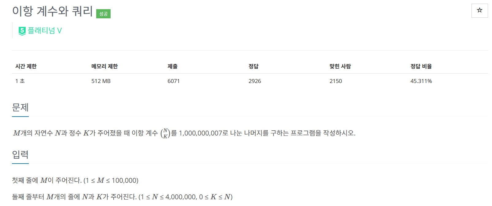

[상위 페이지 · 플레티넘](/study/algorithms/math/platinum/)



## 문제 태그

- 분할 정복을 이용한 거듭제곱
- 모듈러 곱셈 역원
- 페르마의 소정리
- 정수론

## 아이디어

1. 이항계수를 계산하는 방법은 아래와 같음

$$
\binom nr = nCr = \frac{n!}{\ r!\ (r-1!)} \ mod\ p
$$

1. 분수에는 모듈러 연산을 적용하기 힘들어 여러 과정을 거쳐 곱셈으로 만들어줘야 한다
2. 모듈러 곱셈 역원은 $$a * a^{-1} \equiv 1\ (mod\ p)$$ 이때 $$a^{-1}$$이 역원이다.
3. 페르마의 소정리에 의해 p가 소수고 정수 a와 p가 서로소면 $$a^{p-1} \equiv 1\ (mod\ p)$$로 나타낼 수 있다. 이를 모듈로 곱셈 역원에 의해 다시 바꿔 쓸 수 있다. $$a*a^{p-2} \equiv 1\ (mod\ p)$$
4. 고로 p가 소수일 때 a,p가 서로소라면 a의 모듈로 곱셈에 대한 역원은 $$a^{p-2}$$다

$$
nCr = \frac{n!}{\ r!\ (r-1!)} \ mod\ p = (A*B^{-1})\ mod\ p = A * B^{p-2} \ mod\ p
$$

1. 이 $$B^{p-2}$$에서 p가 1e9 + 7임으로 매우 큰 수이다 고로 분할정복을 이용해 계산
2. 쿼리가 한번 들어오는게 아닌 여러번 들어옴으로 팩토리얼을 n,k 범위에 맞춰 미리 계산

## 정답

```python
import sys
input = sys.stdin.readline
MOD = 10**9 + 7
factorial = [1] * (4000001)
for i in range(2,4000001):
    factorial[i] = (i * factorial[i-1]) % MOD

def power(x:int, y:int):
    res = 1
    x = x % MOD
    while y > 0:
        if y & 1:  # y가 홀수면
            res = res * x % MOD # x와 곱하고 나머지 연산
        # y가 짝수이면
        y = y >> 1  # y /= 2
        x = (x * x) % MOD  # 거듭제곱 계산
    return res

def ncr(n, r):
    B2 = power((factorial[r] * factorial[n-r]) % MOD ,MOD-2)
    return (factorial[n]*B2) % MOD

N = int(input())
for _ in range(N):
    n,r = map(int,input().split())
    print(ncr(n,r))
```
