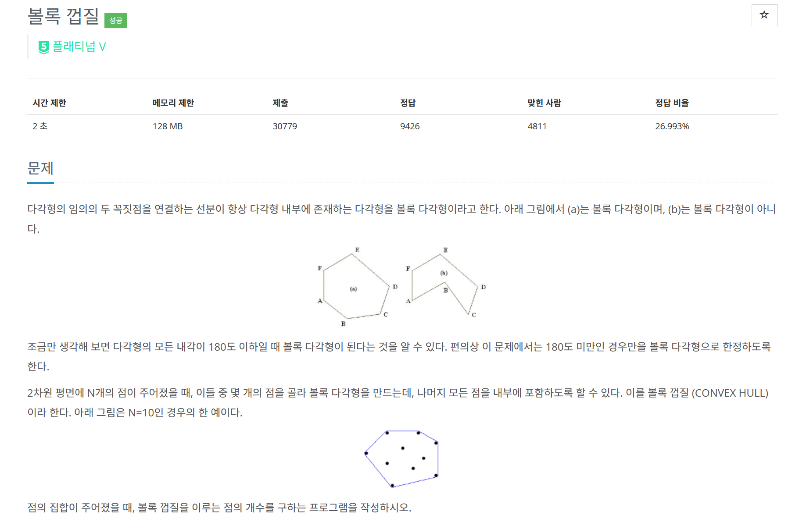

[상위 페이지 · 플레티넘](/study/algorithms/math/platinum/)



## 문제 태그

- 기하
- 볼록 껍질

## 아이디어

1. 기본적인 볼록껍질 구현 문제. 그라함 스캔이나 모노톤체인으로 구현하면된다. 나는 그라함 스캔으로 구현함

## 정답

```python
import math
from collections import deque

class Point:
    def __init__(self, x: int, y: int):
        self.x = x
        self.y = y

    def __str__(self):
        return f"({self.x}, {self.y})"

def ccw(A: Point, B: Point, C: Point) -> int:
    result = (B.x - A.x) * (C.y - A.y) - (C.x - A.x) * (B.y - A.y)

    if result > 0:
        return 1  # 반시계 방향
    elif result < 0:
        return -1  # 시계 방향
    else:
        return 0  # 일직선
def graham_scan(points):
    stack = []
    queue = deque(points)
    stack.append(queue.popleft())
    stack.append(queue.popleft())
    while queue:
        next_point = queue.popleft()
        while stack:
            if ccw(stack[-2], stack[-1], next_point) > 0:
                stack.append(next_point)
                break
            elif ccw(stack[-2], stack[-1], next_point) == 0:
                stack.pop()
                stack.append(next_point)
                break
            else:
                stack.pop()
    return stack

N = int(input())
poses = []
for _ in range(N):
    x, y = map(int, input().split())
    poses.append(Point(x, y))

poses.sort(key=lambda x: (x.y, x.x))
base_point = poses[0]
poses.sort(key=lambda point:math.atan2(point.y - base_point.y, point.x - base_point.x))

convex_hull = graham_scan(poses)

print(len(convex_hull))
```
