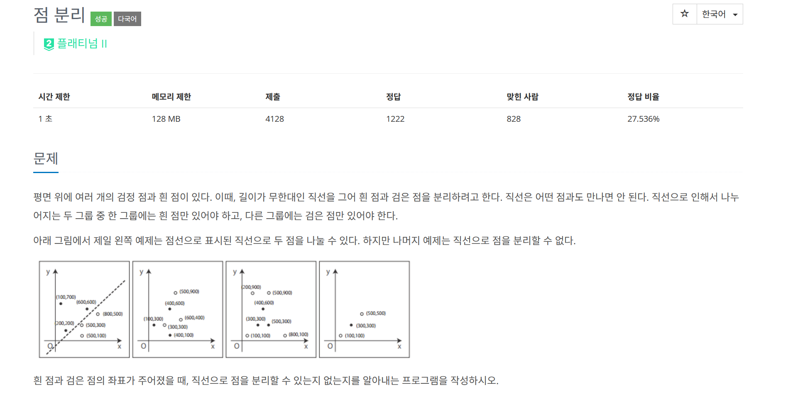

[상위 페이지 · 플레티넘](/study/algorithms/math/platinum/)



## 문제 태그

- 기하학
- 볼록껍질
- 선분 교차 판정
- 볼록 다각형 내부의 점 판정

## 아이디어

1. 일단 직관적으로 봤을 때 각 색끼리 볼록껍질을 구했을 때 서로 접점이 없다면 그을 수 있다


1. 그렇다면 접점이 있다면 못긋는다는것이다.
    1. 볼록 다각형 내부에 점이 있는 케이스
        
        
        
        점 P1은 볼록 다각형 안에 있다. 이는 볼록 다각형의 모든 변에 대해 ccw 값이 반시계 방향이기 때문이다.
        
        점 P2는 볼록 다각형 밖에 있다. 이는 볼록 다각형의 모든 변에 대해 값이 시계 방향이기 때문이다.
        
    2. 선분이 교차할 때
        
        
        
        - 두 선분을 AB와 CD라 하자.
        - 다음 네 개의 방향(외적) 값을 계산한다:
        
        $$
        o_1 = ccw(A,B,C)\\
        o_2 = ccw(A,B,D)\\
        o_3 = ccw(C,D,A)\\
        o_4 = ccw(C,D,B)
        $$
        
        - **일반 교차**:
        
        $$
        o_1 \times o_2 < 0 \text{ 그리고 } o_3 \times o_4 < 0
        $$
        
        이면 두 선분이 서로 내부에서 만난다.
        
        - **특수(경계) 교차**:
        - $$o_1 = 0$$ 이고 점 C가 선분 AB 위에 있을 때
        - $$o_2 = 0$$ 이고 점 D가 선분 AB 위에 있을 때
        - $$o_3 = 0$$ 이고 점 A가 선분 CD 위에 있을 때
        - $$o_4 = 0$$ 이고 점 B가 선분 CD 위에 있을 때
        
        한 가지라도 참이면 "닿는다"고 판정한다.
        
        ### 점 P가 선분 AB 위에 있는지 판정하는 방법
        
        벡터 AB와 벡터 AP의 외적으로 일직선상 존재 여부를 확인한다. 일직선상에 존재한다면, 내적으로 벡터 AB와 AP가 이루는 각도를 계산한다. 각도가 예각이면 점 P는 AB 구간 내에 존재한다.
        

## 정답

```python
import sys
input = sys.stdin.readline

class Point:
    __slots__ = ('x','y')
    def __init__(self, x, y):
        self.x, self.y = x, y
    def __sub__(self, o):
        return Point(self.x - o.x, self.y - o.y)
    def dot(self, o):
        return self.x*o.x + self.y*o.y
    def cross(self, o):
        return self.x*o.y - self.y*o.x

def ccw(a, b, c):
    return (b - a).cross(c - a)

def convex_hull(pts):
    pts = sorted(pts, key=lambda p:(p.x,p.y))
    if len(pts) <= 1:
        return pts[:]
    lower = []
    for p in pts:
        while len(lower) >= 2 and ccw(lower[-2], lower[-1], p) <= 0:
            lower.pop()
        lower.append(p)
    upper = []
    for p in reversed(pts):
        while len(upper) >= 2 and ccw(upper[-2], upper[-1], p) <= 0:
            upper.pop()
        upper.append(p)
    return lower[:-1] + upper[:-1]

def on_segment(a, b, p):
    return (p - a).cross(b - a) == 0 and (p - a).dot(p - b) <= 0

def segments_intersect(a, b, c, d):
    o1, o2 = ccw(a,b,c), ccw(a,b,d)
    o3, o4 = ccw(c,d,a), ccw(c,d,b)
    if o1*o2 < 0 and o3*o4 < 0:
        return True
    if o1 == 0 and on_segment(a,b,c): return True
    if o2 == 0 and on_segment(a,b,d): return True
    if o3 == 0 and on_segment(c,d,a): return True
    if o4 == 0 and on_segment(c,d,b): return True
    return False

def point_in_convex(poly, p):
    n = len(poly)
    if n == 0:
        return False
    if n == 1:
        return p.x == poly[0].x and p.y == poly[0].y
    if n == 2:
        return on_segment(poly[0], poly[1], p)
    for i in range(n):
        if ccw(poly[i], poly[(i+1)%n], p) < 0:
            return False
    return True

t = int(input())
for _ in range(t):
    b, w = map(int, input().split())
    blacks = [Point(*map(int,input().split())) for _ in range(b)]
    whites = [Point(*map(int,input().split())) for _ in range(w)]
    hb = convex_hull(blacks)
    hw = convex_hull(whites)
    ok = True

    for i in range(len(hb)):
        for j in range(len(hw)):
            if segments_intersect(hb[i], hb[(i+1)%len(hb)], hw[j], hw[(j+1)%len(hw)]):
                ok = False
                break
        if not ok:
            break

    if ok:
        for p in blacks:
            if point_in_convex(hw, p):
                ok = False
                break

    if ok:
        for p in whites:
            if point_in_convex(hb, p):
                ok = False
                break

    print("YES" if ok else "NO")

```
