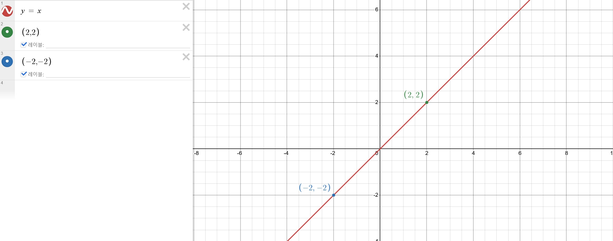
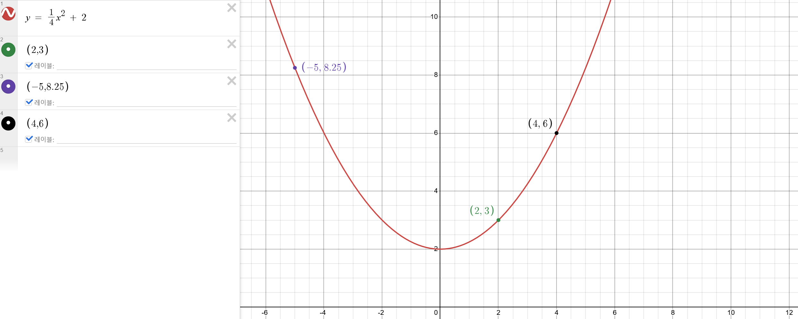
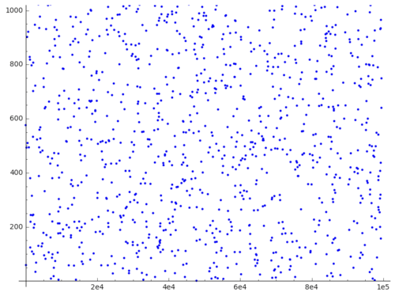

[상위 페이지 · Math](/study/algorithms/math/)

## 선행 지식

- [Lagrange 보간법](/study/algorithms/math/lagrange-boganbeob/)

## 1. 개요

**Shamir's Secret Sharing (SSS)**은 1979년 Adi Shamir가 고안한 암호화 알고리즘으로, 하나의 비밀을 여러 조각으로 나누어 분산 저장하는 방식이다.

이 알고리즘의 핵심은 **$$(k, n)$$ 임계값 체계**이다:

- **$$n$$ (Total Shares):** 비밀을 나눈 전체 조각의 개수
- **$$k$$ (Threshold):** 비밀을 복원하기 위해 필요한 최소 조각의 개수

**주요 특징:**

- $$k$$개 이상의 조각이 모이면 원래의 비밀 $$S$$를 완벽하게 복원할 수 있다
- $$k-1$$개 이하의 조각으로는 비밀에 대한 **어떠한 정보도 얻을 수 없다**

## 2. 기본 개념

- SSS는 **라그랑주 보간법**을 기초로 한다. 기하학적 원리는 다음과 같다
    
    
    
- 2개의 점은 하나의 직선(1차 함수)을 유일하게 결정한다
    
    
    
- 3개의 점은 하나의 포물선(2차 함수)을 유일하게 결정한다
- **$$k$$개의 점은 $$k-1$$차 다항식을 유일하게 결정한다**

## 2.1 비밀 분산

비밀 $$S$$를 정수로 변환한 후, 이를 $$k-1$$차 다항식의 상수항(y절편)으로 설정한다.

**1. 다항식 생성:**

$$
f(x) = a_0 + a_1x + a_2x^2 + \cdots + a_{k-1}x^{k-1}
$$

- $$a_0 = S$$ (평문)
- 나머지 계수 $$a_1, \ldots, a_{k-1}$$은 무작위로 선택된 숫자이다

**2. 조각 생성:**

$$x = 1, 2, \ldots, n$$을 대입하여 $$n$$개의 좌표 점 $$(x, f(x))$$를 계산한다. 각 점이 참여자들에게 나눠줄 **조각**이 된다.

## 2.2 비밀 복원

$$k$$개 이상의 점 $$(x_i, y_i)$$를 모으면, 라그랑주 보간법을 통해 원본 다항식 $$f(x)$$를 재구성할 수 있다.

라그랑주 기저 다항식 $$\ell_j(x)$$를 이용한 복원 공식:

$$
f(x) = \sum_{j=0}^{k-1} y_j \ell_j(x)
$$

여기서 라그랑주 기저 다항식은:

$$
\ell_j(x) = \prod_{\substack{i=0 \\ i \neq j}}^{k-1} \frac{x - x_i}{x_j - x_i}
$$

비밀 $$S = f(0)$$이므로, $$x=0$$일 때의 값만 계산하면 된다:

$$
S = f(0) = \sum_{j=0}^{k-1} y_j \left( \prod_{\substack{i=0 \\ i \neq j}}^{k-1} \frac{-x_i}{x_j - x_i} \right)
$$

## 3. 유한체로의 구현

## 3.1 정수 연산의 취약점

단순한 정수 사칙연산을 사용하면 다음과 같은 보안 문제가 발생한다:

- 공격자가 $$k$$개 미만의 조각으로도 비밀 $$S$$의 범위를 좁히거나 특정 패턴(예: 홀짝 여부)을 유추할 수 있다
- 다항식 곡선의 개형이 연속적이고 예측 가능하므로, 몇 개의 점만으로도 곡선의 기울기나 위치를 짐작하여 비밀값의 후보를 줄일 수 있다

## 3.2 모듈러 연산

이 문제를 해결하기 위해 SSS는 모든 연산을 소수 $$p$$에 대한 **유한체(Galois Field, $$GF(p)$$)** 위에서 수행한다.

### **3.2.1 조건**

- $$p$$는 비밀 $$S$$와 전체 조각 수 $$n$$보다 큰 소수여야 한다

### **3.2.2 다항식 생성 및 점 계산**

$$
f(x) = a_0 + a_1x + \cdots + a_{k-1}x^{k-1} \pmod{p}
$$

### **3.2.3 효과**

- 모듈러 연산을 적용하면 그래프가 연속적인 곡선이 아니라, 좌표 평면상에 무작위로 흩뿌려진 점들(산점도)처럼 보인다
- $$k-1$$개의 조각을 가지고 있어도 나머지 하나의 점이 어디에 찍힐지 수학적으로 완전히 무작위이므로, 비밀 $$S$$에 대한 어떠한 부분적인 정보도 유출되지 않는다

**유한체의 두 가지 핵심 이유:**

- **완전 보안성:** 유한체 내의 연산 결과는 균등 분포를 가진다. $$k-1$$개의 조각으로는 나머지 값을 확률적으로 추측할 수 없다 → 모든 값이 동일한 확률
- **닫힌 연산:** 덧셈, 뺄셈, 곱셈뿐만 아니라 **나눗셈**이 가능하고 그 결과가 항상 집합 내에 존재한다. 이는 라그랑주 보간법 계산 시 필수적이다

## 3.3 유한체 위에서의 다항식 생성

딜러는 비밀 $$S$$를 보호하기 위해 $$k-1$$차 다항식 $$f(x)$$를 생성한다:

$$
f(x) = S + a_1x + a_2x^2 + \cdots + a_{k-1}x^{k-1} \pmod{p}
$$

- $$S \in GF(p)$$: 비밀 값 ($$S < p$$)
- $$a_i \in GF(p)$$: 무작위로 선택된 계수 ($$1 \leq i \leq k-1$$)
- $$p$$: $$p > \max(S, n)$$ 조건을 만족하는 소수

참여자들에게 주는 조각은 $$(x_i, y_i)$$ 쌍이며, 여기서 $$x_i \neq 0$$이다.

## 3.4 라그랑주 보간법을 이용한 복원

$$k$$개의 점 $$(x_0, y_0), \ldots, (x_{k-1}, y_{k-1})$$이 주어졌을 때, 비밀 $$S$$는 $$f(0)$$의 값이다.

라그랑주 보간 공식에 따라 $$f(x)$$는 다음과 같다:

$$
f(x) = \sum_{j=0}^{k-1} y_j \cdot \ell_j(x) \pmod{p}
$$

우리는 $$f(x)$$ 전체가 아니라 **오직 $$f(0)$$만 필요**하므로, $$x=0$$으로 단순화할 수 있다:

$$
S = f(0) = \sum_{j=0}^{k-1} y_j \left( \prod_{\substack{i=0 \\ i \neq j}}^{k-1} \frac{-x_i}{x_j - x_i} \right) \pmod{p}
$$

이 수식에서 나눗셈 $$\frac{A}{B}$$는 모듈러 역원 $$A \cdot B^{-1} \pmod{p}$$로 계산된다.

## 4. 모듈러 역원 계산

SSS를 구현할 때 가장 까다로운 부분은 나눗셈이다.

$$GF(p)$$에서 $$a$$의 역원 $$a^{-1}$$은 $$a \cdot x \equiv 1 \pmod{p}$$를 만족하는 $$x$$이다.

**역원을 구하는 두 가지 방법:**

- **[Euclidean algorithm](/study/algorithms/math/euclidean-algorithm/) :** 가장 효율적이며 일반적으로 사용된다
- **[페르마의 소정리/오일러 정리](/study/algorithms/math/pereumayi-sojeongri-oilreo-jeongri/) :** $$p$$가 소수일 때 $$a^{p-2} \equiv a^{-1} \pmod{p}$$임을 이용한다. 구현이 매우 간단하지만 숫자가 매우 클 경우 유클리드 알고리즘보다 느릴 수 있다

## 5. 장점과 단점

## 5.1 장점

- **완전 보안성:** 공격자가 무한한 컴퓨팅 파워를 가져도 $$k$$개의 조각 없이는 비밀을 풀 수 없다
- **최소성:** 각 조각의 크기는 원래 비밀의 크기와 같다
- **확장성:** 새로운 참여자가 추가되어도 기존 조각을 바꿀 필요 없이 새 조각을 발급할 수 있다
- **유연성:** 중요도에 따라 특정인에게 더 많은 조각을 주어 권한을 차등 부여할 수 있다 (예: 사장은 3개, 직원은 1개)

## 5.2 단점

- **검증 불가:** 복원 과정에서 누군가 가짜 조각을 제출해도, SSS 자체적으로는 그것이 진짜인지 가짜인지 판별할 수 없다
- **단일 실패 지점 :** 비밀을 처음 생성해서 쪼개는 순간과, 비밀을 복원하기 위해 조각을 모으는 순간에는 비밀이 평문으로 존재해야 한다. 이 순간이 공격 대상이 될 수 있다

## 6. 완전 보안성 증명

<aside markdown="1">
💡

**정리:**

$$k-1$$개의 조각을 가진 공격자가 비밀 $$S$$를 알아낼 확률은, 아무런 조각이 없을 때 비밀 $$S$$를 맞출 확률과 같다.

$$
P(S=s \mid y_1, \ldots, y_{k-1}) = P(S=s) = \frac{1}{p}
$$

</aside>

### **6.1 증명**

**1. 문제 설정**

- 딜러는 비밀 $$S \in GF(p)$$를 보호하기 위해 $$k-1$$차 다항식 $$f(x)$$를 생성한다:

$$
f(x) = S + a_1x + a_2x^2 + \cdots + a_{k-1}x^{k-1} \pmod{p}
$$

- 여기서 계수 $$a_1, a_2, \ldots, a_{k-1}$$은 $$GF(p)$$에서 균등 분포로 무작위 선택된다
- $$n$$명의 참여자에게 조각 $$(x_i, y_i) = (x_i, f(x_i))$$를 분배한다. 단, $$x_i \neq 0$$이다

**2. 공격자의 상황**

- 공격자가 $$k-1$$개의 조각 $${(x_1, y_1), (x_2, y_2), \ldots, (x_{k-1}, y_{k-1})}$$을 획득했다고 가정한다
- 공격자는 이 정보를 바탕으로 비밀 $$S = f(0)$$를 추측하려 한다

**3. 임의의 비밀값 가정**

- 공격자가 $$GF(p)$$ 내의 임의의 값 $$S' \in GF(p)$$를 진짜 비밀이라고 가정해 본다
- 즉, $$f(0) = S'$$이라고 가정한다
- 이제 공격자는 총 $$k$$개의 점을 가지게 된다:
- $$(0, S')$$ (가정한 비밀 점)
- $$(x_1, y_1), (x_2, y_2), \ldots, (x_{k-1}, y_{k-1})$$ (획득한 실제 조각)

**4. 다항식의 유일성**

- **라그랑주 보간 정리**에 의하면, 서로 다른 $$k$$개의 점 $$(x_0, y_0), (x_1, y_1), \ldots, (x_{k-1}, y_{k-1})$$이 주어졌을 때, 이들을 모두 지나는 $$k-1$$차 다항식은 $$GF(p)$$ 위에서 **유일하게 결정**된다
- 따라서, 공격자가 가정한 $$S'$$과 획득한 $$k-1$$개의 조각을 만족하는 $$k-1$$차 다항식 $$g(x)$$가 **정확히 하나** 존재한다:

$$
g(0) = S', \quad g(x_i) = y_i \text{ for } i=1,\ldots,k-1
$$

**5. 모든 가능한 비밀값에 대한 동등성**

- $$GF(p)$$ 내의 **모든 가능한** $$S' \in GF(p)$$에 대해, 획득한 $$k-1$$개의 조각과 호환되는 $$k-1$$차 다항식이 정확히 하나씩 존재한다
- 즉, $$p$$개의 서로 다른 $$S'$$ 값에 대해, $$p$$개의 서로 다른 다항식이 존재한다
- 이들 다항식은 모두 주어진 $$k-1$$개의 점을 지나며, $$f(0)$$에서만 다른 값을 가진다

**6. 확률 분포의 균등성**

- 원래 다항식 $$f(x)$$의 계수 $$a_1, a_2, \ldots, a_{k-1}$$은 $$GF(p)$$에서 균등 분포로 선택되었다
- 이는 $$k-1$$차 다항식의 전체 공간 내에서 각 다항식이 선택될 확률이 모두 동일함을 의미한다
- 공격자가 획득한 $$k-1$$개의 조각은 다항식을 부분적으로 제약하지만, $$f(0)$$의 값에 대해서는 여전히 $$p$$개의 가능성이 모두 동등한 확률로 남아있다

**7. 조건부 확률 계산**

- 공격자가 $$k-1$$개의 조각을 관찰한 후, 특정 값 $$s$$가 비밀일 조건부 확률을 계산하면:

$$
P(S=s \mid y_1, \ldots, y_{k-1}) = \frac{P(y_1, \ldots, y_{k-1} \mid S=s) \cdot P(S=s)}{P(y_1, \ldots, y_{k-1})}
$$

- 여기서:
- $$P(S=s) = \frac{1}{p}$$ (비밀은 $$GF(p)$$에서 균등 분포)
- $$P(y_1, \ldots, y_{k-1} \mid S=s)$$는 $$S=s$$가 주어졌을 때, 나머지 $$k-1$$개 계수가 무작위로 선택되어 특정 $$y_i$$값들을 생성할 확률이다
- 계수들이 균등 분포이므로, 모든 $$s \in GF(p)$$에 대해 $$P(y_1, \ldots, y_{k-1} \mid S=s)$$는 동일하다
- 따라서:

$$
P(S=s \mid y_1, \ldots, y_{k-1}) = \frac{\text{constant} \cdot \frac{1}{p}}{\sum_{s'=0}^{p-1} \text{constant} \cdot \frac{1}{p}} = \frac{1}{p}
$$

**8. 결론**

- $$k-1$$개의 조각을 획득한 공격자가 특정 값 $$s$$를 비밀로 추측할 확률은 $$\frac{1}{p}$$이다
- 이는 아무런 정보가 없을 때 무작위로 추측하는 확률과 정확히 동일하다
- 따라서 $$k-1$$개의 조각은 비밀 $$S$$에 대한 **어떠한 정보도 제공하지 않는다**

## 7. 고려사항

## 7.1 동형 암호적 성질

SSS는 덧셈에 대해 동형 성질을 가진다:

- 비밀 $$S_1$$의 조각들을 $$[A]_1, \ldots, [A]_n$$이라 하고
- 비밀 $$S_2$$의 조각들을 $$[B]_1, \ldots, [B]_n$$이라 할 때
- 개별 참여자들이 자신의 조각을 더한 $$([A]_i + [B]_i)$$를 새로운 조각으로 간주하여 복원하면, 그 결과는 $$S_1 + S_2$$가 된다

이 성질은 **SMPC (Secure Multi-Party Computation)**의 기초가 된다.

## 7.2 검증 가능한 비밀 분산 (Verifiable Secret Sharing, VSS)

기본 SSS는 Dealer가 정직하다는 가정과 조각 제출자가 정직하다는 가정이 필요하다.

**Feldman's VSS:**

- 딜러는 계수 $$a_i$$ 자체를 공개하는 대신, 이산 대수 문제에 기반한 $$g^{a_i}$$ 값을 공개한다
- 참여자들은 자신의 조각 $$(x, y)$$가 공개된 $$g^{a_i}$$ 값들과 수학적으로 일치하는지 영지식 방식으로 검증할 수 있다

## 7.3 Side-Channel Attacks

수학적으로는 완벽하지만, 구현상에서는 타이밍 공격에 취약할 수 있다:

- reconstruct_secret 함수 내의 모듈러 연산이나 큰 수 곱셈 시간이 입력값에 따라 달라진다면, 이를 측정하여 비밀 정보를 유추할 수 있다
- 고보안 환경에서는 상수시간 알고리즘으로 구현해야 한다
