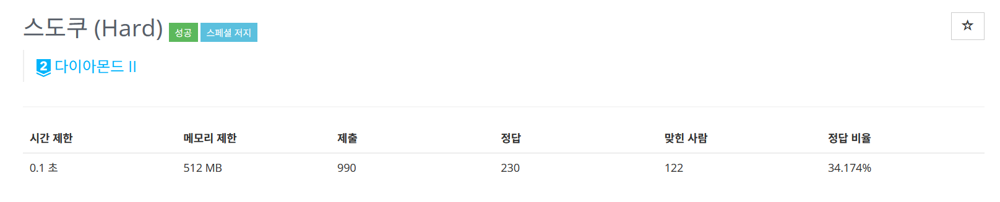
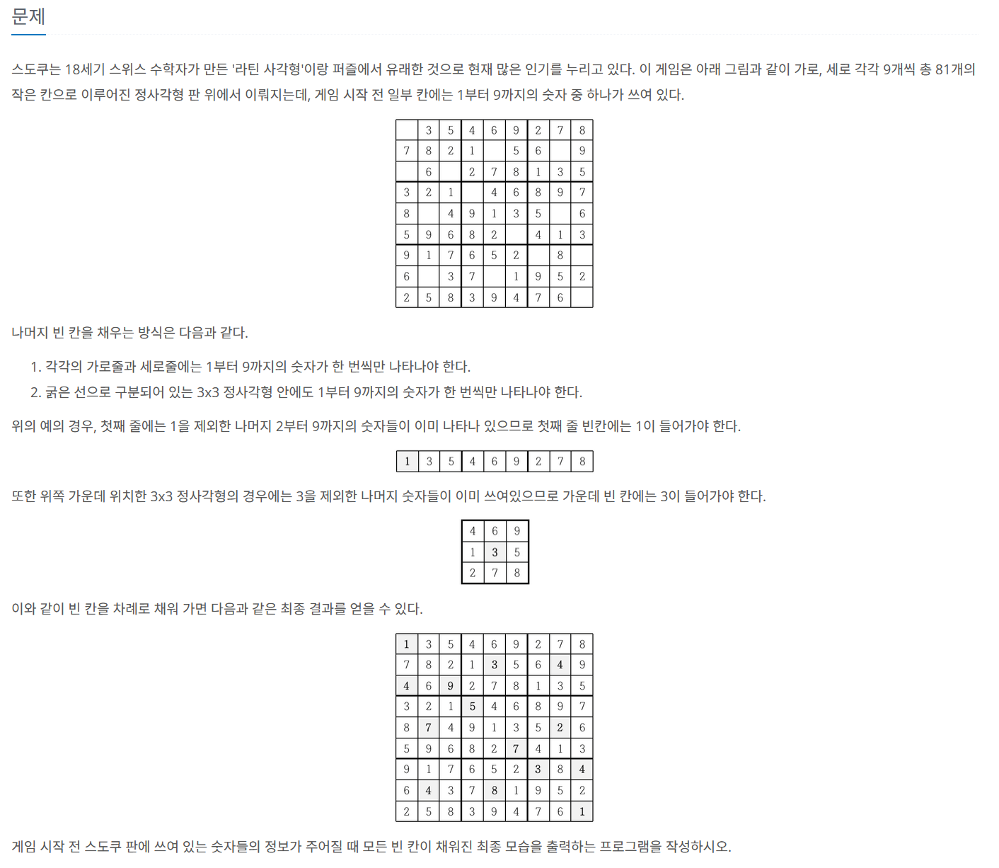

[상위 페이지 · 다이아](/study/algorithms/search/diamond/)





## 문제 태그

- 백트래킹
- 크누스 X
- 댄싱링크

## 아이디어

1. [Knuth X Algorithm](/study/algorithms/search/back-tracking/knuth-x-algorithm/) 을 적용한다
2. 다른 문제도 비슷한 양상

## 정답

```python
import sys

N = 9
SQN = 3

class Node:
    def __init__(self, col_header, row_idx=-1):
        self.L = self.R = self.U = self.D = self
        self.col = col_header
        self.row_idx = row_idx

class ColumnHeader(Node):
    def __init__(self, name=""):
        super().__init__(self)
        self.size = 0
        self.name = name

class DancingLinks:
    def __init__(self, grid):
        self.header = ColumnHeader("header")
        self.solution = []
        self.grid = grid
        self._build_matrix()

    def _build_matrix(self):
        cols = [ColumnHeader(str(i)) for i in range(N * N * 4)]
        for i, col_header in enumerate(cols):
            col_header.R = self.header if i == len(cols) - 1 else cols[i + 1]
            col_header.L = self.header if i == 0 else cols[i - 1]
            self.header.L.R, col_header.R.L = col_header, col_header
            self.header.L = col_header

        for r in range(N):
            for c in range(N):
                for num in range(1, N + 1):
                    row_idx = r * N * N + c * N + (num - 1)
                    if self.grid[r][c] != 0 and self.grid[r][c] != num:
                        continue

                    cell_idx = r * N + c
                    row_idx_offset = N * N + r * N + (num - 1)
                    col_idx_offset = N * N * 2 + c * N + (num - 1)
                    box_idx = (r // SQN) * SQN + (c // SQN)
                    box_idx_offset = N * N * 3 + box_idx * N + (num - 1)

                    indices = [cell_idx, row_idx_offset, col_idx_offset, box_idx_offset]

                    first_node = None
                    for i in indices:
                        new_node = Node(cols[i], row_idx)
                        cols[i].size += 1
                        new_node.U = cols[i].U
                        new_node.D = cols[i]
                        cols[i].U.D = new_node
                        cols[i].U = new_node

                        if first_node is None:
                            first_node = new_node
                        else:
                            new_node.L = first_node.L
                            new_node.R = first_node
                            first_node.L.R = new_node
                            first_node.L = new_node

    def _cover(self, col):
        col.R.L, col.L.R = col.L, col.R
        node = col.D
        while node != col:
            right_node = node.R
            while right_node != node:
                right_node.D.U, right_node.U.D = right_node.U, right_node.D
                right_node.col.size -= 1
                right_node = right_node.R
            node = node.D

    def _uncover(self, col):
        node = col.U
        while node != col:
            left_node = node.L
            while left_node != node:
                left_node.col.size += 1
                left_node.D.U, left_node.U.D = left_node, left_node
                left_node = left_node.L
            node = node.U
        col.R.L, col.L.R = col, col

    def solve(self):
        if self.header.R == self.header:
            return True

        col_to_cover = None
        min_size = float('inf')
        current = self.header.R
        while current != self.header:
            if current.size < min_size:
                min_size = current.size
                col_to_cover = current
            current = current.R

        self._cover(col_to_cover)

        row_node = col_to_cover.D
        while row_node != col_to_cover:
            self.solution.append(row_node)

            right_node = row_node.R
            while right_node != row_node:
                self._cover(right_node.col)
                right_node = right_node.R

            if self.solve():
                return True

            self.solution.pop()
            col_to_cover = row_node.col
            left_node = row_node.L
            while left_node != row_node:
                self._uncover(left_node.col)
                left_node = left_node.L

            row_node = row_node.D

        self._uncover(col_to_cover)
        return False

    def get_solution(self):
        solved_grid = [[0] * N for _ in range(N)]
        for node in self.solution:
            row_idx = node.row_idx
            r = row_idx // (N * N)
            c = (row_idx // N) % N
            num = row_idx % N + 1
            solved_grid[r][c] = num
        return solved_grid

if __name__ == "__main__":
    sudoku_grid = []
    for _ in range(N):
        line = list(map(int, sys.stdin.readline().split()))
        sudoku_grid.append(line)

    dlx_solver = DancingLinks(sudoku_grid)

    if dlx_solver.solve():
        solution = dlx_solver.get_solution()

        for row in solution:
            print(" ".join(map(str, row)))
```
