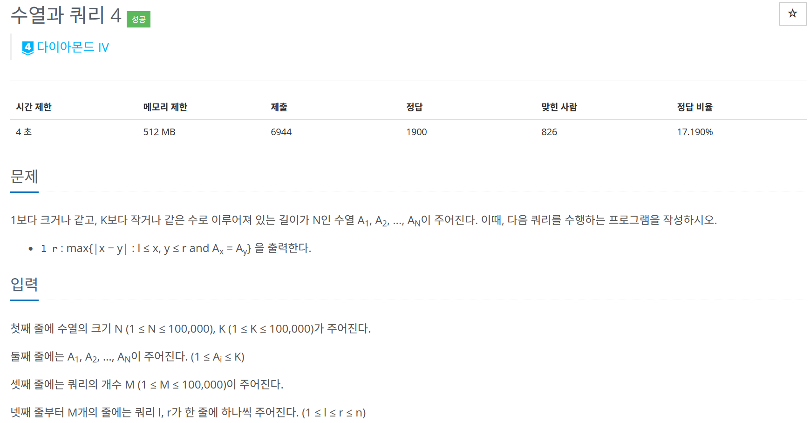

[상위 페이지 · 다이아](/study/algorithms/search/diamond/)



## 문제 태그

- 제곱근 분할법
- mo’s 알고리즘
- 오프라인 쿼리

## 아이디어

1. 쿼리를 모아다가 다음과 같이 정렬 함
    
    ```python
    	queries.sort(key=lambda x: (x[0] // block, x[1] if (x[0] // block) % 2 == 0 else -x[1]))
    ```
    
2. 투 포인터로 쿼리 실시
    
    ```python
    for ql, qr, qi in queries:
        while l > ql:
            l -= 1
            add(l)
        while r < qr:
            r += 1
            add(r)
        while l < ql:
            remove(l)
            l += 1
        while r > qr:
            remove(r)
            r -= 1
        result[qi] = current_max
    ```
    
3. 구간의 크기를 늘릴때 (l 포인터가 좌측으로 r포인터가 우측으로)는 add함수 구간의 크기가 줄어들때(역)은 remove함수
4. 덱을 통해 해당 arr[idx]의 인덱스들을 관리함
    1. 추가
    
    ```python
        if not dq or idx > dq[-1]:
            dq.append(idx)
        else:
            dq.appendleft(idx)
    ```
    
    b. 제거
    
    ```python
        if dq[0] == idx:
            dq.popleft()
        else:
            dq.pop()
    ```
    
    이가 가능한 이유는 포인터들의 움직임을 생각해보면 중간에 있는 값들은 빠질 이유가 없기 때문.
    
5. 거리를 관리하는 리스트로 최대 거리 계산
    1. dist_count[거리] = 개수
    2. 다음과 같이 인덱스를 제거해야할 때 보정을 해야하기 때문
    
    ```python
        while current_max > 0 and dist_count[current_max] == 0:
            current_max -= 1
    ```
    

## 정답

```python
import sys
from collections import defaultdict, deque

input = sys.stdin.readline

N, K = map(int, input().split())
arr = list(map(int, input().split()))
M = int(input())

block = int(N ** 0.5) + 1
queries = []
for i in range(M):
    l, r = map(int, input().split())
    queries.append((l - 1, r - 1, i))

queries.sort(key=lambda x: (x[0] // block, x[1] if (x[0] // block) % 2 == 0 else -x[1]))

result = [0] * M
freq = defaultdict(deque)
dist_count = defaultdict(int)
current_max = 0

def update_dist(v):
    dq = freq[v]
    if len(dq) >= 2:
        return dq[-1] - dq[0]
    return 0

def add(idx):
    global current_max
    v = arr[idx]
    dq = freq[v]

    old_dist = update_dist(v)
    if old_dist > 0:
        dist_count[old_dist] -= 1

    if not dq or idx > dq[-1]:
        dq.append(idx)
    else:
        dq.appendleft(idx)

    new_dist = update_dist(v)
    if new_dist > 0:
        dist_count[new_dist] += 1
        current_max = max(current_max, new_dist)

def remove(idx):
    global current_max
    v = arr[idx]
    dq = freq[v]

    old_dist = update_dist(v)
    if old_dist > 0:
        dist_count[old_dist] -= 1

    if dq[0] == idx:
        dq.popleft()
    else:
        dq.pop()

    new_dist = update_dist(v)
    if new_dist > 0:
        dist_count[new_dist] += 1

    while current_max > 0 and dist_count[current_max] == 0:
        current_max -= 1

l, r = 0, -1
for ql, qr, qi in queries:
    while l > ql:
        l -= 1
        add(l)
    while r < qr:
        r += 1
        add(r)
    while l < ql:
        remove(l)
        l += 1
    while r > qr:
        remove(r)
        r -= 1
    result[qi] = current_max

print('\n'.join(map(str, result)))

```
