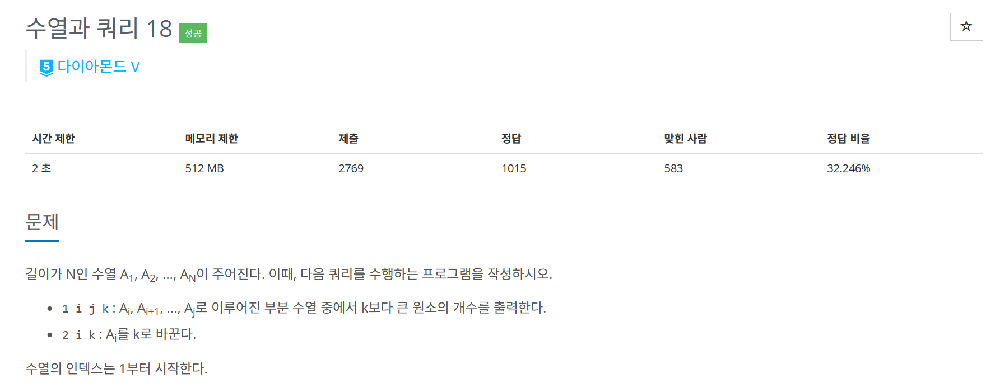
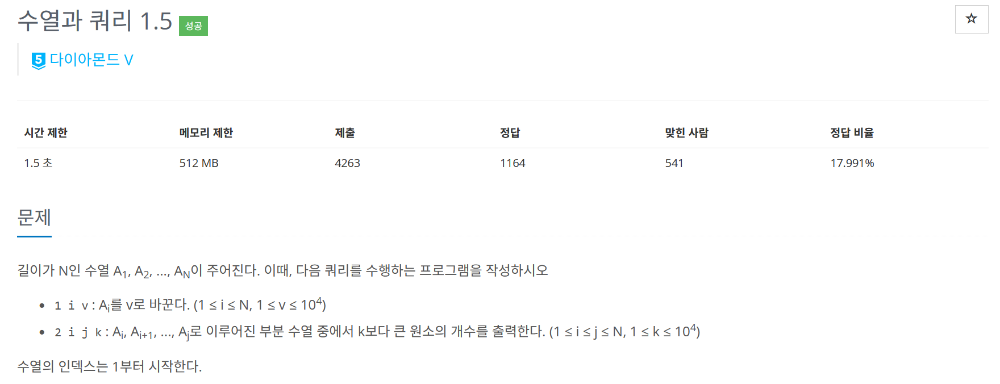

[상위 페이지 · 다이아](/study/algorithms/search/diamond/)





## 문제 태그

- 제곱근 분할법

## 아이디어

- 제곱근 분할법을 이용해서 수열을 분할
- 범위 쿼리는 쿼리 구간에 완전히 포함되는 블록들은 정렬된 데이터를 이용한 이진탐색으로 빠르게 처리하고 걸쳐있는 블록은 직접 순회함
- 업데이트 쿼리는 원본 배열과 해당 원소가 속한 하나의 블록만 수정함

## 정답

```python
import sys
import math
import bisect

input = sys.stdin.readline

N = int(input().strip())
A = [0] + list(map(int, input().strip().split()))
block_size = math.ceil(math.sqrt(N))
num_blocks = math.ceil(N / block_size)
blocks = []
for i in range(num_blocks):
    start = i * block_size + 1
    end = min((i + 1) * block_size, N) + 1
    blocks.append(sorted(A[start:end]))

M = int(input().strip())
for _ in range(M):
    k,*args = list(map(int, input().strip().split()))
    if k == 1:
        i, j, k = args
        count = 0
        cur = i
        while cur <= j:
            bid = (cur - 1) // block_size
            bstart = bid * block_size + 1
            bend = min((bid + 1) * block_size, N)
            if cur == bstart and j >= bend:
                count += len(blocks[bid]) - bisect.bisect_right(blocks[bid], k)
                cur = bend + 1
            else:
                pend = min(j, bend)
                for p in range(cur, pend + 1):
                    if A[p] > k:
                        count += 1
                cur = pend + 1
        print(count)
    elif k == 2:
        idx, val = args
        old = A[idx]
        A[idx] = val
        bid = (idx - 1) // block_size
        pos = bisect.bisect_left(blocks[bid], old)
        if pos < len(blocks[bid]) and blocks[bid][pos] == old:
            del blocks[bid][pos]
        bisect.insort(blocks[bid], val)
```
