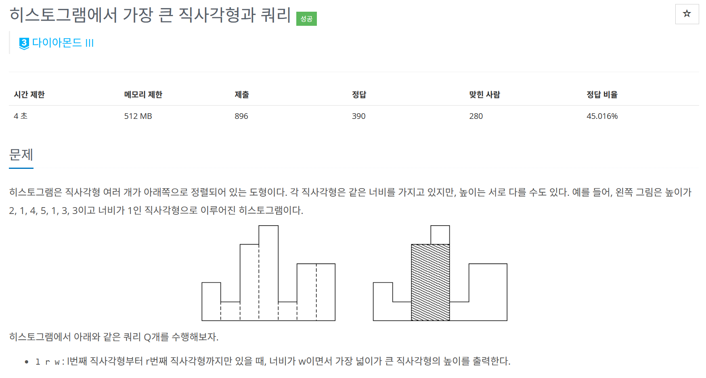

[상위 페이지 · 다이아](/study/algorithms/search/diamond/)



## 문제 태그

- 자료구조
- 세그먼트 트리
- 이분 탐색
- PBS
- 최대 부분 배열 문제

## 아이디어

- “너비가 w이면서 가장 넓이가 큰 직사각형의 높이”라는 질문에서 “너비가 w이면서 높이가 h이상인 직사각형을 만들 수 있는가?”인 결정 문제로 변환해주면 h가 단조 증가함에 따라 가능 → 불가능으로 바뀐다
- 높이 h를 기준으로 성공한 쿼리는 low = mid, 실패한 쿼리는 high = mid로 적용한다.
- 분할정복 히스토그램 문제와 같이 세그먼트 트리를 이용한다

## 정답

```python
import sys

sys.setrecursionlimit(10 ** 6)
input = sys.stdin.readline

class Node:
    def __init__(self, prefix=0, suffix=0, total=0, length=1):
        self.prefix = prefix
        self.suffix = suffix
        self.total = total
        self.len = length

class SegmentTree:
    def __init__(self, n):
        self.n = n
        self.tree = [Node(0, 0, 0, 1) for _ in range(4 * n)]

    def _merge(self, left, right):
        if not left:
            return right
        if not right:
            return left

        new_node = Node()
        new_node.len = left.len + right.len

        new_node.prefix = left.prefix
        if left.prefix == left.len:
            new_node.prefix += right.prefix

        new_node.suffix = right.suffix
        if right.suffix == right.len:
            new_node.suffix += left.suffix

        new_node.total = max(left.total, right.total, left.suffix + right.prefix)
        return new_node

    def update(self, idx, val):
        self._update(1, 1, self.n, idx)

    def _update(self, node, start, end, idx):
        if start == end:
            self.tree[node] = Node(1, 1, 1, 1)
            return

        mid = (start + end) // 2
        if idx <= mid:
            self._update(node * 2, start, mid, idx)
        else:
            self._update(node * 2 + 1, mid + 1, end, idx)

        self.tree[node] = self._merge(self.tree[node * 2], self.tree[node * 2 + 1])

    def query(self, start, end):
        if start > end:
            return None
        return self._query(1, 1, self.n, start, end)

    def _query(self, node, start, end, l, r):
        if r < start or end < l:
            return None
        if l <= start and end <= r:
            return self.tree[node]

        mid = (start + end) // 2
        left_res = self._query(node * 2, start, mid, l, r)
        right_res = self._query(node * 2 + 1, mid + 1, end, l, r)

        return self._merge(left_res, right_res)

def main():
    n = int(input())
    heights = list(map(int, input().split()))

    q_cnt = int(input())
    queries = []
    for i in range(q_cnt):
        l, r, w = map(int, input().split())
        queries.append((l, r, w, i))

    h_sorted = sorted([(heights[i], i + 1) for i in range(n)], reverse=True)

    low = [0] * q_cnt
    high = [10 ** 9 + 1] * q_cnt
    ans = [0] * q_cnt

    for _ in range(31):
        groups = {}
        active_queries_exist = False
        for i in range(q_cnt):
            if low[i] < high[i]:
                active_queries_exist = True
                mid = (low[i] + high[i] + 1) // 2
                if mid not in groups:
                    groups[mid] = []
                groups[mid].append(i)

        if not active_queries_exist:
            break

        seg_tree = SegmentTree(n)
        h_idx = 0
        sorted_mids = sorted(groups.keys(), reverse=True)

        for mid_val in sorted_mids:
            while h_idx < n and h_sorted[h_idx][0] >= mid_val:
                seg_tree.update(h_sorted[h_idx][1], 1)
                h_idx += 1

            for q_idx in groups[mid_val]:
                l, r, w, original_idx = queries[q_idx]
                res_node = seg_tree.query(l, r)
                max_len = res_node.total if res_node else 0

                if max_len >= w:
                    ans[original_idx] = mid_val
                    low[q_idx] = mid_val
                else:
                    high[q_idx] = mid_val - 1

    for val in ans:
        print(val)

if __name__ == "__main__":
    main()
```
