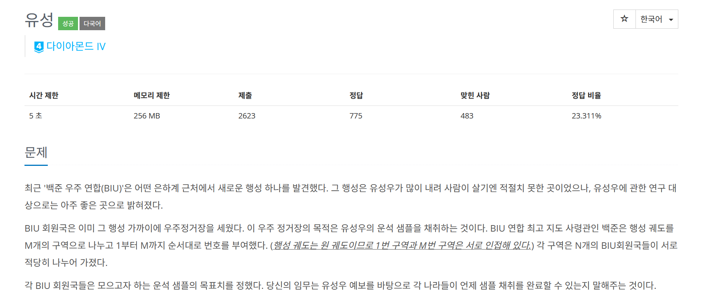

[상위 페이지 · 다이아](/study/algorithms/search/diamond/)



## 문제 태그

- 자료구조
- 세그먼트 트리
- 이분 탐색
- 차분 배열 트릭
- PBS

## 아이디어

- “A 국가는 며칠만에 목표에 달성하는가?”, “B 국가는 며칠만에 목표에 달성하는가” … “N 국가는 며칠만에 목표에 달성하는가?”의 독립적인 질의를 해야함
- 일수가 단조 증가함에 따라 불가능 → 가능으로 바뀌어 이분 탐색을 적용 할 수 있음
- N개의 국가에 대하여 각각 이분 탐색을 진행하는것은 비효율적임
    - 각각 독립적인 질문이니 모든 탐색을 동시에 진행함
    - 시간에 대해 한번의 이분탐색을 진행하면서 각 국가를 “성공”그룹과 “실패”그룹으로 나누어 탐색을 진행함

## 정답

```python
import sys

class Fenwick:
    def __init__(self, size):
        self.tree = [0] * (size + 1)

    def add(self, idx, value):
        while idx < len(self.tree):
            self.tree[idx] += value
            idx += idx & -idx

    def query(self, idx):
        s = 0
        while idx > 0:
            s += self.tree[idx]
            idx -= idx & -idx
        return s

def main():
    input = sys.stdin.readline
    n, m = map(int, input().split())
    o = list(map(int, input().split()))

    country_sectors = [[] for _ in range(n + 1)]
    for i, onwer in enumerate(o):
        country_sectors[onwer].append(i + 1)

    p = [0] + list(map(int, input().split()))

    q = int(input())
    showers = [tuple(map(int, input().split())) for _ in range(q)]

    low = [1] * (n + 1)
    high = [q + 1] * (n + 1)

    for _ in range(20):
        groups = {}
        for i in range(1, n + 1):
            if low[i] < high[i]:
                mid = (low[i] + high[i]) // 2
                if mid not in groups:
                    groups[mid] = []
                groups[mid].append(i)

        if not groups:
            break

        bit = Fenwick(m + 2)
        for day in range(1, q + 1):
            l, r, a = showers[day - 1]
            if l <= r:
                bit.add(l, a)
                bit.add(r + 1, -a)
            else:
                bit.add(1, a)
                bit.add(r + 1, -a)
                bit.add(l, a)

            if day in groups:
                for country_idx in groups[day]:
                    collected = 0
                    for sector in country_sectors[country_idx]:
                        collected += bit.query(sector)
                        if collected >= p[country_idx]:
                            break

                    if collected >= p[country_idx]:
                        high[country_idx] = day
                    else:
                        low[country_idx] = day + 1

    for i in range(1, n + 1):
        if high[i] > q:
            print("NIE")
        else:
            print(high[i])

if __name__ == "__main__":
    main()
```
