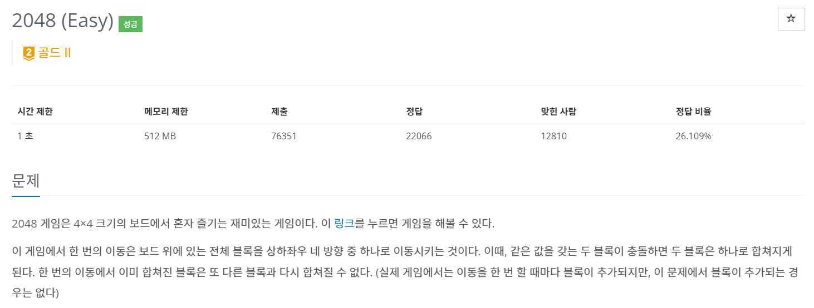
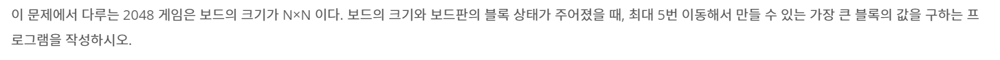

[상위 페이지 · 골드](/study/algorithms/search/gold/)

[https://www.acmicpc.net/problem/12100](https://www.acmicpc.net/problem/12100)





## 아이디어

백트래킹으로 모든 가짓수 (위 아래 왼쪽 오른쪽)을 다 돌려보면서 가장 큰 값을 얻으면 된다.

## 정답

```python
import copy
import sys
from collections import deque
sys.setrecursionlimit(10**6)
N = int(input())
graph = [list(map(int,input().split())) for _ in range(N)]
answer = 0

def move_right():
    for i in range(N):
        visited = [False] * N
        temp = [0] * N
        size = -1
        for j in range(N-1,-1,-1):
            if graph[i][j] == 0:
                continue
            if size != -1 and temp[size] == graph[i][j] and not visited[size]:
                temp[size] *= 2
                visited[size] = True
            else:
                size += 1
                temp[size] = graph[i][j]
        temp.reverse()
        graph[i] = temp

def move_left():
    for i in range(N):
        visited = [False] * N
        temp = [0] * N
        size = -1
        for j in range(N):
            if graph[i][j] == 0:
                continue
            if size != -1 and temp[size] == graph[i][j] and not visited[size]:
                temp[size] *= 2
                visited[size] = True
            else:
                size += 1
                temp[size] = graph[i][j]
        graph[i] = temp

def move_up():
    for j in range(N):
        visited = [False] * N
        temp = [0] * N
        size = -1
        for i in range(N):
            if graph[i][j] == 0:
                continue
            if size != -1 and temp[size] == graph[i][j] and not visited[size]:
                temp[size] *= 2
                visited[size] = True
            else:
                size += 1
                temp[size] = graph[i][j]
        for i in range(N):
            graph[i][j] = temp[i]

def move_down():
    for j in range(N):
        visited = [False] * N
        temp = [0] * N
        size = -1
        for i in range(N-1,-1,-1):
            if graph[i][j] == 0:
                continue
            if size != -1 and temp[size] == graph[i][j] and not visited[size]:
                temp[size] *= 2
                visited[size] = True
            else:
                size += 1
                temp[size] = graph[i][j]
        temp.reverse()
        for i in range(N):
            graph[i][j] = temp[i]

event = [move_up,move_down,move_right,move_left]

def back_track(depth):
    global graph
    if depth == 5:
        global answer
        max_graph = 0
        for i in graph:
            max_graph = max(max(i),max_graph)
        answer = max(answer,max_graph)
        return
    previous_graph = copy.deepcopy(graph)
    for i in range(4):
        event[i]()
        back_track(depth+1)
        graph = copy.deepcopy(previous_graph)

back_track(0)
print(answer)
```

여기서 제발 그래프를 복사하고 다시 덮어 씌울때 둘다 deepcopy를 쓰길 바람. 저번에도 똑같은 실수를 했으면 다시 실수하면 안됨.
