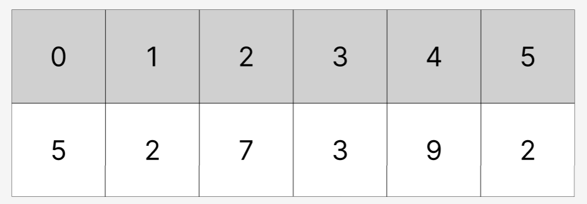

[상위 페이지 · Search](/study/algorithms/search/)

Mo’s Algoritm은 수많은 구간 쿼리를 오프라인으로 매우 효율적으로 처리하기 위한 알고리즘이다. 쿼리를 특정 순서로 정렬하여 이전 쿼리의 계산 결과를 최대한 재활용한다.

## 핵심 아이디어

Mo's Algoritm의 핵심은 두 개의 포인터의 총 이동거리를 최소화하는것이다. 이는 구간의 원소를 효율적으로 추가하고 제거하는 방식으로 동작한다.

현재 $$[L, R]$$ 구간에 대한 답을 알고 있다고 가정하면 다음 쿼리인 $$[L', R']$$ 구간의 답을 구하기 위해 $$L→L', R→ R'$$ 로 포인터를 한칸씩 옮기게 된다. 이때 원소를 추가하거나 제거하면서 결과를 업데이트한다:

- 포인터가 왼쪽으로 이동할 때 ($$L → L-1$$): 새 원소를 구간에 **추가**한다
- 포인터가 오른쪽으로 이동할 때 ($$L → L+1$$): 기존 원소를 구간에서 **제거**한다
- 포인터가 오른쪽으로 이동할 때 ($$R → R+1$$): 새 원소를 구간에 **추가**한다
- 포인터가 왼쪽으로 이동할 때 ($$R → R-1$$): 기존 원소를 구간에서 **제거**한다

예를 들어 다음과 같은 배열이 있다.



만약 이 같은 배열에서 1~4까지의 합을 알고 있고 0~5까지의 합이 필요하다면 좌우로 포인터를 한칸씩 옮기는것으로 전체 합이 구해진다. 왼쪽 포인터를 1→0으로 이동하면서 값 5을 **추가**하고, 오른쪽 포인터를 4→5로 이동하면서 값 2를 **추가**한다.

여기까지만 보면 그냥 평범한 투포인터이다. 문제는 쿼리의 범위가 중구난방이면 오히려 포인터가 양 끝을 계속 왕복하여 총 이동거리가 매우 커진다는 점이다. 이렇게 되면 원소의 추가/제거 연산이 비효율적으로 너무 많이 발생한다.

Mo's Algoritm은 이 쿼리를 적절히 정렬하여 이 이동거리를 줄임으로써 원소의 추가/제거 연산을 최소화한다. 

## 정렬 방법

### 1단계: 정렬 없음

가장 처음에는 쿼리가 주어진 순서 그대로 처리된다.

- **초기 쿼리**: [100, 200], [950, 980], [20, 60], [960, 990]
- **처리 순서**: 위 순서와 동일하다.
- **포인터의 움직임**:
    1. [100, 200] 처리: L과 R 포인터가 초기 위치로 이동한다.
    2. [950, 980] 처리: L은 100에서 950으로, R은 200에서 980으로 크게 이동한다.
    3. [20, 60] 처리: L은 950에서 20으로, R은 980에서 60으로 다시 크게 이동한다.
- **문제점**: L과 R 포인터의 이동 범위가 크고 불규칙하여 효율성이 떨어진다.

---

### 2단계: 단순 오름차순 정렬

위 문제를 개선하기 위해 가장 직관적인 정렬을 도입한다.

- **정렬 규칙**: 쿼리를 L 좌표 오름차순으로 정렬하고, L이 같으면 R 좌표 오름차순으로 정렬한다.
- **초기 쿼리**: [12, 990], [10, 999], [11, 15], [13, 16]
- **정렬 후 쿼리**: [10, 999] → [11, 15] → [12, 990] → [13, 16]
- **이전 문제 해결**: L이 순서대로 증가하므로 L 포인터의 큰 이동 문제가 해결된다.
- **새로운 문제점**: L의 안정성을 확보했지만 R의 이동 효율이 저하된다. R 포인터가 배열의 양 끝을 반복적으로 오가며 비효율적이다.

---

### 3단계: 제곱근 분할법

단순 오름차순 정렬에서 발생한 R 포인터의 불규칙한 이동 문제를 해결하기 위해 제곱근 분할법을 도입한다.

<aside markdown="1">
💡

**제곱근 분할법**

핵심 아이디어는 L 좌표를 일정 단위의 블록으로 묶어, L 포인터의 큰 움직임을 제한하고 R 포인터의 움직임을 한 방향으로 유도하는 것이다. L이 조금만 변해도 R이 크게 변하는 상황을 막기 위해, L의 변화를 '블록'이라는 큰 단위로 묶는다.

블록의 크기는 시간 복잡도에 직접적인 영향을 미치는데, 일반적으로 $$\sqrt N$$이 가장 효율적이다. 이는 L 포인터의 블록 간 이동과 R 포인터의 블록 내 이동의 총비용을 균형 있게 최적화하는 크기이다.

</aside>

- **정렬 규칙 :**이 아이디어를 적용한 정렬 규칙은 다음과 같다.
    1. **우선순위 1**: 각 쿼리의 시작점 L을 블록 크기 S(=$$\sqrt N$$)로 나눈 몫(L/S, 즉 블록 번호)을 기준으로 오름차순 정렬한다.
    2. **우선순위 2**: 블록 번호가 같은 쿼리끼리는 종료점 R을 기준으로 오름차순 정렬한다.
- **초기 쿼리**: [40, 100], [10, 50], [5, 950], [35, 900]
- **정렬 후 쿼리**: [10, 50] → [5, 950] → [40, 100] → [35, 900]
- **이전 문제 해결**: 단순 정렬의 문제였던 R 포인터의 불규칙한 왕복 이동이 해결된다. 같은 블록 내에서는 R이 오름차순으로 한 방향으로만 이동하기 때문이다.
- **새로운 문제점**: 블록과 블록의 경계에서 R 포인터의 불필요한 이동이 발생한다. 0번 블록의 마지막 쿼리 [5, 950]을 처리하면 R 포인터는 950에 위치한다. 다음 1번 블록의 첫 쿼리 [40, 100]을 처리하기 위해, R은 950에서 100까지 크게 되돌아와야 한다.

---

### 4단계: 지그재그 정렬

마지막으로 R 포인터의 불필요한 복귀 이동 문제를 해결한다.

- **정렬 규칙**: 블록 단위로 처리하는 것은 같지만, 홀수 번째 블록은 R을 내림차순으로 정렬하여 포인터가 되돌아올 필요 없이 그 자리에서 바로 다음 작업을 시작하게 한다.
    
    이는 이론적인 시간복잡도는 동일하지만 실제로는 실행 시간이 크게 감소한다.
    
- **초기 쿼리**: [40, 100], [10, 50], [5, 950], [35, 900] (3단계와 동일)
- **정렬 후 쿼리**: [10, 50] → [5, 950] → [35, 900] → [40, 100]
- **이전 문제 해결 확인**: 블록 경계에서 R 포인터의 큰 이동 문제가 해결된다.
    - **분석**: 0번 블록 처리 후 R 포인터는 950에 있다. 다음 1번 블록의 첫 쿼리는 R이 내림차순으로 정렬되어 [35, 900]이다. R은 950에서 900으로 단 50칸만 이동하면 된다. 3단계에서 발생했던 큰 폭의 복귀 이동 문제가 해결된다.
- **최종 결론**: 포인터의 불필요한 이동을 단계적으로 제거하여 총 이동 거리를 최소화하는 효율적인 정렬 방식이 완성된다.

## 시간 복잡도 분석

Mo's 알고리즘의 시간 복잡도는 $$O((N+Q)\sqrt N)$$이다. 이를 구성하는 요소는 다음과 같다:

- **포인터 이동 비용**: 모든 쿼리를 처리하는 과정에서 각 포인터(L,R)는 최대 $$O(N\sqrt N)$$ 만큼 이동한다.
- **각 이동당 연산 비용**: 각 포인터 이동마다 add/remove 연산을 수행하며, 이 연산이 $$O(1)$$이라면 전체 시간 복잡도는 $$O((N+Q)\sqrt N)$$이 된다.
- **추가 자료구조 사용 시**: add/remove 연산이 펜윅 트리나 세그먼트 트리와 같은 추가 자료구조를 사용하는 경우 시간 복잡도는 $$O((N+Q)\sqrt N·logN)$$으로 증가한다.

## 구현

```python
import sys

# 빠른 입력을 위한 설정
input = sys.stdin.readline

# ===== 1. 입력 및 전역 변수 설정 =====

# 배열의 크기 N, 쿼리의 개수 M
N = int(input())
A = list(map(int, input().split()))
M = int(input())

# 제곱근 분할을 위한 블록 크기 S
S = int(N**0.5)

# 쿼리들을 저장할 리스트
# 각 쿼리는 [시작점, 끝점, 원본 쿼리 인덱스] 형태를 가짐
queries = []
for i in range(M):
    l, r = map(int, input().split())
    # 0-based index로 변환하여 저장
    queries.append([l - 1, r - 1, i])

# 쿼리 정렬
# 1. 시작점(l)이 속한 블록 번호를 기준으로 오름차순 정렬
# 2. 블록 번호가 같다면,
#   - 블록 번호가 짝수: 끝점(r)을 오름차순 정렬
#   - 블록 번호가 홀수: 끝점(r)을 내림차순 정렬 (지그재그 최적화)
queries.sort(key=lambda q: (q[0] // S, q[1] if (q[0] // S) % 2 == 0 else -q[1]))

# ===== 2. 문제에 맞는 변수와 함수 정의 =====

# 각 쿼리의 결과를 저장할 리스트
answers = [0] * M

# 현재 구간 [l, r]에 포함된 각 원소의 개수를 저장
# 문제에 따라 배열 크기를 조절하거나 dictionary/hashmap 사용
# 예: 원소의 최대값이 1,000,000 이라면
count = [0] * 1000001

# 현재 구간의 고유한 원소의 개수 (문제의 정답)
current_answer = 0

# add: 현재 구간에 원소를 추가하는 함수
# 문제의 종류에 따라 이 함수의 내용을 수정해야 함
def add(idx):
    global current_answer
    val = A[idx]
    if count[val] == 0:
        current_answer += 1
    count[val] += 1

# remove: 현재 구간에서 원소를 제거하는 함수
# 문제의 종류에 따라 이 함수의 내용을 수정해야 함
def remove(idx):
    global current_answer
    val = A[idx]
    count[val] -= 1
    if count[val] == 0:
        current_answer -= 1

# ===== 3. Mo's 알고리즘 실행 =====

# 첫 번째 쿼리에 대한 초기화
# 첫 번째 쿼리의 구간을 [l, r]에 먼저 설정해 둠
q_l, q_r, q_idx = queries[0]
l, r = q_l, q_l - 1 # 초기 구간 [l, r]은 비어있는 상태 [q_l, q_l-1]
while r < q_r:
    r += 1
    add(r)
answers[q_idx] = current_answer

# 나머지 쿼리 처리
for i in range(1, M):
    q_l, q_r, q_idx = queries[i]
    
    # 이전 구간의 l과 현재 쿼리의 q_l을 맞춤
    while l > q_l:
        l -= 1
        add(l)
    while l < q_l:
        remove(l)
        l += 1
        
    # 이전 구간의 r과 현재 쿼리의 q_r을 맞춤
    while r < q_r:
        r += 1
        add(r)
    while r > q_r:
        remove(r)
        r -= 1
        
    # 현재 쿼리에 대한 정답을 원래 인덱스에 저장
    answers[q_idx] = current_answer

# ===== 4. 결과 출력 =====

for ans in answers:
    print(ans)
```

## 해결 가능한 문제 유형

Mo's 알고리즘은 아래 세 가지 핵심 조건을 만족하는 문제에 적용할 수 있다.

1. **오프라인(Offline) 처리가 가능한가?**
    - 모든 쿼리를 미리 받은 뒤, 순서를 바꿔서 처리해도 각 쿼리의 답에 영향이 없어야 한다.
    - 쿼리의 순서를 자유롭게 재배열할 수 있어야 하며, 쿼리 결과는 원래 순서대로 출력한다.
2. **배열의 값이 변하지 않는가?**
    - 쿼리가 구간의 정보를 '조회'만 할 뿐, 배열의 특정 값을 '수정'하지 않아야 한다. (수정이 있는 경우 Mo's with updates라는 더 복잡한 기법이 필요하다.)
    - 구간 쿼리는 배열의 상태를 변경하지 않는 읽기 전용 작업이어야 한다.
3. **add/remove 연산이 효율적인가?**
    - 현재 구간 [L, R]의 답을 알 때, [L-1, R], [L+1, R], [L, R-1], [L, R+1]처럼 한 칸 확장되거나 축소된 구간의 답을 빠르게 계산할 수 있어야 한다. (이상적으로는 $$O(1)$$ 또는 $$O(logN)$$)
    - 이 조건은 Mo's 알고리즘의 가장 중요한 부분으로, 포인터 이동 시 결과를 점진적으로 업데이트할 수 있어야 한다.

---

### 대표적인 문제 예시

- **구간 내 고유한 원소의 개수 (Distinct Elements)**
    - 가장 대표적인 Mo's 알고리즘 문제이다. add/remove 시 특정 원소의 카운트를 조절하여 고유 원소 개수를 $$O(1)$$에 갱신할 수 있다.
    - 각 원소의 등장 횟수를 세는 카운트 배열을 활용하여 구간 내 중복 없이 등장하는 원소 수를 관리한다.
- **구간 내 특정 조건을 만족하는 원소의 개수**
    - 예: "구간 내에서 K보다 큰 수의 개수는?", "등장 횟수가 3 이상인 수의 종류는 몇 개인가?"
    - add/remove 시 카운트 배열을 업데이트하며 조건 만족 여부를 확인한다.
    - 빈도수에 따른 조건이 변경될 때마다 결과값을 증가시키거나 감소시키는 방식으로 구현한다.
- **구간 내 역상 쌍(Inversion Pair)의 개수**
    - add/remove 시 추가/제거되는 원소와 현재 구간 내 다른 원소들과의 대소 관계를 따져야 한다. 이 경우 add/remove 내부에 펜윅 트리(BIT)나 세그먼트 트리를 사용하여 $$O(\log N)$$에 연산을 처리할 수 있다. (전체 시간 복잡도는 $$O((N+M)\sqrt{N}\log N)$$이 된다.)
- **구간 내 특정 합을 만족하는 쌍의 개수**
    - 예: "A[i]+A[j]=K를 만족하는 (i,j) 쌍의 개수는?"
    - add(x)를 할 때, 현재 구간에 K-x가 몇 개 있는지 확인하여 답을 갱신한다.
    - 해시맵이나 카운터 배열을 사용하여 현재 구간의 각 원소의 등장 횟수를 관리한다.
