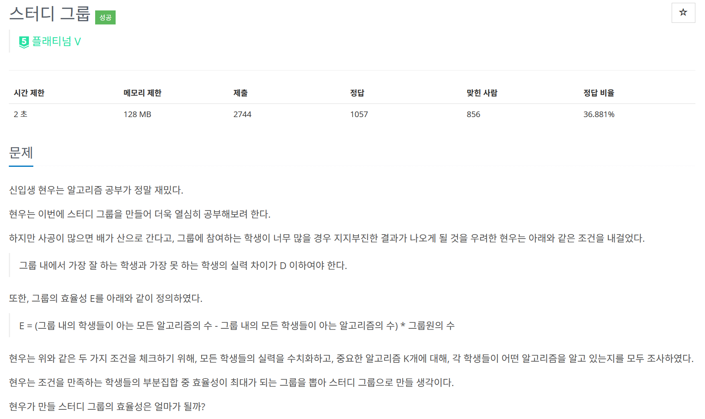

[상위 페이지 · 플래티넘](/study/algorithms/search/platinum/)



## 문제 태그

- 그리디
- 정렬
- 투 포인터

## 아이디어

1. 인원을 선택할 때는 정렬을 해야 인접한 인원 간의 점수 차이를 최소화할 수 있다.
2. 투 포인터에서 r을 증가시키며 현재 포함된 인원들의 알고리즘 합집합과 교집합을 딕셔너리로 관리한다
    1. 교집합이 알고리즘 개수와 인원수가 같다면 모든 인원이 알고 있는 것이다
    2. 합집합은 딕셔너리의 길이와 같다
3. 차이가 D 미만이 될 때까지 l을 증가시킨다. mo’s 알고리즘 하위호환 느낌으로 이 과정에서도 합집합과 교집합을 지속적으로 관리해야 한다 
4. answer = max(answer, $$(|합집합| - |교집합|) * 그룹원 수$$)

## 정답

```python
N, K, D = map(int, input().split())
known_algo = [set() for _ in range(N)]
score = [0] * N
for j in range(N):
    m, d = map(int, input().split())
    score[j] = (d, j)
    for i in map(int, input().split()):
        known_algo[j].add(i)

l = r = 0
freq = {}
answer = -1

score.sort()

while r < N:
    student = score[r][1]
    for algo in known_algo[student]:
        freq[algo] = freq.get(algo, 0) + 1
    r+=1
    while l < r and score[r-1][0] - score[l][0] > D:
        student = score[l][1]
        for algo in known_algo[student]:
            freq[algo] -= 1
            if freq[algo] == 0:
                del freq[algo]
        l += 1
    answer = max(answer, (len(freq) - list(freq.values()).count(r-l)) * (r - l))

print(answer)

```
