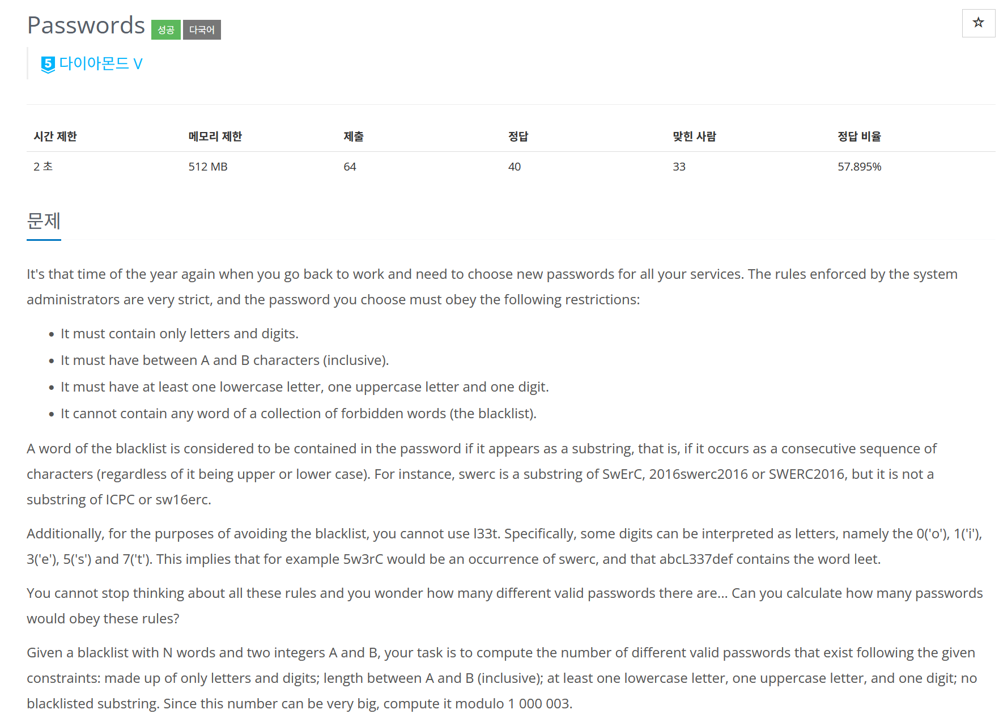
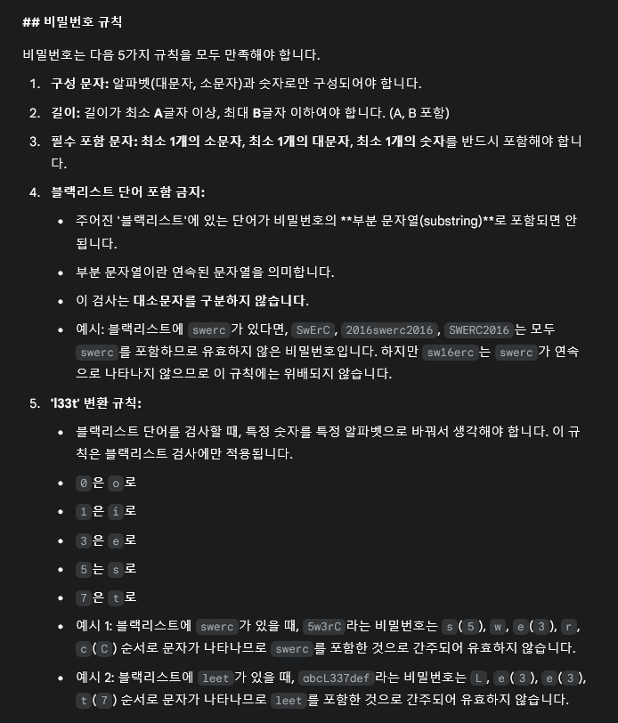

[상위 페이지 · 다이아](/study/algorithms/string/diamond/)



## 문제 해석




## 문제 태그

- DP
- 자료구조
- 문자열
- 트리
- 트라이
- 아호 코라식

## 아이디어

- 문제에 제약 중 “최소 1개의 소문자, 1개의 대문자, 1개의 숫자를 포함해야한다”는 부분을 처리하기 위해 포함 배제 원리를 사용
    - 전체 경우의 수는 다음과 같음
    - (전체 비밀번호 개수) - (소문자가 없는 경우 + 대문자가 없는 경우 + 숫자가 없는 경우) + (소문자와 대문자가 없는 경우 + 소문자와 숫자가 없는 경우 + 대문자와 숫자가 없는 경우) - (소문자,대문자,숫자 모두 없는 경우)
    - 비트 마스크를 이용하여 구현
- 각 mask에 대해 허용된 문자들로 만들 수 있는 비밀번호 중 블랙리스트 단어를 포함하지 않는것의 개수를 아호 코라식으로 세어줌
- 비밀번호 개수는 DP로 세어준다
    - DP상태 정의
        - dp[L][S] = 길이가 L이고 아호코라식 오토마타에서 상태 S에 도달하는 유효한 비밀번호 개수
    - DP식
        
        $$
        dp[i][j] = \sum_{k \in S} \sum_{c\in C} dp[i-1][k] \pmod {1000003}
        $$
        

## 정답

```python
import sys
from collections import deque

input = sys.stdin.readline

class Node:
    def __init__(self):
        self.children = {}
        self.fail = None
        self.output = []

class AhoCorasick:
    def __init__(self):
        self.root = Node()
        self.root.fail = self.root
        self.pattern_lengths = {}

    def add_pattern(self, pattern, id):
        node = self.root
        for char in pattern:
            if char not in node.children:
                node.children[char] = Node()
            node = node.children[char]
        node.output.append(id)
        self.pattern_lengths[id] = len(pattern)

    def build_fail(self):
        queue = deque()
        for child in self.root.children.values():
            child.fail = self.root
            queue.append(child)
        while queue:
            current = queue.popleft()
            for char, child in current.children.items():
                fail = current.fail
                while fail != self.root and char not in fail.children:
                    fail = fail.fail
                if char in fail.children:
                    fail = fail.children[char]
                child.fail = fail if fail != self.root or char in self.root.children else self.root
                child.output = child.output + child.fail.output
                queue.append(child)

    def get_transition(self, node, c, rep, root):
        effective = rep.get(c, None)
        if effective is None:
            return root
        temp = node
        while temp != root and effective not in temp.children:
            temp = temp.fail
        if effective in temp.children:
            temp = temp.children[effective]
        else:
            temp = root
        return temp

def solve():
    A, B = map(int, input().split())
    N = int(input())
    blacklist = []
    for _ in range(N):
        blacklist.append(input().strip())

    MOD = 1000003
    rep = {}
    for i in range(26):
        low = chr(ord('a') + i)
        up = chr(ord('A') + i)
        rep[low] = low
        rep[up] = low
    l33t = {'0': 'o', '1': 'i', '3': 'e', '5': 's', '7': 't'}
    for d, l in l33t.items():
        rep[d] = l

    lowers = [chr(i) for i in range(ord('a'), ord('z') + 1)]
    uppers = [chr(i) for i in range(ord('A'), ord('Z') + 1)]
    digits = [str(i) for i in range(10)]

    ac = AhoCorasick()
    for i, w in enumerate(blacklist):
        ac.add_pattern(w, i)
    ac.build_fail()

    all_nodes = []
    queue = deque([ac.root])
    while queue:
        node = queue.popleft()
        all_nodes.append(node)
        for child in node.children.values():
            queue.append(child)
    good_nodes = [n for n in all_nodes if not n.output]
    node_to_id = {node: idx for idx, node in enumerate(good_nodes)}
    S = len(good_nodes)
    root_id = node_to_id[ac.root]

    ans = 0
    for mask in range(8):
        allowed = []
        if (mask & 1) == 0:
            allowed += lowers
        if (mask & 2) == 0:
            allowed += uppers
        if (mask & 4) == 0:
            allowed += digits
        pop = bin(mask).count('1')
        sign = 1 if pop % 2 == 0 else -1
        subtotal = 0
        if allowed:
            prev = [0] * S
            prev[root_id] = 1
            for l in range(1, B + 1):
                curr = [0] * S
                for s in range(S):
                    if prev[s] == 0:
                        continue
                    curr_node = good_nodes[s]
                    for c in allowed:
                        next_node = ac.get_transition(curr_node, c, rep, ac.root)
                        if next_node.output:
                            continue
                        next_s = node_to_id[next_node]
                        curr[next_s] = (curr[next_s] + prev[s]) % MOD
                prev = curr
                if l >= A:
                    subtotal = (subtotal + sum(prev) % MOD) % MOD
        ans = (ans + (sign * subtotal % MOD + MOD) % MOD) % MOD
    print(ans)

if __name__ == '__main__':
    solve()
```
