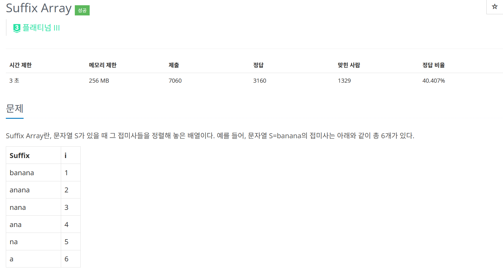
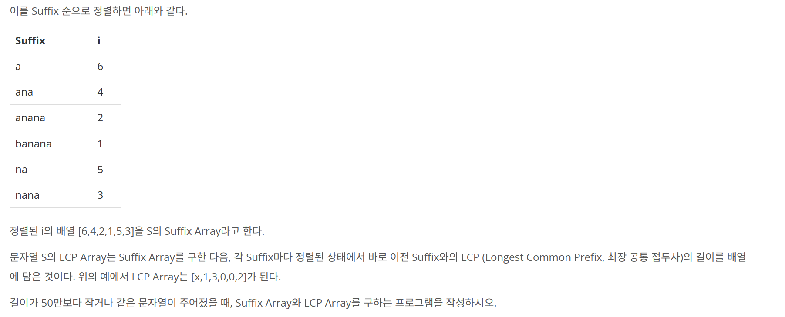

[상위 페이지 · 플레티넘](/study/algorithms/string/platinum/)





## 문제 태그

- 문자열
- 접미사 배열과 lcp 배열

## 아이디어

1. [11479. **서로 다른 부분 문자열의 개수 2**](/study/algorithms/string/platinum/boj-11479/) 코드 그대로 가져와서 중복제거 부분을 빼고 각 배열만 출력 양식에 맞게 출력하면 됨

## 정답

```python
import sys
def build_sa(s):
    n = len(s)
    k = 1
    # 초기 랭크: 문자 코드
    rank = [ord(c) for c in s]
    sa = list(range(n))
    tmp = [0] * n

    while True:
        # (rank[i], rank[i+k]) 튜플로 정렬
        sa.sort(key=lambda i: (rank[i], rank[i + k] if i + k < n else -1))
        tmp[sa[0]] = 0
        for i in range(1, n):
            prev, curr = sa[i - 1], sa[i]
            prev_key = (rank[prev], rank[prev + k] if prev + k < n else -1)
            curr_key = (rank[curr], rank[curr + k] if curr + k < n else -1)
            tmp[curr] = tmp[prev] + (prev_key < curr_key)
        rank, tmp = tmp, rank
        if rank[sa[-1]] == n - 1:
            break
        k <<= 1
    return sa

def build_lcp(s, sa):
    n = len(s)
    rank = [0] * n
    for i, si in enumerate(sa):
        rank[si] = i
    h = 0
    lcp = [0] * n
    for i in range(n):
        if rank[i] == 0:
            continue
        j = sa[rank[i] - 1]
        while i + h < n and j + h < n and s[i + h] == s[j + h]:
            h += 1
        lcp[rank[i]] = h
        if h:
            h -= 1
    return lcp

s = sys.stdin.readline().strip()
sa = build_sa(s)
lcp = build_lcp(s, sa)
lcp[0] = "x"
sa = [i + 1 for i in sa]
print(*sa)
print(*lcp)

```
