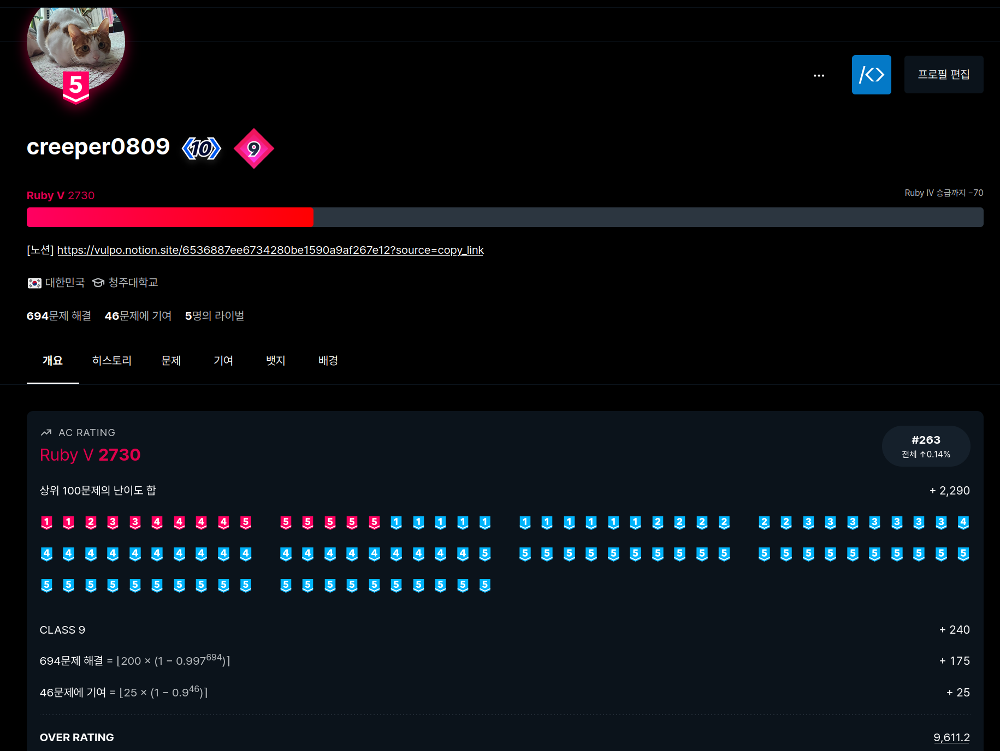
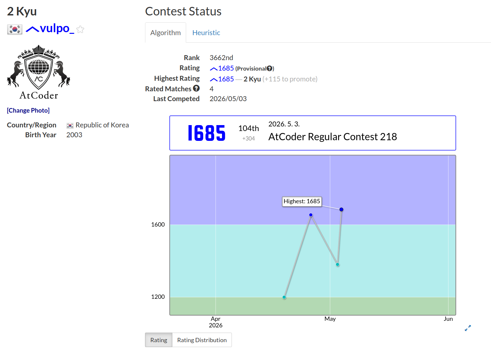

[상위 페이지 · 공부](/study/)

알고리즘은 “이론 컴퓨터 과학” 하위 분류이지만 중요도가 높다 생각하여 메인 분류로 올림.

## *******!루비 달성!*******



## ****블루단 달성*****



[https://github.com/Creeper0809/Algorithm](https://github.com/Creeper0809/Algorithm)

- [알고리즘 이론](/study/algorithms/theory/)

- [스켈레톤 코드 모음](/study/algorithms/code-templates/)

<details id="unsorted" markdown="1">
<summary>미정리</summary>

- [Link-Cut Tree (링크 컷 트리)](/study/algorithms/unsorted/link-cut-tree-ringkeu-keos-teuri/)
- [1921. 트리와 쿼리 20](/study/algorithms/unsorted/boj-1921/)
- [2-SAT](/study/algorithms/unsorted/2-sat/)
- [Heavy-Light Decomposition](/study/algorithms/unsorted/heavy-light-decomposition/)
- [*Dynamic Tree DP*](/study/algorithms/unsorted/dynamic-tree-dp/)
- [비트(Bit) 학개론](/study/algorithms/unsorted/biteu-bit-haggaeron/)
- [볼록 껍질을 이용한 최적화](/study/algorithms/unsorted/bolrog-ggeobjileul-iyonghan-coejeoghwa/)
- [확장 유클리드](/study/algorithms/unsorted/hwagjang-yukeulrideu/)
- [오일러 - 라그랑주](/study/algorithms/unsorted/oilreo-rageurangju/)
- [**Aliens Trick**](/study/algorithms/unsorted/aliens-trick/)
- [22222. 지애상수](/study/algorithms/unsorted/boj-22222/)
- [17477. 수열과 쿼리 29](/study/algorithms/unsorted/boj-17477/)
- [17475. 수열과 쿼리 27](/study/algorithms/unsorted/boj-17475/)
- [13569. Rounding](/study/algorithms/unsorted/boj-13569/)
- [16124. **나는 행복합니다**](/study/algorithms/unsorted/boj-16124/)
- [16670. **King Kog’s Reception**](/study/algorithms/unsorted/boj-16670/)
- [13361. **최고인 대장장이 토르비욘**](/study/algorithms/unsorted/boj-13361/)
- [11808. **마리오와 사악한 키노피오**](/study/algorithms/unsorted/boj-11808/)
- [1144. **싼 비용**](/study/algorithms/unsorted/boj-1144/)
- [1031. **스타 대결**](/study/algorithms/unsorted/boj-1031/)
- [13557. **수열과 쿼리 10**](/study/algorithms/unsorted/boj-13557/)
- [1077. **넓이**](/study/algorithms/unsorted/boj-1077/)
- [10070. **벽**](/study/algorithms/unsorted/boj-10070/)
- [13705. **Ax+Bsin(x)=C**](/study/algorithms/unsorted/boj-13705/)
- [16911·16912. 그래프와 쿼리 / 트리와 쿼리 12](/study/algorithms/unsorted/boj-16911-16912/)
- [11410. **칙칙폭폭**](/study/algorithms/unsorted/boj-11410/)
- [5647. **연속 합**](/study/algorithms/unsorted/boj-5647/)
- [16695. **The Bridge on the River Kawaii**](/study/algorithms/unsorted/boj-16695/)
- [15316. 현수시티](/study/algorithms/unsorted/boj-15316/)
- [7662. **이중 우선순위 큐**](/study/algorithms/unsorted/boj-7662/)

</details>

## 유형

<details id="competitive-programming" markdown="1">
<summary>Competitive Programming</summary>

- [Codeforce Round 1018 (Div. 1+Div. 2)](/study/algorithms/competitive-programming/codeforce-round-1018-div-1-div-2/)
- [Codeforce Round 1069 (Div. 2)](/study/algorithms/competitive-programming/codeforce-round-1069-div-2/)
- [2025-2026 ICPC, NERC, Northern Eurasia Finals](/study/algorithms/competitive-programming/2025-2026-icpc-nerc-northern-eurasia-finals/)
- [AtCoder Beginner Contest 435](/study/algorithms/competitive-programming/atcoder-beginner-contest-435/)
- [AtCoder Beginner Contest 436](/study/algorithms/competitive-programming/atcoder-beginner-contest-436/)
- [**AtCoder Beginner Contest 437**](/study/algorithms/competitive-programming/atcoder-beginner-contest-437/)
- [**AtCoder Beginner Contest 454**](/study/algorithms/competitive-programming/atcoder-beginner-contest-454/)
- [**AtCoder Beginner Contest 455**](/study/algorithms/competitive-programming/atcoder-beginner-contest-455/)
- [**AtCoder Regular Contest 218**](/study/algorithms/competitive-programming/atcoder-regular-contest-218/)

</details>

- [Data Structure](/study/algorithms/data-structure/)

- [Greedy](/study/algorithms/greedy/)

- [Graph](/study/algorithms/graph/)

- [Math](/study/algorithms/math/)

- [Implementation](/study/algorithms/implementation/)

- [Dynamic Programming](/study/algorithms/dynamic-programming/)

- [Sorting](/study/algorithms/sorting/)

- [Game Theory](/study/algorithms/game-theory/)

- [Search](/study/algorithms/search/)

- [String](/study/algorithms/string/)

- [Etc](/study/algorithms/etc/)

## 파이썬의 초당연산 횟수

파이썬의 초당연산 횟수는 약 2000만정도라고 생각하면 된다.

즉 시간제한이 1초, n이 10만일때 $$O(n^2)$$ 으로 짜게 된다면 필요연산 횟수는 총 100억번의 연산이 필요하게 됨으로 시간초과가 난다.

고로 $$O(nlogn)$$ 으로 알고리즘을 짜야한다.

## N의 범위 별 시간 복잡도 예시

**시간 제한이 1초인 문제의 경우 (파이썬)**

- N의 범위가 500: 시간 복잡도가 $$O(N³)$$ 알고리즘을 설계하면 문제를 풀 수 있다.
- N의 범위가 2,000: 시간 복잡도가 $$O(N²)$$ 알고리즘을 설계하면 문제를 풀 수 있다.
- N의 범위가 100,000: 시간 복잡도가 $$O(NlogN)$$ 알고리즘을 설계하면 문제를 풀 수 있다.
- N의 범위가 10,000,000: 시간 복잡도가 $$O(N)$$ 알고리즘을 설계하면 문제를 풀 수 있다.

**시간 제한이 1초인 문제의 경우 (Cpp 17)**

- N의 범위가 2,000: 시간 복잡도가 $$O(N³)$$ 알고리즘을 설계하면 문제를 풀 수 있다.
- N의 범위가 40,000: 시간 복잡도가 $$O(N²)$$ 알고리즘을 설계하면 문제를 풀 수 있다.
- N의 범위가 20,000,000: 시간 복잡도가 $$O(NlogN)$$ 알고리즘을 설계하면 문제를 풀 수 있다.
- N의 범위가 160,000,000: 시간 복잡도가 $$O(N)$$ 알고리즘을 설계하면 문제를 풀 수 있다.

## 실수하기 좋은 타입

- 산술 오버플로
    
    정수형 변수나 실수형 변수의 범위를 초과하는 값을 저장하려 할 때 발생하는 오류입니다. int나 long long의 범위를 잘 확인해야 합니다.
    
- 배열 범위 밖 원소 접근
    
    다른 언어는 체크해줘도 C/C++은 해당 인덱스가 배열 범위 안에 있는지 별도로 확인해주지않는다. 오류가 날 수도있지만 이런경우는 오류가 나지 않는다.
    
    ```cpp
    int array[10],t;
    ```
    
    만약 array[10]에 접근을 하면 t에 접근을 하게 될 것이다.
    
    이런 오류를 범하지 않기 위해서는 초기부터 배열의 크기를 잘 계산하여 정한다.
    
- Off-by-one 오류
    
    반복문이나 if문에서 <, >, ≤, ≥를 잘못써서 구간에 혼동이 생기는 경우이다.
    
- 상수 오타
    
    출력 실수, 1000007을 100007로 잘못 입력하는등 상수관련 오타
    
- 스택 오버플로
    
    재귀 함수의 호출 깊이가 너무 깊어지거나, 지역 변수를 너무 많이 선언하여 스택 메모리가 부족해지는 경우이다.
    
- 인덱스 순서 바꿔쓰기
    
    2차원 배열에서 행과 열의 인덱스를 반대로 쓰거나, 함수 파라미터의 순서를 잘못 입력하는 경우이다.
    
- 잘못된 비교 함수
    
    정렬이나 우선순위 큐에서 사용되는 비교 함수를 잘못 구현하여 원하는 결과가 나오지 않는 경우이다.
    
- 최소, 최대 예외 잘못 다루기
    
    최소값이나 최대값을 구할 때 초기값 설정을 잘못하거나, 예외 케이스를 고려하지 않는 경우이다.
    
- 연산자 우선 순위
    
    수식에서 연산자의 우선순위를 잘못 이해하여 괄호를 적절히 사용하지 않는 경우이다.
    
- 느린 입출력
    
    Python의 input() 대신 sys.stdin.readline()을 사용하지 않거나, C++에서 cin/cout의 동기화를 끄지 않아 시간 초과가 발생하는 경우이다.
    
- 변수 초기화
    
    전역 변수나 지역 변수를 적절히 초기화하지 않아 이전 테스트 케이스의 값이 영향을 미치는 경우이다.
    

## 공부 방법

알고리즘 문제 해결 전략

GPT

구글 서치

백준

코드포스

프로그래머스
