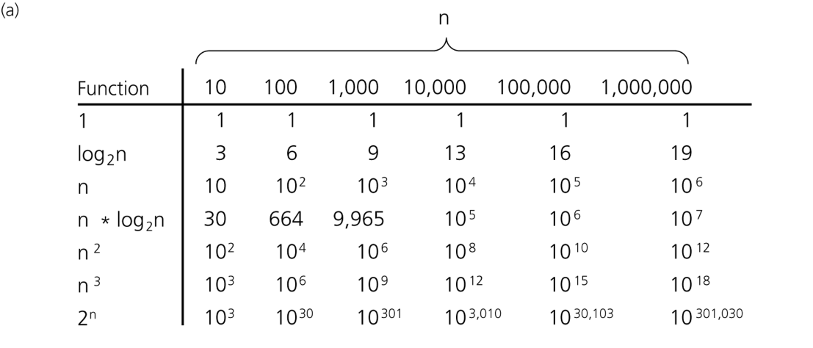
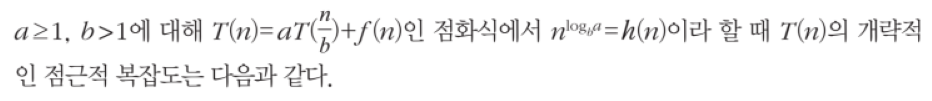
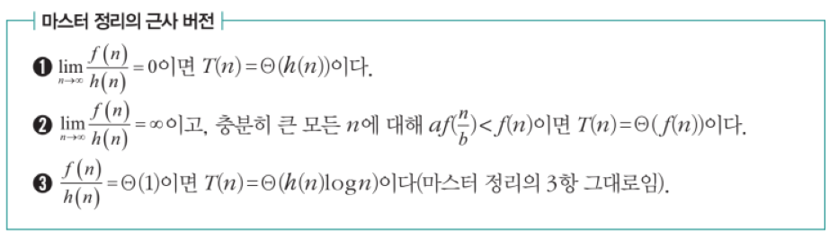

[상위 페이지 · 알고리즘](/study/algorithms/)

## 알고리즘의 필수 요소

알고리즘을 구성하는 필수 요소는 다음과 같다.

### 입력 (Input)

알고리즘이 작동하려면 처리할 데이터나 정보를 입력받아야 한다.

### 출력 (Output)

알고리즘은 입력을 처리한 결과를 반드시 출력해야 한다.

### 명확성 (Definiteness)

알고리즘의 각 단계는 명확하게 정의된 작업으로 구성되어야 한다. 모호한 알고리즘은 구현이 어렵고 오류가 발생하기 쉽다.

### 유한성 (Finiteness)

알고리즘은 반드시 유한한 시간 내에 종료되어야 한다. 무한 루프나 무한 재귀 호출이 발생해서는 안 된다.

### 효율성 (Efficiency)

알고리즘은 효율적이어야 한다. 입력이 커질수록 알고리즘의 수행 시간이 느려지는 경우, 해당 알고리즘은 비효율적이라고 할 수 있다. 알고리즘의 효율성은 시간 복잡도와 공간 복잡도로 측정된다.

## 문제를 해결하는 단계

### 1단계: 문제를 읽고 이해한다

마음이 아무리 조급하더라도 문제를 차분히 읽고 요구사항을 완전히 이해하는 과정이 반드시 필요하다. 제대로 읽지 않으면 나중에 큰 어려움을 겪을 수 있다.

### 2단계: 재정의와 추상화

현실 세계의 개념을 수학적/전산학적 개념으로 변환하여 표현하는 과정이다.

현실 세계의 개념은 복잡하므로, 이를 효과적으로 다루기 위해 본질만 남기고 단순화하는 추상화 과정이 필요하다.

### 3단계: 계획 세우기

문제를 어떤 방식으로 해결할지 결정하고, 사용할 알고리즘과 자료구조를 선택한다.

### 4단계: 계획 검증하기

설계한 알고리즘이 모든 경우에 요구 조건을 정확히 수행하는지 검증하고, 수행 시간과 메모리 사용량이 제한 범위 내인지 확인한다.

### 5단계: 계획 수행하기

프로그램을 작성하며, 구현 과정에서 실수하지 않도록 주의한다.

### 6단계: 회고하기

문제 해결 과정을 돌아보고 개선점을 찾는 과정이다.

1. 노션이나 블로그에 기록
2. 남의 코드를 보고 이해
3. 다른 사람과 함께 공부

## 체계적인 접근을 위한 질문

1. 비슷한 문제를 풀어본 경험이 있는가?
2. 단순한 방법에서 시작할 수 있는가?
3. 내가 문제를 푸는 과정을 수식화 할 수 있는가?
4. 문제를 단순화할 수 있는가?
5. 그림으로 그려 볼 수 있는가?
6. 문제를 분해 할 수 있는가?
7. 뒤에서부터 생각해서 문제를 풀 수 있는가?
8. 순서를 강제 할 수 있는가?
9. 특정 형태의 답만을 고려 할 수 있는가?

## 시간 복잡도

알고리즘의 시간 복잡도는 입력 크기가 증가함에 따라 알고리즘의 수행 시간이 어떻게 변화하는지를 나타낸다. 즉, 입력의 크기와 수행 시간 사이의 관계를 분석하는 것이다.

### 빅오 표기법 (Big O notation)

빅오 표기법은 알고리즘 수행 시간의 상한을 나타내는 표기법으로, 최악의 경우 시간 복잡도를 표현한다. 이는 가장 널리 사용되며, 알고리즘의 성능 비교에 주로 활용된다.

수학적 정의: $$f(n) = O(g(n))$$은 어떤 양수 $$c$$와 $$n_0$$이 존재하여 $$n \geq n_0$$일 때 $$\vert f(n)\vert  \leq c\vert g(n)\vert $$을 만족하는 함수 $$f(n)$$과 $$g(n)$$이 존재함.

예시: $$f(n) = 3n^2 + 2n + 1$$일 때, $$f(n) = O(n^2)$$.

### 세타 표기법 (Theta notation)

세타 표기법은 알고리즘의 평균적인 수행 시간을 나타내는 표기법이다. 이는 빅오 표기법과 함께 알고리즘의 성능을 비교하는 데 사용된다.

수학적 정의: $$f(n) = \theta(g(n))$$은 어떤 양수 $$c_1$$, $$c_2$$와 $$n_0$$이 존재하여 $$n \geq n_0$$일 때 $$c_1\vert g(n)\vert  \leq \vert f(n)\vert  \leq c_2\vert g(n)\vert $$을 만족하는 함수 $$f(n)$$과 $$g(n)$$이 존재함.

예시: $$f(n) = 3n^2 + 2n + 1$$일 때, $$f(n) = \theta(n^2)$$.

### 오메가 표기법 (Omega notation)

오메가 표기법은 알고리즘 수행 시간의 하한을 나타내는 표기법으로, 최선의 경우 시간 복잡도를 표현한다. 이는 알고리즘의 최소 수행 시간을 비교할 때 사용된다.

수학적 정의: $$f(n) = \Omega(g(n))$$은 어떤 양수 $$c$$와 $$n_0$$이 존재하여 $$n \geq n_0$$일 때 $$\vert f(n)\vert  \geq c\vert g(n)\vert $$을 만족하는 함수 $$f(n)$$과 $$g(n)$$이 존재.

예시: $$f(n) = 3n^2 + 2n + 1$$일 때, $$f(n) = \Omega(n^2)$$.

### 리틀 오 표기법 (Little O notation)

리틀 오 표기법은 빅오 표기법보다 더 엄격한 상한을 나타내며, 주어진 함수보다 항상 더 빠르게 증가하는 함수를 표현한다.

수학적 정의: $$f(n) = o(g(n))$$은 어떤 양수 $$c$$와 $$n_0$$이 존재하여 $$n \geq n_0$$일 때 $$\vert f(n)\vert  < c\vert g(n)\vert $$을 만족하는 함수 $$f(n)$$과 $$g(n)$$이 존재함.

예시: $$f(n) = n^2$$일 때, $$f(n) = o(n^3)$$.

### 리틀 오메가 표기법 (Little Omega notation)

리틀 오메가 표기법은 오메가 표기법보다 더 엄격한 하한을 나타내며, 주어진 함수보다 항상 더 느리게 증가하는 함수를 표현한다.

수학적 정의: $$f(n) = \omega(g(n))$$은 어떤 양수 $$c$$와 $$n_0$$이 존재하여 $$n \geq n_0$$일 때 $$\vert f(n)\vert  > c\vert g(n)\vert $$을 만족하는 함수 $$f(n)$$과 $$g(n)$$이 존재함.

예시: $$f(n) = n^3$$일 때, $$f(n) = \omega(n^2)$$.

## 알고리즘 수행 시간



## 알고리즘 점화식

점화식은 수열에서 이전 항과 다음 항 사이의 관계를 나타내는 재귀적 형태의 식이다. 알고리즘 문제 해결에서도 이러한 점화식을 활용할 수 있다.

예시: 피보나치 수열

피보나치 수열은 이전 두 항의 합이 다음 항이 되는 수열이며, 다음과 같은 점화식으로 표현된다.

$$F_0 = 0$$

$$F_1 = 1$$

$$F_n = F_{n-1} + F_{n-2}$$ (n ≥ 2)

이를 코드로 구현하면 다음과 같다.

```python
def fibonacci(n):
    if n == 0:
        return 0
    elif n == 1:
        return 1
    else:
        return fibonacci(n-1) + fibonacci(n-2)
```

그러나 이 구현은 지수 시간 복잡도를 가져 매우 비효율적이다. 동적 계획법을 사용하면 중복 계산을 피해 효율성을 높일 수 있다.

예시: 피보나치 수열 (동적 계획법 사용)

```python
def fibonacci(n):
    memo = [0, 1]
    for i in range(2, n+1):
        memo.append(memo[i-1] + memo[i-2])
    return memo[n]
```

이 방식은 선형 시간 복잡도를 가져 훨씬 효율적이다.

### 반복 대치로 시간복잡도 구하기

반복 대치(recursion-tree method)는 점화식을 이용해 알고리즘의 시간 복잡도를 구하는 방법 중 하나이다. 이 방법은 알고리즘의 수행 시간이 점차 감소하거나 증가하는 경우에 유용하게 사용될 수 있다.

반복 대치는 다음과 같은 과정으로 시간 복잡도를 구한다.

1. 점화식을 적는다.
2. 대입을 통해 점화식을 풀어 쓴다.
3. 결과를 합산한다.
4. 최고차항만 남긴다.

예를 들어, 주어진 점화식이 $$T(n) = 2T(n/2) + n$$일 때, 반복 대치를 사용해 시간 복잡도를 구할 수 있다.

1. 점화식을 적는다.
    
    $$T(n) = 2T(n/2) + n$$
    
2. 대입을 통해 점화식을 풀어 쓴다. 대입한 항은 $$T(n/2)$$이다.
    
    $$= 2T(n/4) + n/2$$
    
    $$= 2^2T(n/8) + 2(n/4) + n/2$$
    
    $$= 2^3T(n/16) + 2^2(n/8) + 2(n/4) + n/2$$
    
    ...
    
    $$= \dots = 2^k T(n/2^k) + kn/2^k$$
    
    이때, $$n/2^k = 1$$이 되는 최소의 $$k$$를 구한다. $$n/2^k = 1$$에서 $$k = \log_2 n$$이므로,
    
    $$T(n/2) = 2^{\log_2 n}T(1) + n\log_2 n$$
    
    $$T(n/2) = nT(1) + n\log_2 n$$
    
    $$T(n) = nT(1) + n\log_2 n$$
    
    따라서, $$T(n) = \Theta(n\log n)$$이다.
    

이렇게 반복 대치를 사용해 점화식을 푸는 것은 알고리즘의 시간 복잡도를 구하는 데 있어 매우 유용한 방법 중 하나이다.

### 추정 후 증명으로 시간 복잡도 구하기

추정 후 증명은 시간복잡도를 예측해 증명을 하는것이다.

점화식이 주어졌을 때, 시간복잡도를 추정하는 과정은 다음과 같다.

1. 점화식을 적는다.
    
    $$T(n) = aT(n/b) + f(n)$$
    
    이 때 $$a$$는 재귀 호출 횟수, $$b$$는 입력의 크기를 나누는 비율, $$f(n)$$은 재귀 호출 이외의 작업에 소요되는 시간을 나타낸다.
    
2. 추정한다.
    
    점화식을 보고 시간 복잡도를 추정한다. 이 때, 부등식, 상한과 하한 표기법 등을 이용해 추정한다.
    
3. 증명한다.
    
    추정한 시간 복잡도가 맞는지 증명한다. 이 때, 수학적 귀납법, 반복 대치 등을 이용해 증명한다.
    

예시: 병합 정렬의 시간 복잡도

병합 정렬의 시간 복잡도는 다음과 같은 점화식으로 나타낼 수 있다.

$$T(n) = 2T(n/2) + n$$

이를 이용해 시간 복잡도를 추정하면 다음과 같다.

- 점화식을 적는다.
    
    $$T(n) = 2T(n/2) + n$$
    
- 추정한다.
    
    점화식을 보면 재귀 호출이 2번 일어나며, 입력이 2로 나누어진다. 따라서 $$a=2$$, $$b=2$$이다. 또한, 재귀 호출 이외에 병합하는 작업에도 $$n$$만큼의 시간이 소요된다. 따라서, 시간 복잡도는 다음과 같이 추정할 수 있다.
    
    $$T(n) = O(n \log n)$$
    
- 증명한다.
    
    추정한 시간 복잡도가 맞는지 증명하면 다음과 같다.
    
    - 기저 사례: $$T(1) = 1$$이므로 참이다.
    - 귀납 가정: $$T(n/2) \leq cn/2 \log (n/2)$$이라고 가정한다. ($$c$$는 상수)
    - 귀납 단계: $$T(n)$$을 계산하면 다음과 같다.
        
        $$T(n) = 2T(n/2) + n \leq 2(c \frac{n}{2} \log \frac{n}{2}) + n$$
        
        $$= cn \log n - cn \log 2 + n$$
        
        $$= cn \log n - cn + n$$
        
        $$= cn \log n - (c-1)n$$
        
        $$= O(n \log n)$$
        
        따라서, $$T(n) = O(n \log n)$$이다.
        

이렇게 점화식을 이용해 시간 복잡도를 추정하고, 증명하는 것은 알고리즘 분석에서 매우 중요한 과정 중 하나이다.

여기서 중요한점은 추정을 의미 있게 해야한다. 너무 여유롭게 잡는것은 의미가 없다.

### 마스터 정리로 시간 복잡도 구하기

점화식이 주어졌을 때, 마스터 정리(Master Theorem)를 사용해 시간복잡도를 분석할 수 있다. 마스터 정리는 다음과 같은 점화식에 대해 사용할 수 있다.

$$T(n) = aT(n/b) + f(n)$$

이 때 $$a$$는 재귀 호출 횟수, $$b$$는 입력의 크기를 나누는 비율, $$f(n)$$은 재귀 호출 이외의 작업에 소요되는 시간을 나타낸다.

마스터 정리는 다음과 같은 세 가지 경우로 나눠진다.

### Case 1

만약 $$f(n) = O(n^{log_b a - \epsilon})$$인 어떤 $$\epsilon > 0$$이 존재한다면, $$T(n) = \Theta(n^{log_b a})$$이다.

### Case 2

만약 $$f(n) = \Theta(n^{log_b a})$$이라면, $$T(n) = \Theta(n^{log_b a} \log n)$$이다.

### Case 3

만약 $$f(n) = \Omega(n^{log_b a + \epsilon})$$인 어떤 $$\epsilon > 0$$이 존재하고, $$af(n/b) \leq cf(n)$$인 어떤 $$c < 1$$과 충분히 큰 $$n$$에 대해서는 만족한다면, $$T(n) = \Theta(f(n))$$이다.

**예시**: **병합 정렬의 시간 복잡도**

병합 정렬의 시간 복잡도는 다음과 같은 점화식으로 나타낼 수 있다.

$$T(n) = 2T(n/2) + n$$

이를 마스터 정리를 사용해 시간 복잡도를 구할 수 있다.

- Case 1

$$f(n) = n = O(n^{log_2 2 - \epsilon}) = O(n)$$이므로, $$T(n) = \Theta(n^{log_2 2}) = \Theta(n)$$이다.

따라서, 병합 정렬의 시간 복잡도는 $$O(n \log n)$$이다.

이렇게 마스터 정리를 사용해 점화식을 푸는 것은 알고리즘의 시간 복잡도를 구하는 데 있어 매우 유용한 방법 중 하나이다.

---

좀 더 쉽게 이해하려면





① $$h(n)$$이 더 무거우면 $$h(n)$$이 수행 시간을 결정한다.

② $$f(n)$$이 더 무거우면 $$f(n)$$이 수행 시간을 결정한다.

③ $$h(n)$$과 $$f(n)$$이 같은 무게이면 $$h(n)$$에  $$logn$$을 곱한 것이 수행 시간이 된다.

위를 적용한 예

Case 1:

$$T(n) = 2T(n/3) + c$$

$$a = 2$$ , $$b = 3$$ , $$h(n) = n^{log_32}$$, $$f(n) = c$$

$$\lim\limits_{n->\infty}\frac{f(n)}{h(n)} = \lim\limits_{n->\infty}\frac{c}{n^{log_32}} = 0$$

$$\therefore T(n) = Θ(n^{log_32})$$

Case 2:

$$T(n) = 2T(\frac{n}{4}) + n$$

$$a = 2$$ , $$b = 4$$ , $$h(n) = n^{log_42} = n^{\frac{1}{2}} = \sqrt{n}$$, $$f(n) = n$$

$$\lim\limits_{n->\infty}\frac{f(n)}{h(n)} = \lim\limits_{n->\infty}\frac{n}{\sqrt{n}} = \infin$$

$$\therefore T(n) = Θ(n)$$

Case 3:

$$T(n) = 2T(n/2) + n$$

$$a = 2$$ , $$b = 2$$ , $$h(n) =n^{log_22} = n$$, $$f(n) = n$$

$$\lim\limits_{n->\infty}\frac{f(n)}{h(n)} = \lim\limits_{n->\infty}\frac{n}{n} = 1$$

$$\therefore T(n) = Θ(nlogn)$$
