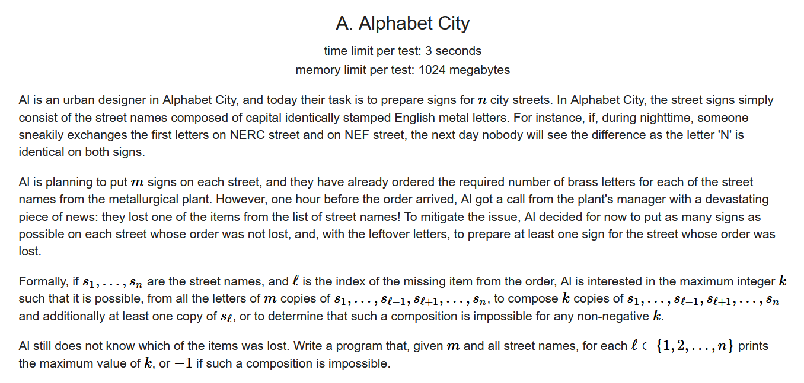
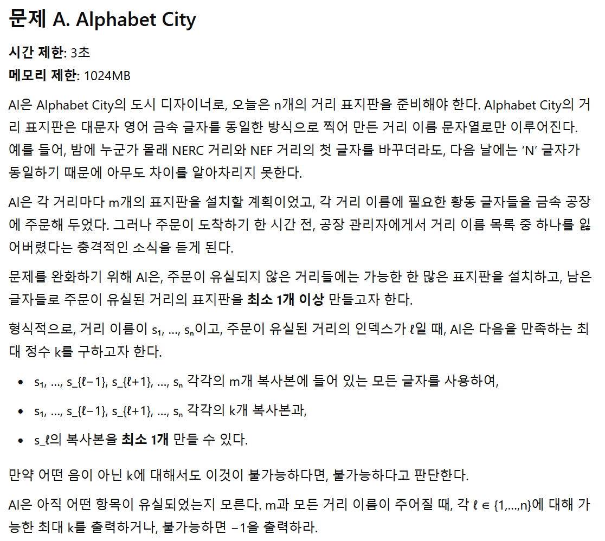

[상위 페이지 · 2025-2026 ICPC, NERC, Northern Eurasia Finals](/study/algorithms/competitive-programming/2025-2026-icpc-nerc-northern-eurasia-finals/)





## 문제 태그

- 그리디
- 문자열

## 아이디어

1. 우선 전체 존재하는 알파벳의 개수를 구한다(= inv). 이는 한 세트를 까면 얻을 수 있는 알파벳의 양이다
2. 각 케이스에 대해 존재하는 알파벳의 개수(= need)를 inv에서 빼어준다.
3. 만약 need에 존재하는데 inv에 존재하지 않는다면 그것은 만들 수 없는 케이스로 -1
4. 그 알파벳이 몇세트가 필요한지는 다음과 같다.
    
    $$
    \frac{need[j]+set[j] - 1 }{set[j]}
    $$
    
5. 각 알파벳에 대해 제일 많이 필요로 하는 개수가 무엇인지 구한다(= ans)
6. 만약 이 ans가 m보다 크다면 못만드는것으로 -1
7. m보다 작다면 k-ans가 답이다

## 정답

```cpp
#include <bits/stdc++.h>

using namespace std;

using ll = long long;
using pii = pair<int, int>;
using vi = vector<int>;
using vll = vector<ll>;
using vpii = vector<pii>;

#define all(x) (x).begin(), (x).end()
#define rall(x) (x).rbegin(), (x).rend()
#define F first
#define S second
#define pb push_back
#define mp make_pair
#define lb lower_bound
#define ub upper_bound

#ifndef ONLINE_JUDGE
template <typename A, typename B>
ostream &operator<<(ostream &os, const pair<A, B> &p)
{
    return os << "{" << p.first << ", " << p.second << "}";
}
template <typename T>
ostream &operator<<(ostream &os, const vector<T> &v)
{
    os << "[";
    for (size_t i = 0; i < v.size(); ++i)
    {
        os << v[i];
        if (i != v.size() - 1)
            os << ", ";
    }
    return os << "]";
}

#define debug(...) cerr << "[DEBUG] " << #__VA_ARGS__ << ": ", DBG(__VA_ARGS__)
template <typename T>
void DBG(const T &v) { cerr << v << endl; }
template <typename T, typename... Args>
void DBG(const T &v, const Args &...args)
{
    cerr << v << ", ";
    DBG(args...);
}
#else
#define debug(...)
#endif

int main()
{
    ios::sync_with_stdio(0);
    cin.tie(0);
    int n, m;
    cin >> n >> m;

    vi inv(26, 0);
    vector<string> s(n);

    for (int i = 0; i < n; i++)
    {
        cin >> s[i];
        for (char c : s[i])
            inv[c - 'A']++;
    }

    for (int i = 0; i < n; i++)
    {
        vi need(26, 0);
        for (char c : s[i])
            need[c - 'A']++;

        int ans = 0;
        bool is_possible = true;

        for (int j = 0; j < 26; j++)
        {
            if (need[j] == 0)
                continue;

            int one_set = inv[j] - need[j];
            int needs = need[j];

            if (one_set == 0)
            {
                is_possible = false;
                break;
            }

            int need_set = (needs + one_set - 1) / one_set;

            ans = max(ans, need_set);
        }

        if (!is_possible || ans > m)
            cout << -1 << (i == n - 1 ? "" : " ");
        else
            cout << m - ans << (i == n - 1 ? "" : " ");
    }

    return 0;
}
```
