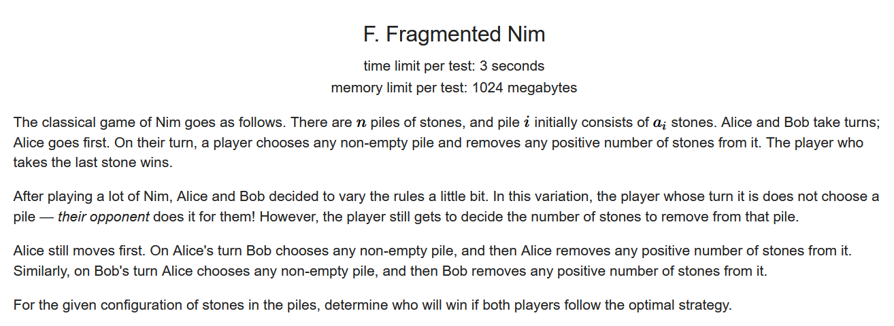
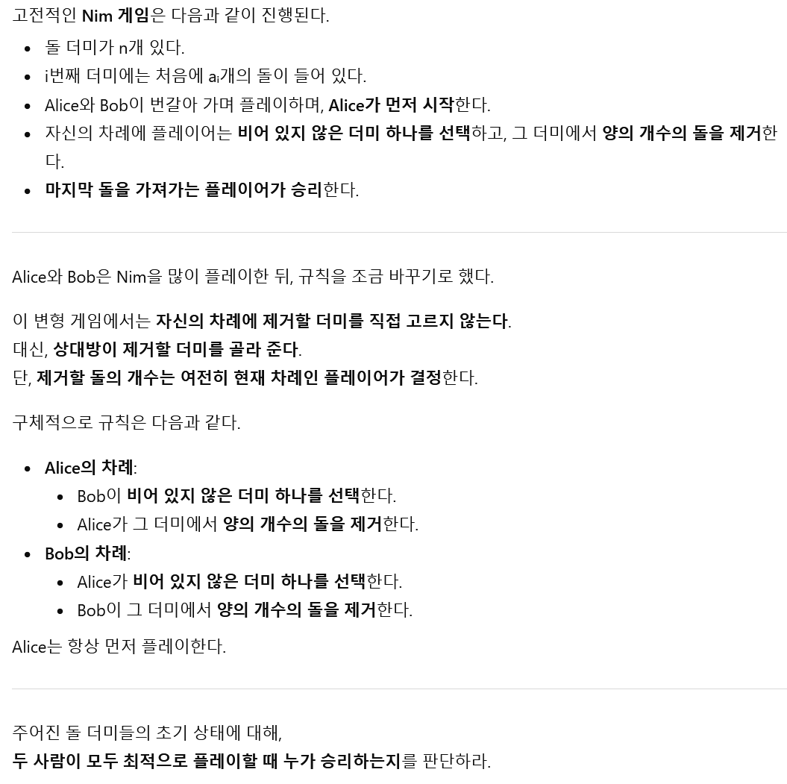

[상위 페이지 · 2025-2026 ICPC, NERC, Northern Eurasia Finals](/study/algorithms/competitive-programming/2025-2026-icpc-nerc-northern-eurasia-finals/)





## 문제 태그

- 그리디
- 게임 이론

## 아이디어

1. 먼저 상대가 선택해준다는 느낌에서 스프라그-그런디로 풀리지 않는다
2. 돌이 한개인 더미는 상대방이 이 더미를 고르면 현재 플레이어가 그 돌을 무조건 가져가야한다.
이 경우 더미가 사라지고 턴이 넘어간다
3. 돌이 1개보다 많은 더미는 상대방이 선택권을 가진다. 다 가져가서 더미를 없앨수도 있고 1개만 남겨서 다음턴에 1개를 강제로 가져가게 만들수도 있다
4. 그리하여 만약 모든 돌더미가 1이라면?
    1. 돌더미의 개수가 홀수라면 앨리스 승
    2. 짝수라면 밥 승
5. 2 이상의 돌더미가 존재한다면?
    1. 이 경우에는 크기가 1인 더미들을 누가 다 처리하고 나서 크기가 1보다 큰 더미를 먼저 마주하느냐의 싸움이 된다
    2. 고로 1의 더미의 개수가 짝수라면 앨리스 승리
    3. 1의 더미의 개수가 홀수라면 밥 승리

## 정답

```cpp
#include <bits/stdc++.h>

using namespace std;

using ll = long long;
using pii = pair<int, int>;
using vi = vector<int>;
using vll = vector<ll>;
using vpii = vector<pii>;

#define all(x) (x).begin(), (x).end()
#define rall(x) (x).rbegin(), (x).rend()
#define F first
#define S second
#define pb push_back
#define mp make_pair
#define lb lower_bound
#define ub upper_bound

#ifndef ONLINE_JUDGE
template <typename A, typename B>
ostream &operator<<(ostream &os, const pair<A, B> &p)
{
    return os << "{" << p.first << ", " << p.second << "}";
}
template <typename T>
ostream &operator<<(ostream &os, const vector<T> &v)
{
    os << "[";
    for (size_t i = 0; i < v.size(); ++i)
    {
        os << v[i];
        if (i != v.size() - 1)
            os << ", ";
    }
    return os << "]";
}

#define debug(...) cerr << "[DEBUG] " << #__VA_ARGS__ << ": ", DBG(__VA_ARGS__)
template <typename T>
void DBG(const T &v) { cerr << v << endl; }
template <typename T, typename... Args>
void DBG(const T &v, const Args &...args)
{
    cerr << v << ", ";
    DBG(args...);
}
#else
#define debug(...)
#endif

int main()
{
    ios::sync_with_stdio(0);
    cin.tie(0);
    int t;
    cin >> t;
    while (t--)
    {
        int n;
        cin >> n;

        int ones = 0;
        for (int i = 0; i < n; ++i)
        {
            int x;
            cin >> x;
            if (x == 1)
                ones++;
        }
        if (ones == n)
            cout << (n & 1 ? "Alice" : "Bob") << "\n";
        else
            cout << (~ones & 1 ? "Alice" : "Bob") << "\n";
    }
    return 0;
}
```
