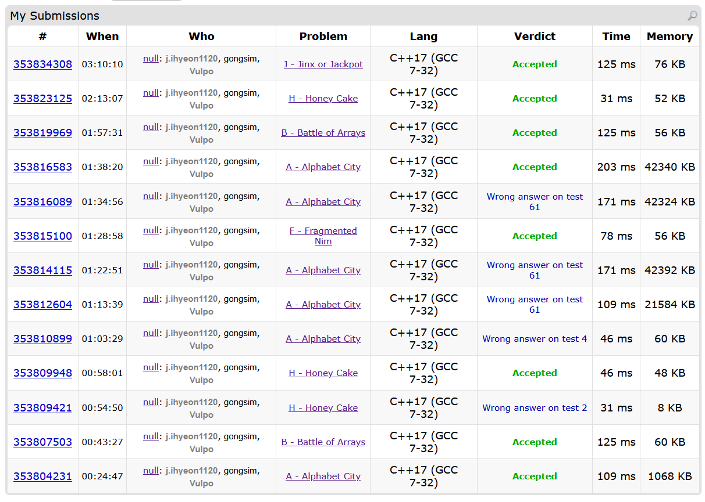
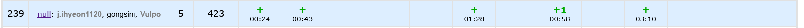

[상위 페이지 · Competitive Programming](/study/algorithms/competitive-programming/)

---

- [A. Alphabet City](/study/algorithms/competitive-programming/2025-2026-icpc-nerc-northern-eurasia-finals/a-alphabet-city/)

- [B. Battle of Arrays](/study/algorithms/competitive-programming/2025-2026-icpc-nerc-northern-eurasia-finals/b-battle-of-arrays/)

- [F. Fragmented Nim](/study/algorithms/competitive-programming/2025-2026-icpc-nerc-northern-eurasia-finals/f-fragmented-nim/)

- [H. Honey Cake](/study/algorithms/competitive-programming/2025-2026-icpc-nerc-northern-eurasia-finals/h-honey-cake/)

- [J. Jinx or Jackpot](/study/algorithms/competitive-programming/2025-2026-icpc-nerc-northern-eurasia-finals/j-jinx-or-jackpot/)
