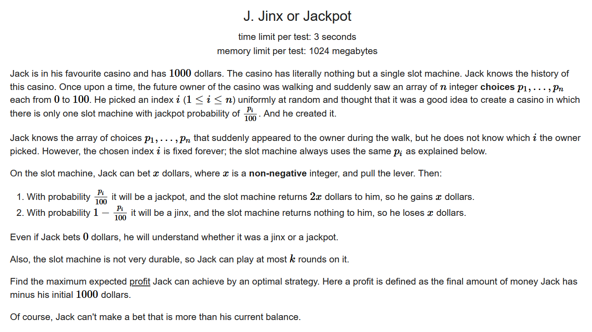
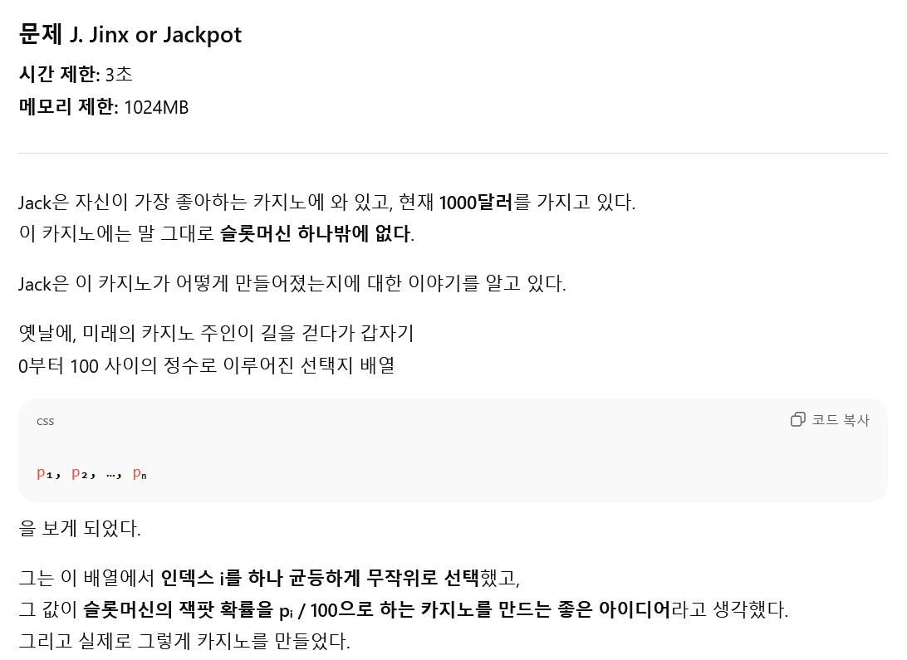
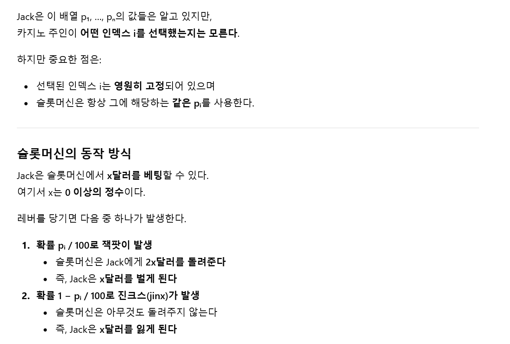
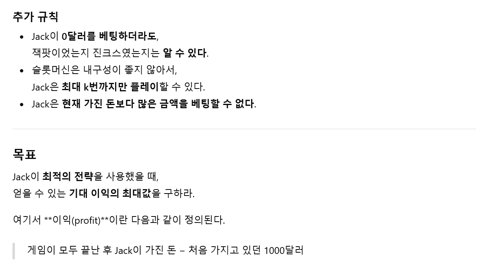

[상위 페이지 · 2025-2026 ICPC, NERC, Northern Eurasia Finals](/study/algorithms/competitive-programming/2025-2026-icpc-nerc-northern-eurasia-finals/)









## 문제 태그

- DP
- 베이즈 정리
- 확률

## 아이디어

### 1단계: 배팅 전략 수립

- **기대 자산 식 유도:** $$E = M + x(2P_{win} - 1)$$
    - 현재 자산 $$M$$원이 있고, $$x$$원을 배팅한다고 가정
    - 승리 시: 자산이 $$M + x$$가 됨 (확률 $$P_{win}$$)
    - 패배 시: 자산이 $$M - x$$가 됨 (확률 $$1 - P_{win}$$)
    - 기댓값: $$E = P_{win}(M + x) + (1 - P_{win})(M - x) = M + x(2P_{win} - 1)$$
- **최적 배팅 결정:**
    - $$P_{win} > 0.5$$일 때: $$2P_{win} - 1 > 0$$이므로 $$x$$가 클수록 기댓값이 증가 → All-in (전액 배팅)
    - $$P_{win} \le 0.5$$일 때: $$2P_{win} - 1 \le 0$$이므로 $$x$$가 작을수록 기댓값이 증가 → Bet 0 (0원 배팅)
- **결론:** 어중간한 금액은 불필요. "전부를 걸거나, 안 걸거나" 두 가지만 고려

### 2단계: 베이지안 확률 추론

- **목적:** 과거 데이터($$w$$승 $$l$$패)로 현재 게임의 진짜 승률 추정
- **가능성 계산:**
    
    $$
    L(i \mid w, l) = (p_i)^w (1-p_i)^l
    $$
    
    - 게임의 진짜 승률이 $$p_i$$일 때, $$w$$번 이기고 $$l$$번 질 확률
- **정규화 상수:**
    
    $$
    S(w, l) = \sum_{k=1}^n L(k \mid w, l)
    $$
    
    - 가능한 모든 승률 $$p_1, p_2, \ldots, p_n$$에 대한 가능성의 총합
    - 베이즈 정리를 적용할 때 분모 역할을 하며, 확률의 합이 1이 되도록 정규화

### 3단계: 다음 판 승률 계산 단순화

- **핵심 테크닉:** 복잡한 조건부 확률 대신 점화식 형태로 변환
- **승률 공식:**
    
    $$
    P_{next\_win} = \frac{S(w+1, l)}{S(w, l)}
    $$
    
    - 현재 $$w$$승 $$l$$패 상태에서 다음 판을 이길 확률
    - 유도: $$P_{next\_win} = \sum_{i=1}^n p_i \cdot P(i \mid w, l) = \sum_{i=1}^n p_i \cdot \frac{L(i \mid w, l)}{S(w, l)}$$
    - 분자를 정리하면: $$\sum_{i=1}^n p_i \cdot (p_i)^w (1-p_i)^l = \sum_{i=1}^n (p_i)^{w+1} (1-p_i)^l = S(w+1, l)$$
- **패율 공식:**
    
    $$
    P_{next\_loss} = \frac{S(w, l+1)}{S(w, l)}
    $$
    
    - 같은 방식으로 유도: $$P_{next\_loss} = \sum_{i=1}^n (1-p_i) \cdot \frac{L(i \mid w, l)}{S(w, l)} = \frac{S(w, l+1)}{S(w, l)}$$
- **의미:** 현재 상태의 총 우도 대비 다음 상태 우도의 비율로 확률을 효율적으로 계산

### 4단계: DP 점화식 설계

- **상태 정의:** $$DP[w][l]$$ = $$w$$승 $$l$$패일 때 자산의 최대 증가 배율
    - 초기 자산을 1로 정규화했을 때, 최종적으로 얻을 수 있는 자산의 기댓값
- **선택지 1 (0원 베팅 & 정보 획득):**
    
    $$
    \frac{S(w+1, l) \cdot DP[w+1][l] + S(w, l+1) \cdot DP[w][l+1]}{S(w, l)}
    $$
    
    - 0원을 걸면 자산은 변하지 않지만 게임 결과(승/패)를 관찰하여 정보를 얻음
    - 승리 확률 $$\frac{S(w+1, l)}{S(w, l)}$$로 $$w+1, l$$ 상태로 이동 → 기댓값 $$DP[w+1][l]$$
    - 패배 확률 $$\frac{S(w, l+1)}{S(w, l)}$$로 $$w, l+1$$ 상태로 이동 → 기댓값 $$DP[w][l+1]$$
    - 전체 기댓값: 각 확률과 미래 가치의 가중 평균
- **선택지 2 (All-in):**
    
    $$
    \frac{2 \cdot S(w+1, l) \cdot DP[w+1][l]}{S(w, l)}
    $$
    
    - 전액을 걸면 승리 시 자산이 2배가 되고, 패배 시 0원이 됨
    - 승리 확률 $$\frac{S(w+1, l)}{S(w, l)}$$로 자산이 2배가 되며 $$w+1, l$$ 상태로 이동
    - 패배하면 자산이 0이 되므로 기댓값에 기여하지 않음
    - 전체 기댓값: $$2 \times$$ (승리 확률) $$\times$$ (미래 가치)
- **최종 결정:** 두 값 중 큰 값 선택
    - 각 상태에서 기댓값을 최대화하는 전략을 선택

### 5단계 : DP 최적화

- 매번 pow 연산을 하면 오래 걸리므로 모든 w,l에 대해 look-up 테이블을 전처리한다

## 정답

```cpp
#include <bits/stdc++.h>

using namespace std;

using ll = long long;
using pii = pair<int, int>;
using vi = vector<int>;
using vll = vector<ll>;
using vpii = vector<pii>;

#define all(x) (x).begin(), (x).end()
#define rall(x) (x).rbegin(), (x).rend()
#define F first
#define S second
#define pb push_back
#define mp make_pair
#define lb lower_bound
#define ub upper_bound

#ifndef ONLINE_JUDGE
template<typename A, typename B>
ostream& operator<<(ostream& os, const pair<A, B>& p) {
    return os << "{" << p.first << ", " << p.second << "}";
}
template<typename T>
ostream& operator<<(ostream& os, const vector<T>& v) {
    os << "[";
    for (size_t i = 0; i < v.size(); ++i) {
        os << v[i];
        if (i != v.size() - 1) os << ", ";
    }
    return os << "]";
}

#define debug(...) cerr << "[DEBUG] " << #__VA_ARGS__ << ": ", DBG(__VA_ARGS__)
template<typename T> void DBG(const T& v) { cerr << v << endl; }
template<typename T, typename... Args> void DBG(const T& v, const Args&... args) { cerr << v << ", "; DBG(args...); }
#else
#define debug(...)
#endif

int N, K;
vi P;

double S_table[35][35]; 

double dp[35][35];
bool visited[35][35];

double solve(int w, int l) {
    if (w + l == K) {
        return 1.0;
    }
    
    if (visited[w][l]) return dp[w][l];

    double current_likelihood = S_table[w][l];

    if (current_likelihood == 0) return dp[w][l] = 0;

    double next_win_S = S_table[w + 1][l];
    double next_loss_S = S_table[w][l + 1];

    double val_win = solve(w + 1, l);
    double val_loss = solve(w, l + 1);

    double option_zero = (next_win_S * val_win + next_loss_S * val_loss);
    double all_in = (2.0 * next_win_S * val_win);

    visited[w][l] = true;
    return dp[w][l] = max(option_zero, all_in) / current_likelihood;
}

int main() {
    ios::sync_with_stdio(0);
    cin.tie(0);
    
    cin >> N >> K;

    P.resize(N);
    for(int i=0; i<N; ++i) {
        cin >> P[i];
    }

    for(int i=0; i<N; ++i) {
        double p = P[i] / 100.0;
        double q = 1.0 - p;

        double p_pow = 1.0;
        for(int w=0; w<=K; ++w) {
            double q_pow = 1.0;
            for(int l=0; l<=K-w; ++l) {
                S_table[w][l] += p_pow * q_pow;
                
                if (l < K-w) q_pow *= q;
            }
            if (w < K) p_pow *= p;
        }
    }

    double max_multiplier = solve(0, 0);
    double result = 1000.0 * max_multiplier - 1000.0;
    cout << fixed << setprecision(5) << result << "\n";
    
    return 0;
}
```
