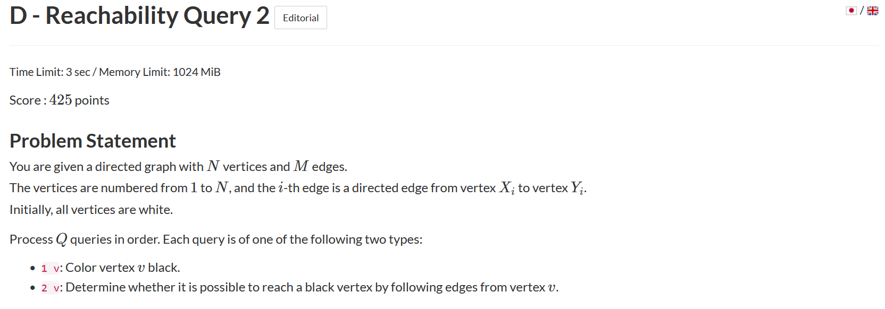
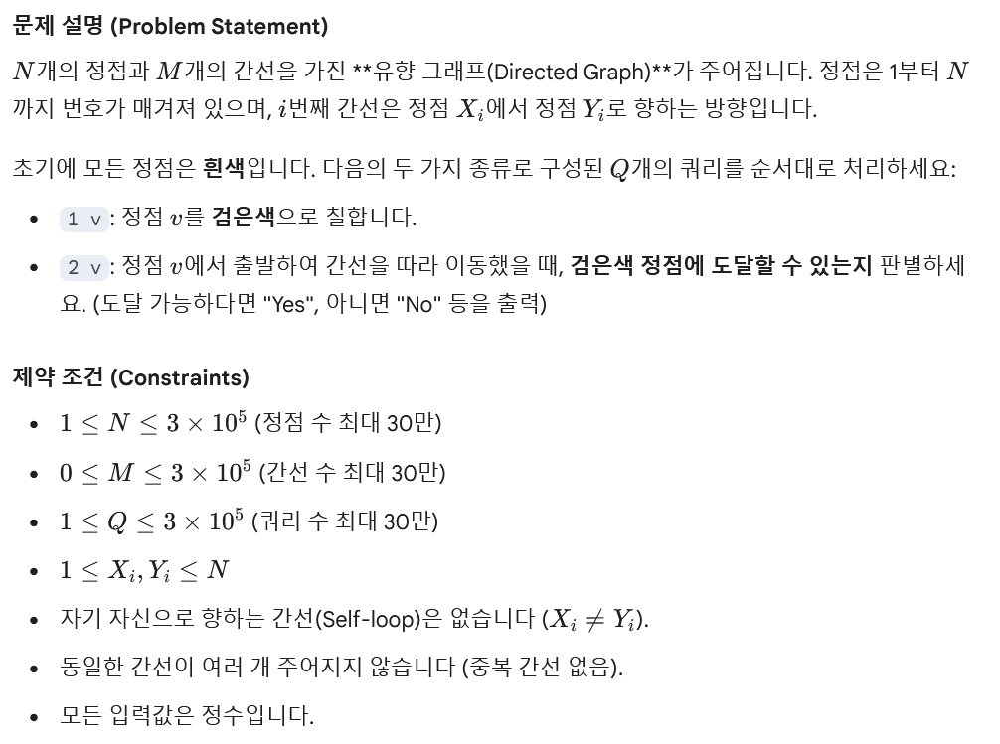

[상위 페이지 · AtCoder Beginner Contest 435](/study/algorithms/competitive-programming/atcoder-beginner-contest-435/)





## 문제 태그

- 그래프 이론

## 아이디어

- 쿼리가 최대 30만개로 2번 쿼리마다 매번 그래프 순회를 돌리면 시간초과가 발생
- 간선의 방향을 반대로 뒤집은 그래프를 만들어 위 문제를 다음과 같이 변형한다
    - “정점 v에서 검은색으로 갈 수 있는가?” → “검은색 정점에서 출발하여 v에 도달할 수 있는가”
- 문제를 다음과 같이 생각하면 검은색 정점이 추가될 때마다 뒤집은 그래프에서 탐색을 **이어나가기**만 하면 된다

## 정답

```cpp
#include <bits/stdc++.h>

using namespace std;

using ll = long long;
using pii = pair<int, int>;
using vi = vector<int>;
using vll = vector<ll>;
using vpii = vector<pii>;

#define all(x) (x).begin(), (x).end()
#define rall(x) (x).rbegin(), (x).rend()
#define F first
#define S second
#define pb push_back
#define mp make_pair
#define lb lower_bound
#define ub upper_bound

#ifndef ONLINE_JUDGE
template<typename A, typename B>
ostream& operator<<(ostream& os, const pair<A, B>& p) {
    return os << "{" << p.first << ", " << p.second << "}";
}
template<typename T>
ostream& operator<<(ostream& os, const vector<T>& v) {
    os << "[";
    for (size_t i = 0; i < v.size(); ++i) {
        os << v[i];
        if (i != v.size() - 1) os << ", ";
    }
    return os << "]";
}

#define debug(...) cerr << "[DEBUG] " << #__VA_ARGS__ << ": ", DBG(__VA_ARGS__)
template<typename T> void DBG(const T& v) { cerr << v << endl; }
template<typename T, typename... Args> void DBG(const T& v, const Args&... args) { cerr << v << ", "; DBG(args...); }
#else
#define debug(...)
#endif

int main() {
    ios::sync_with_stdio(0);
    cin.tie(0);
    
    int N, M;
    cin >> N >> M;

    vector<vi> adj(N + 1);
    for(int i = 0; i < M; ++i) {
        int u, v;
        cin >> u >> v;
        adj[v].pb(u);
    }

    int Q;
    cin >> Q;

    vi visited(N + 1, 0); 

    queue<int> q;

    while(Q--) {
        int type, v;
        cin >> type >> v;
        if (type == 1) {
            if (!visited[v]) {
                visited[v] = 1;
                q.push(v);
                while(!q.empty()) {
                    int curr = q.front();
                    q.pop();

                    for(int next_node : adj[curr]) {
                        if(!visited[next_node]) {
                            visited[next_node] = 1;
                            q.push(next_node);
                        }
                    }
                }
            }
        } else {
            if (visited[v]) cout << "Yes\n";
            else cout << "No\n";
        }
    }
    
    return 0;
}
```
