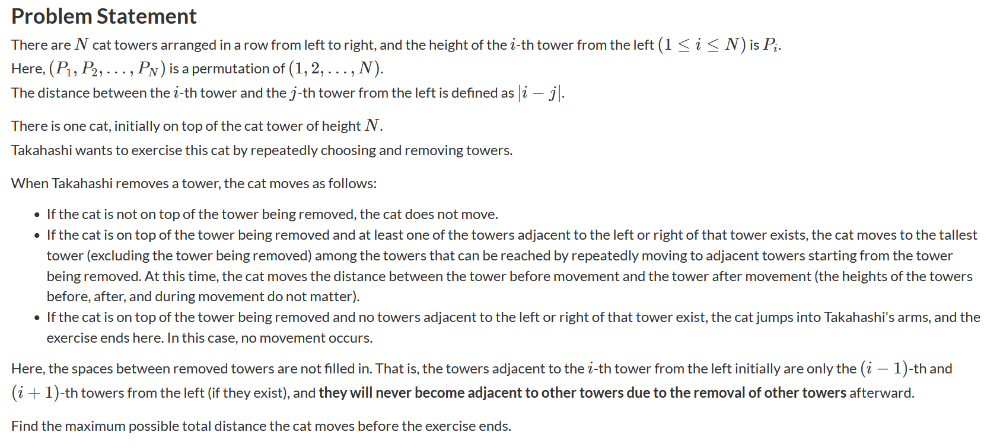
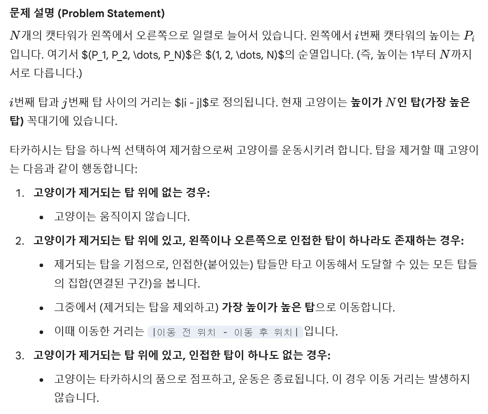

[상위 페이지 · AtCoder Beginner Contest 435](/study/algorithms/competitive-programming/atcoder-beginner-contest-435/)





## 문제 태그

- 자료구조
- 트리에서의 DP
- 데카르트 트리
- 최대힙

## 아이디어

- 문제의 구조인 “가장 높은 탑을 제거하면, 그 왼쪽과 오른쪽 구간이 분리됨”은 데카르트 트리의 정의와 일치한다
    - 구조 : 배열에서 가장 큰 값이 루트가 되고, 그 왼쪽 구간의 최대값이 왼쪽 자식, 오른쪽 구간의 최대값이 오른쪽 자식이 됨
- 이 트리에서 부모 노드가 제거될 때 고양이가 이동할 수 있는 후보는 왼쪽 자식과 오른쪽 자식이 된다
- dp 정의 = dp[u]
    - u : 현재 고양이가 위치한 캣타워
    - dp[u] = 현재 고양이가 u번 탑에 있을 때 이 탑이 제거되면서 시작되는 이후 이동거리 합의 최대값
- 점화식
    - 왼쪽으로 갈때 :
        - 왼쪽 자식 노드u에서 시작하여 오른쪽 자식 방향으로만 계속 내려가는 경로상(RightSpine)의 어떤 노드 v로든 이동할 수 있다
        - 이때 이동거리는 u-v
    - 오른쪽으로 갈때:
        - 오른쪽 자식 노드 u에서 시작하여 왼쪽 자식방향으로만 계속 내려가는 경로(LeftSpine)상의 어떤 노드 v로든 이동할 수 있다
        - 이때의 이동거리는 v-u
    - 최종 점화식
    
    $$
    dp[u] = max\left( \left\{\begin{matrix}
     u +\underset{v\in RightSpine(l[u])}{max}(dp[v] - v)\\-u+\underset{v\in LeftSpine(r[u])}{max}(dp[v] + v)
    \end{matrix}\right.
    \right)
    $$
    
- 매번 Spine을 탐색하면 $$O(N^2)$$이므로 DFS를 수행하며 자식 노드에서 올라올때 최대값을 미리 계산한다. 점화식에서 max(dp[v]-v)와 max(dp[v]+v)를 의미한다
- 자식값이 정해져야 부모 노드값도 정해질 수 있으므로 전위순회를 진행한다

## 정답

```cpp
#include <bits/stdc++.h>
using namespace std;
using ll = long long;
using pii = pair<int, int>;
using vi = vector<int>;
using vll = vector<ll>;
using vpii = vector<pii>;
#define all(x) (x).begin(), (x).end()
#define rall(x) (x).rbegin(), (x).rend()
#define F first
#define S second
#define pb push_back
#define mp make_pair
#define lb lower_bound
#define ub upper_bound
#ifndef ONLINE_JUDGE
template<typename A, typename B>
ostream& operator<<(ostream& os, const pair<A, B>& p) {
    return os << "{" << p.first << ", " << p.second << "}";
}
template<typename T>
ostream& operator<<(ostream& os, const vector<T>& v) {
    os << "[";
    for (size_t i = 0; i < v.size(); ++i) {
        os << v[i];
        if (i != v.size() - 1) os << ", ";
    }
    return os << "]";
}
#define debug(...) cerr << "[DEBUG] " << #__VA_ARGS__ << ": ", DBG(__VA_ARGS__)
template<typename T> void DBG(const T& v) { cerr << v << endl; }
template<typename T, typename... Args> void DBG(const T& v, const Args&... args) { cerr << v << ", "; DBG(args...); }
#else
#define debug(...)
#endif

const int MAXN = 200005;
const ll INF = 1e18;
int n;
int priority[MAXN];
int l[MAXN], r[MAXN];
ll dp[MAXN];          
ll max_minus[MAXN];
ll max_plus[MAXN];

void dfs(int node) {
    if (node == -1) return;

    dfs(l[node]);
    dfs(r[node]);

    ll val_left = -INF;
    ll val_right = -INF;

    if (l[node] != -1) {
        val_left = node + max_minus[l[node]];
    }
    if (r[node] != -1) {
        val_right = -node + max_plus[r[node]];
    }

    if (l[node] == -1 && r[node] == -1) {
        dp[node] = 0;
    } else if (l[node] == -1) {
        dp[node] = val_right;
    } else if (r[node] == -1) {
        dp[node] = val_left;
    } else {
        dp[node] = max(val_left, val_right);
    }

    max_minus[node] = dp[node] - node;
    if (r[node] != -1) {
        max_minus[node] = max(max_minus[node], max_minus[r[node]]);
    }
    
    max_plus[node] = dp[node] + node;
    if (l[node] != -1) {
        max_plus[node] = max(max_plus[node], max_plus[l[node]]);
    }
}
int main() {
    ios::sync_with_stdio(0);
    cin.tie(0);
    if (!(cin >> n)) return 0;
    for (int i = 0; i < n; ++i) {
        cin >> priority[i];
        l[i] = -1;
        r[i] = -1;
    }
    vector<int> stack;
    for (int i = 0; i < n; ++i) {
        int prev = -1;
        while (!stack.empty() && priority[stack.back()] < priority[i]) {
            prev = stack.back();
            stack.pop_back();
        }
        l[i] = prev;
        if (!stack.empty()) {
            r[stack.back()] = i;
        }
        stack.push_back(i);
    }
    int root = -1;
    for (int i = 0; i < n; ++i) {
        if (priority[i] == n) {
            root = i;
            break;
        }
    }
    dfs(root);
    cout << dp[root] << "\n";
    return 0;
}
```
