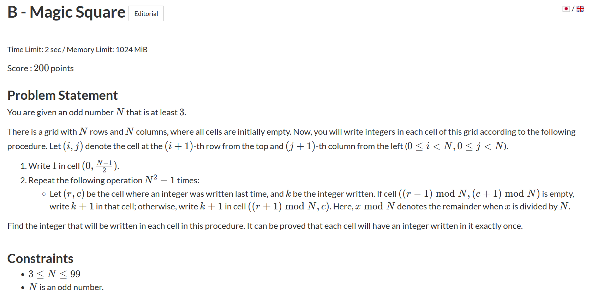
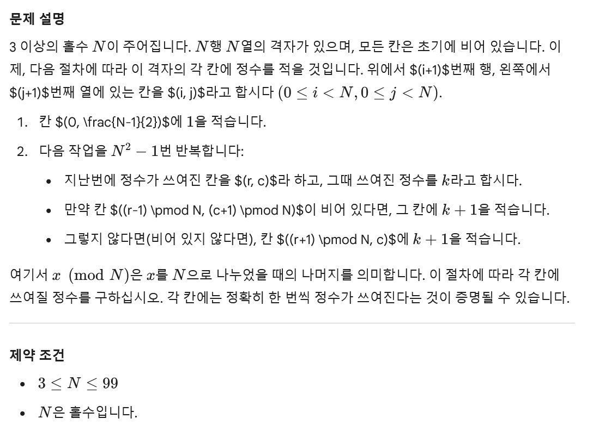

[상위 페이지 · AtCoder Beginner Contest 436](/study/algorithms/competitive-programming/atcoder-beginner-contest-436/)





## 문제 태그

- 구현
- 시뮬레이션

## 아이디어

1. 문제에 주어진 방법 그대로 구현을 한다
2. 다만 cpp는 음수 모듈러 처리가 안되므로 $$r-1 \% N$$을 $$r-1+N\%N$$으로 계산해줘야한다

## 정답

```cpp
#include <bits/stdc++.h>

using namespace std;

using ll = long long;
using pii = pair<int, int>;
using vi = vector<int>;
using vll = vector<ll>;
using vpii = vector<pii>;

#define all(x) (x).begin(), (x).end()
#define rall(x) (x).rbegin(), (x).rend()
#define F first
#define S second
#define pb push_back
#define mp make_pair
#define lb lower_bound
#define ub upper_bound

#ifndef ONLINE_JUDGE
template<typename A, typename B>
ostream& operator<<(ostream& os, const pair<A, B>& p) {
    return os << "{" << p.first << ", " << p.second << "}";
}
template<typename T>
ostream& operator<<(ostream& os, const vector<T>& v) {
    os << "[";
    for (size_t i = 0; i < v.size(); ++i) {
        os << v[i];
        if (i != v.size() - 1) os << ", ";
    }
    return os << "]";
}

#define debug(...) cerr << "[DEBUG] " << #__VA_ARGS__ << ": ", DBG(__VA_ARGS__)
template<typename T> void DBG(const T& v) { cerr << v << endl; }
template<typename T, typename... Args> void DBG(const T& v, const Args&... args) { cerr << v << ", "; DBG(args...); }
#else
#define debug(...)
#endif

int main() {
    ios::sync_with_stdio(0);
    cin.tie(0);
    
    int N;
    cin >> N;

    vector<vector<int>> grid(N, vector<int>(N, 0));

    int r = 0;
    int c = (N - 1) / 2;

    grid[r][c] = 1;

    for (int k = 2; k <= N * N; ++k) {

        int next_r = (r - 1 + N) % N;
        int next_c = (c + 1) % N;

        if (grid[next_r][next_c] == 0) {
            r = next_r;
            c = next_c;
        } else {
            r = (r + 1) % N;
        }
        
        grid[r][c] = k;
    }

    for (int i = 0; i < N; ++i) {
        for (int j = 0; j < N; ++j) {
            cout << grid[i][j] << (j == N - 1 ? "" : " ");
        }
        cout << "\n";
    }
    
    return 0;
}
```
