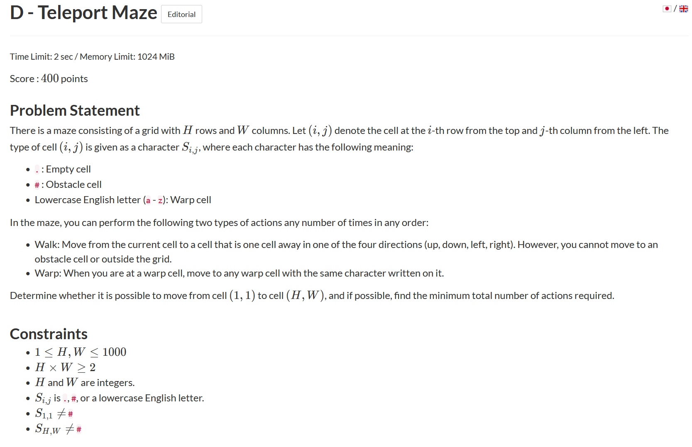
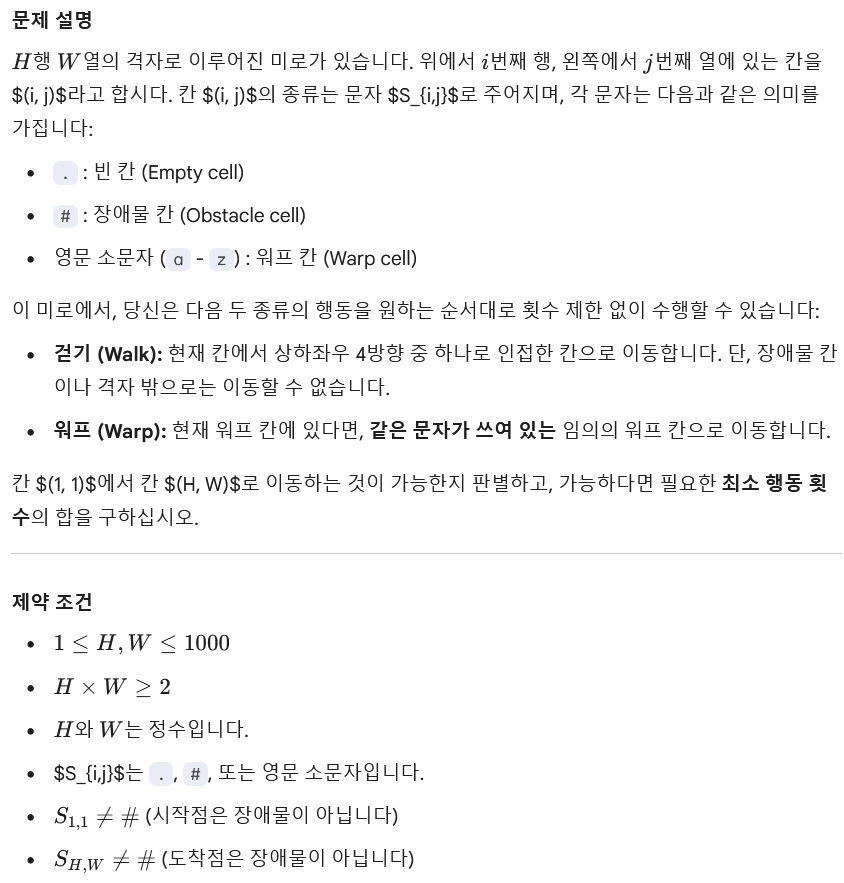

[상위 페이지 · AtCoder Beginner Contest 436](/study/algorithms/competitive-programming/atcoder-beginner-contest-436/)





## 문제 태그

- 그래프 이론
- BFS
- 비트 마스킹

## 아이디어

1. 최단거리를 찾는 정석적인 BFS 문제
2. 포탈끼리 이어지는걸 빠르게 찾기 위해 미리 값을 찾아둠
3. BFS를 돌면서 만나는 포탈은 또 타지 않기 위해 방문 처리를 하는데 비트 마스킹을 하면 조금 더 효율적임

## 정답

```cpp
#include <bits/stdc++.h>

using namespace std;

using ll = long long;
using pii = pair<int, int>;
using vi = vector<int>;
using vll = vector<ll>;
using vpii = vector<pii>;

#define all(x) (x).begin(), (x).end()
#define rall(x) (x).rbegin(), (x).rend()
#define F first
#define S second
#define pb push_back
#define mp make_pair
#define lb lower_bound
#define ub upper_bound

#ifndef ONLINE_JUDGE
template<typename A, typename B>
ostream& operator<<(ostream& os, const pair<A, B>& p) {
    return os << "{" << p.first << ", " << p.second << "}";
}
template<typename T>
ostream& operator<<(ostream& os, const vector<T>& v) {
    os << "[";
    for (size_t i = 0; i < v.size(); ++i) {
        os << v[i];
        if (i != v.size() - 1) os << ", ";
    }
    return os << "]";
}

#define debug(...) cerr << "[DEBUG] " << #__VA_ARGS__ << ": ", DBG(__VA_ARGS__)
template<typename T> void DBG(const T& v) { cerr << v << endl; }
template<typename T, typename... Args> void DBG(const T& v, const Args&... args) { cerr << v << ", "; DBG(args...); }
#else
#define debug(...)
#endif

int dx[] = {-1, 1, 0, 0};
int dy[] = {0, 0, -1, 1};

int main() {
    ios::sync_with_stdio(0);
    cin.tie(0);
    
    int H, W;
    cin >> H >> W;

    vector<string> grid(H);

    vector<pair<int, int>> portals[26];

    for(int i=0; i<H; ++i) {
        cin >> grid[i];
        for(int j=0; j<W; ++j) {
            if(islower(grid[i][j])) {
                portals[grid[i][j] - 'a'].push_back({i, j});
            }
        }
    }

    vector<vector<int>> visited(H, vector<int>(W, -1));
    queue<pair<int, int>> q;

    int visited_portal = 0;

    visited[0][0] = 0;
    q.push({0, 0});

    while(!q.empty()) {
        auto [x, y] = q.front();
        q.pop();

        if(x == H - 1 && y == W - 1) {
            cout << visited[x][y] << "\n";
            return 0;
        }

        for(int i=0; i<4; ++i) {
            int ddx = x + dx[i];
            int ddy = y + dy[i];

            if(ddx >= 0 && ddx < H && ddy >= 0 && ddy < W) {
                if(grid[ddx][ddy] != '#' && visited[ddx][ddy] == -1) {
                    visited[ddx][ddy] = visited[x][y] + 1;
                    q.push({ddx, ddy});
                }
            }
        }

        char current_char = grid[x][y];
        if(islower(current_char)) {
            int p = current_char - 'a';

            if (!(visited_portal & (1 << p))) {

                visited_portal |= (1 << p);

                for(auto next_pos : portals[p]) {
                    int ddx = next_pos.first;
                    int ddy = next_pos.second;

                    if(visited[ddx][ddy] == -1) {
                        visited[ddx][ddy] = visited[x][y] + 1;
                        q.push({ddx, ddy});
                    }
                }
            }
        }
    }

    cout << -1 << "\n";

    return 0;
}
```
