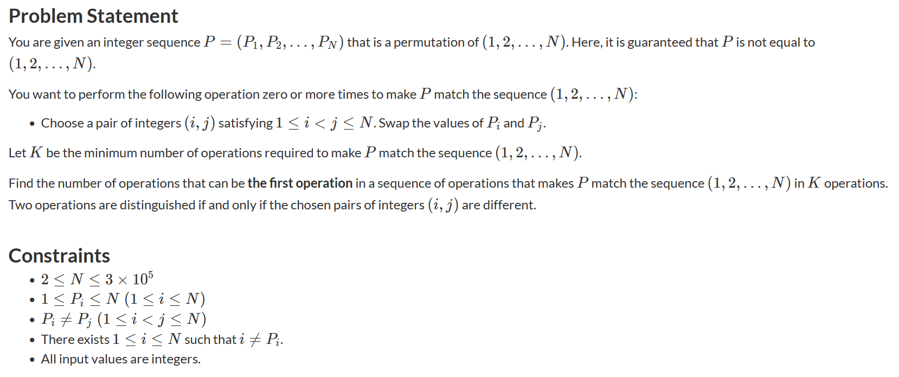
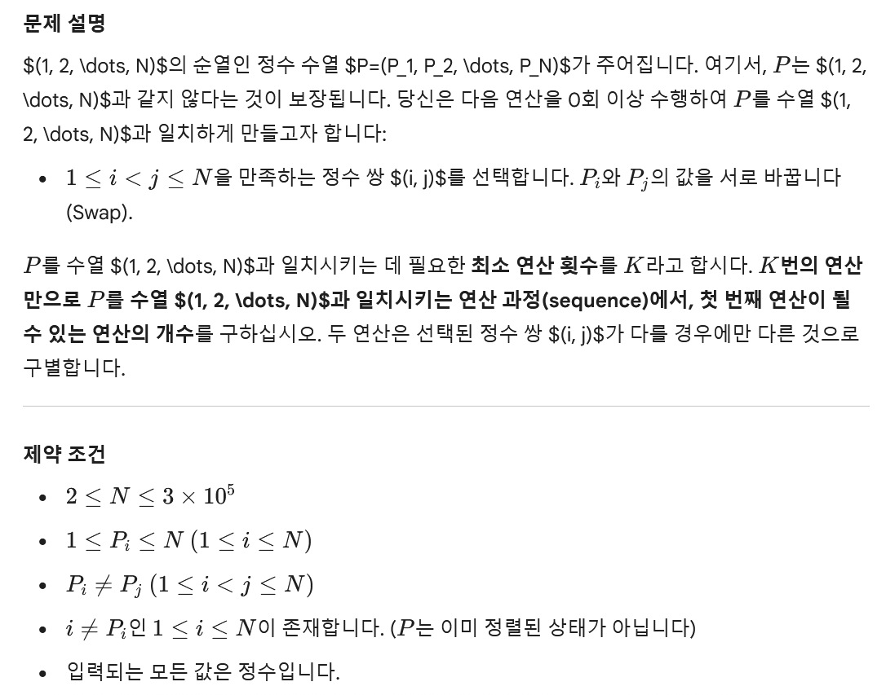

[상위 페이지 · AtCoder Beginner Contest 436](/study/algorithms/competitive-programming/atcoder-beginner-contest-436/)





## 문제 태그

- 순열 사이클 분해
- 그래프 이론
- 조합론
- DFS

## 아이디어

- 순열은 여러개의 독립적인 사이클이 존재한다고 생각할 수 있음
    - 예 P = [3, 1, 2, 4, 5]
    - 1번 위치에 3이 존재 (1 → 3)
    - 3번 위치에 2가 존재 (3 → 2)
    - 2번 위치에 1이 존재 (2 → 1)
    - 4번 위치에는 4가 존재 (4→ 4)
    - 5번 위치에는 5가 존재 (5 → 5)
    - 고로 (1,3,2), (4), (5)라는 사이클이 존재
- 여기서 순열을 정렬한다는것은 모든 원소가 자기 자신을 가르킨다는것
    - 서로 다른 사이클에 있는 두 원소를 스왑하면 사이클이 합쳐지며 정렬에서 멀어짐
    - 서로 같은 사이클에 있는 두 원소를 스왑하면 사이클이 분리 되며 정렬에 가까워짐
- 따라서 최소 횟수로 정렬하기 위해서는 서로 같은 사이클에 있는 두 원소를 스왑하는것
- 고로 다음과 같은 로직으로 최소 횟수를 찾을 수 있다
    1. 전체 순열에서 존재하는 모든 사이클을 찾는다
    2. 각 사이클의 길이(=L)를 구한다
    3. 각 사이클 내부에서 원소 2개를 고르는 경우의 수 $$_LC_2= \frac{L(L-1)}{2}$$를 구한다

## 정답

```cpp
#include <bits/stdc++.h>

using namespace std;

using ll = long long;
using pii = pair<int, int>;
using vi = vector<int>;
using vll = vector<ll>;
using vpii = vector<pii>;

#define all(x) (x).begin(), (x).end()
#define rall(x) (x).rbegin(), (x).rend()
#define F first
#define S second
#define pb push_back
#define mp make_pair
#define lb lower_bound
#define ub upper_bound

#ifndef ONLINE_JUDGE
template<typename A, typename B>
ostream& operator<<(ostream& os, const pair<A, B>& p) {
    return os << "{" << p.first << ", " << p.second << "}";
}
template<typename T>
ostream& operator<<(ostream& os, const vector<T>& v) {
    os << "[";
    for (size_t i = 0; i < v.size(); ++i) {
        os << v[i];
        if (i != v.size() - 1) os << ", ";
    }
    return os << "]";
}

#define debug(...) cerr << "[DEBUG] " << #__VA_ARGS__ << ": ", DBG(__VA_ARGS__)
template<typename T> void DBG(const T& v) { cerr << v << endl; }
template<typename T, typename... Args> void DBG(const T& v, const Args&... args) { cerr << v << ", "; DBG(args...); }
#else
#define debug(...)
#endif

int main() {
    ios::sync_with_stdio(0);
    cin.tie(0);
    
    int N;
    cin >> N;
    
    vi P(N);
    for(int i = 0; i < N; i++) {
        cin >> P[i];
        P[i]--;
    }
    
    vector<bool> visited(N, false);
    ll ans = 0;
    
    for(int i = 0; i < N; i++) {
        if (!visited[i]) {
            ll len = 0;
            int curr = i;

            while (!visited[curr]) {
                visited[curr] = true;
                curr = P[curr];
                len++;
            }
            
            ans += (len * (len - 1)) / 2;
        }
    }
    
    cout << ans << "\n";
    
    return 0;
}
```
