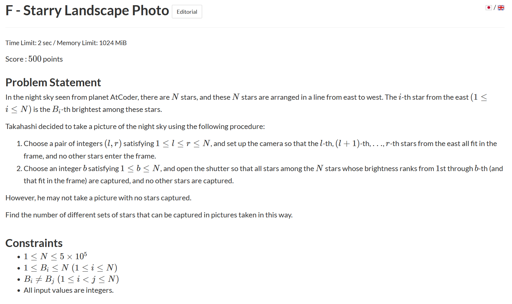
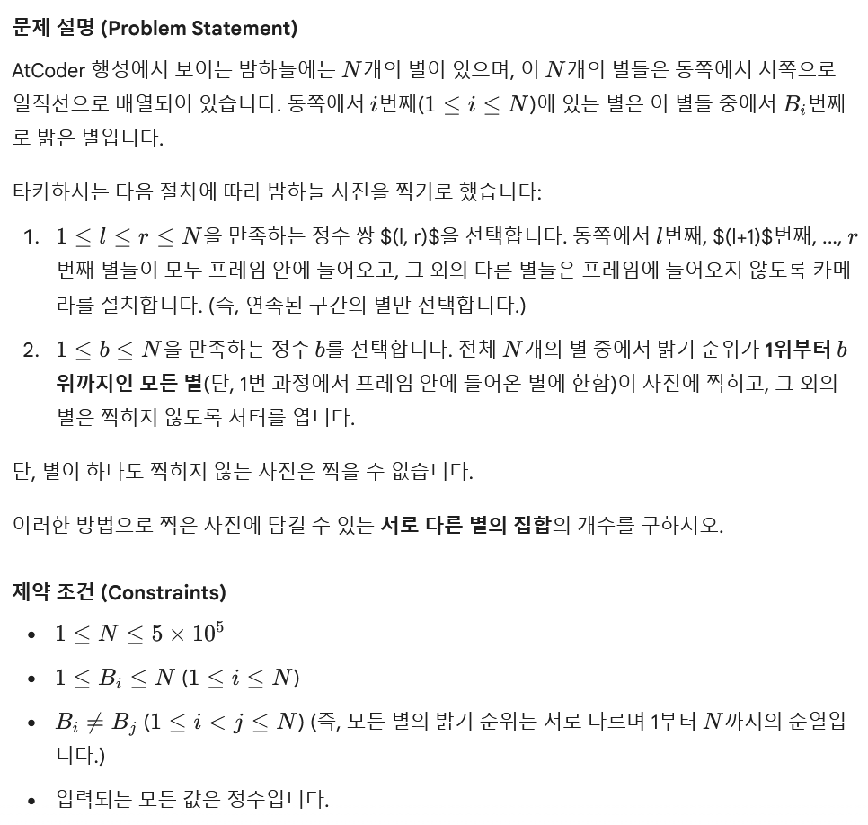

[상위 페이지 · AtCoder Beginner Contest 436](/study/algorithms/competitive-programming/atcoder-beginner-contest-436/)





## 문제 태그

- 펜윅 트리
- 조합론

## 아이디어

1. 문제의 핵심은 중복을 세지 않는것
    - 이를 위해 “이 집합에 포함된 별 중 가장 어두운 별은 어떤 별인가?”를 기준으로 잡는다
    - 모든 유효한 별 집합은 반드시 하나의 어두운 별을 가진다
    - 따라서 밝기가 v인 별이 “가장 어두운 별이 되는 집합”의 개수를 더한다
2. 고로 중복을 세지 않기 위하여 밝기를 1→N까지 순서대로 처리한다
3. 현재 나보다 밝은 별이 내 왼쪽/오른쪽에 몇개나 있는지 빠른 쿼리를 위해 펜윅트리를 도입한다
4. 이제 밝기 v인 별을 포함하면서, 그보다 밝은 별들로만 이루어진 연속된 구간을 찾아야한다
    
    $$\because$$ v보다 어두운 별은 배열 중간에 끼어있어도 B 필터링 조건에 의해 자동으로 사라짐
    
5. 경우의 수 계산
    - 왼쪽으로 확장 가능한 범위 : 0~l개 선택 가능
    - 오른쪽으로 확장 가능한 범위 : 0~r개 선택 가능
    - 따라서 밝기 v가 가장 어두울 때의 집합의 개수는 $$(l+1)(r+1)$$개가 된다.
6. 경우의 수를 정답에 더해주고 v를 펜윅트리에 업데이트한다.

## 정답

```cpp
#include <bits/stdc++.h>

using namespace std;

using ll = long long;
using pii = pair<int, int>;
using vi = vector<int>;
using vll = vector<ll>;
using vpii = vector<pii>;

#define all(x) (x).begin(), (x).end()
#define rall(x) (x).rbegin(), (x).rend()
#define F first
#define S second
#define pb push_back
#define mp make_pair
#define lb lower_bound
#define ub upper_bound

#ifndef ONLINE_JUDGE
template<typename A, typename B>
ostream& operator<<(ostream& os, const pair<A, B>& p) {
    return os << "{" << p.first << ", " << p.second << "}";
}
template<typename T>
ostream& operator<<(ostream& os, const vector<T>& v) {
    os << "[";
    for (size_t i = 0; i < v.size(); ++i) {
        os << v[i];
        if (i != v.size() - 1) os << ", ";
    }
    return os << "]";
}

#define debug(...) cerr << "[DEBUG] " << #__VA_ARGS__ << ": ", DBG(__VA_ARGS__)
template<typename T> void DBG(const T& v) { cerr << v << endl; }
template<typename T, typename... Args> void DBG(const T& v, const Args&... args) { cerr << v << ", "; DBG(args...); }
#else
#define debug(...)
#endif

struct Fenwick {
    int size;
    vll tree;

    Fenwick(int n) : size(n), tree(n + 1, 0) {}

    void update(int i, int val) {
        while (i <= size) {
            tree[i] += val;
            i += (i & -i);
        }
    }

    ll query(int i) {
        ll res = 0;
        while (i > 0) {
            res += tree[i];
            i -= (i & -i);
        }
        return res;
    }
};

int main() {
    ios::sync_with_stdio(0);
    cin.tie(0);
    
    int N;
    cin >> N;

    vi pos(N + 1);
    for (int i = 1; i <= N; ++i) {
        int b;
        cin >> b;
        pos[b] = i;
    }

    Fenwick ft(N);
    ll ans = 0;

    for (int v = 1; v <= N; ++v) {
        int idx = pos[v];

        ll l = ft.query(idx);
        ll r = (v - 1) - l;
        ans += (l + 1) * (r + 1);

        ft.update(idx, 1);
    }

    cout << ans << "\n";

    return 0;
}
```
