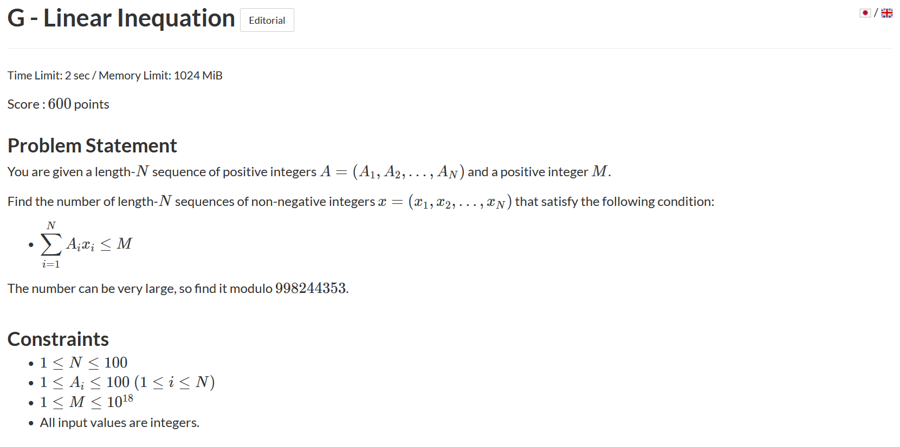
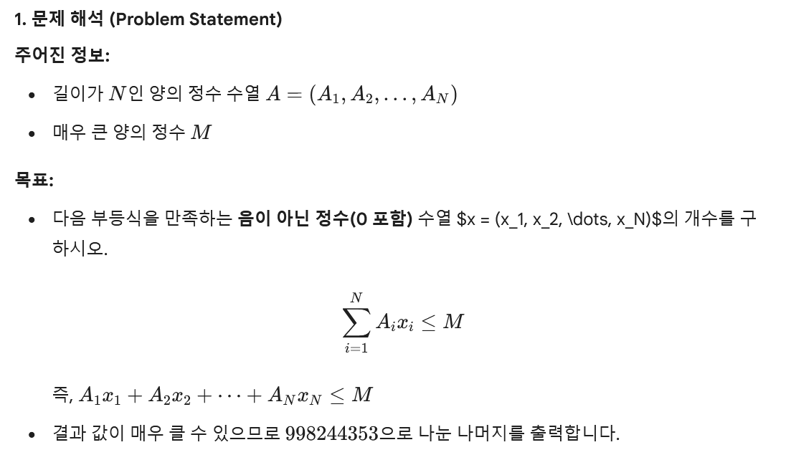

[상위 페이지 · AtCoder Beginner Contest 436](/study/algorithms/competitive-programming/atcoder-beginner-contest-436/)





## 문제 태그

- 수학
- 생성함수
- FFT
- 선형 점화식
- 분할 정복
- 보스턴-모리

## 아이디어

1. 먼저 합이 정확히 k가 되는 경우의 수에 대해서 생각한다. 이는 다음 다항식의 곱에 $$z^k$$계수를 구하는것과 동일하다. 각 $$A_i$$에 대해서 $$x_i$$가 0, 1, 2, 3, … 일때의 기여도는 다음과 같이 무한 등비 급수 꼴의 다항식으로 표현된다
    
    $$
    (1 + Z^{A_i} + Z^{2A_i} + ...) = \frac{1}{1-z^{A_i}}
    $$
    
    전체 수열 A에 대해 합이 정확히 k가 되는 경우의 수는 다음 식과 같다
    
    $$
    F(z) = \prod^N_{i=1} \frac{1}{1-z^{A_i}}
    $$
    
2. 우리는 결국 합이 M 이하인 모든 경우를 구해야한다. F(z)의 계수를 0~M까지 모두 더하는것과 같다. 이는 수학적으로 F(z)에 $$\frac{1}{1-z}$$를 곱한뒤 M차항의 계수를 모두 구하는것과 동일하다
    
    $$
    G(z) = \frac{1}{1-z}\prod^N_{i=1} \frac{1}{1-z^{A_i}}
    $$
    
3. 이를 해결하는 알고리즘이 보스턴-모리 알고리즘으로 라이브러리에서 가져왔다

## 정답

```cpp
#include <bits/stdc++.h>

using namespace std;

using ll = long long;
using pii = pair<int, int>;
using vi = vector<int>;
using vll = vector<ll>;
using vpii = vector<pii>;

#define all(x) (x).begin(), (x).end()
#define rall(x) (x).rbegin(), (x).rend()
#define F first
#define S second
#define pb push_back
#define mp make_pair
#define lb lower_bound
#define ub upper_bound

#ifndef ONLINE_JUDGE
template<typename A, typename B>
ostream& operator<<(ostream& os, const pair<A, B>& p) {
    return os << "{" << p.first << ", " << p.second << "}";
}
template<typename T>
ostream& operator<<(ostream& os, const vector<T>& v) {
    os << "[";
    for (size_t i = 0; i < v.size(); ++i) {
        os << v[i];
        if (i != v.size() - 1) os << ", ";
    }
    return os << "]";
}

#define debug(...) cerr << "[DEBUG] " << #__VA_ARGS__ << ": ", DBG(__VA_ARGS__)
template<typename T> void DBG(const T& v) { cerr << v << endl; }
template<typename T, typename... Args> void DBG(const T& v, const Args&... args) { cerr << v << ", "; DBG(args...); }
#else
#define debug(...)
#endif

template <int MOD>
struct ModInt {
    int value;
    ModInt(long long v = 0) { if (v < 0) v = v % MOD + MOD; if (v >= MOD) v %= MOD; value = v; }
    
    int val() const { return value; }
    static constexpr int mod() { return MOD; }
    static constexpr int get_primitive_root() {
        if (MOD == 998244353) return 3;
        if (MOD == 167772161) return 3;
        if (MOD == 469762049) return 3;
        return 3;
    }
    
    ModInt operator-() const { return value ? MOD - value : 0; }
    ModInt inv() const {
        int a = value, b = MOD, u = 1, v = 0;
        while (b) {
            int t = a / b;
            a -= t * b; swap(a, b);
            u -= t * v; swap(u, v);
        }
        return ModInt(u);
    }
    ModInt pow(long long n) const {
        ModInt res = 1, base = *this;
        while (n) {
            if (n & 1) res *= base;
            base *= base;
            n >>= 1;
        }
        return res;
    }
    
    ModInt& operator+=(const ModInt& o) { value += o.value; if (value >= MOD) value -= MOD; return *this; }
    ModInt& operator-=(const ModInt& o) { value -= o.value; if (value < 0) value += MOD; return *this; }
    ModInt& operator*=(const ModInt& o) { value = (long long)value * o.value % MOD; return *this; }
    ModInt& operator/=(const ModInt& o) { return *this *= o.inv(); }
    
    friend ModInt operator+(ModInt a, const ModInt& b) { return a += b; }
    friend ModInt operator-(ModInt a, const ModInt& b) { return a -= b; }
    friend ModInt operator*(ModInt a, const ModInt& b) { return a *= b; }
    friend ModInt operator/(ModInt a, const ModInt& b) { return a /= b; }
    friend bool operator==(const ModInt& a, const ModInt& b) { return a.value == b.value; }
    friend bool operator!=(const ModInt& a, const ModInt& b) { return a.value != b.value; }
    friend ostream& operator<<(ostream& os, const ModInt& m) { return os << m.value; }
};

using mint = ModInt<998244353>;

template <typename MODINT>
std::vector<MODINT> nttconv(std::vector<MODINT> a, std::vector<MODINT> b, bool skip_garner);

constexpr int nttprimes[3] = {998244353, 167772161, 469762049};

template <typename MODINT> void ntt(std::vector<MODINT> &a, bool is_inverse = false) {
    int n = a.size();
    if (n == 1) return;
    static const int mod = MODINT::mod();
    static const MODINT root = MODINT::get_primitive_root();
    assert(__builtin_popcount(n) == 1 and (mod - 1) % n == 0);

    static std::vector<MODINT> w{1}, iw{1};
    for (int m = w.size(); m < n / 2; m *= 2) {
        MODINT dw = root.pow((mod - 1) / (4 * m)), dwinv = 1 / dw;
        w.resize(m * 2), iw.resize(m * 2);
        for (int i = 0; i < m; i++) w[m + i] = w[i] * dw, iw[m + i] = iw[i] * dwinv;
    }

    if (!is_inverse) {
        for (int m = n; m >>= 1;) {
            for (int s = 0, k = 0; s < n; s += 2 * m, k++) {
                for (int i = s; i < s + m; i++) {
                    MODINT x = a[i], y = a[i + m] * w[k];
                    a[i] = x + y, a[i + m] = x - y;
                }
            }
        }
    } else {
        for (int m = 1; m < n; m *= 2) {
            for (int s = 0, k = 0; s < n; s += 2 * m, k++) {
                for (int i = s; i < s + m; i++) {
                    MODINT x = a[i], y = a[i + m];
                    a[i] = x + y, a[i + m] = (x - y) * iw[k];
                }
            }
        }
        MODINT n_inv = MODINT(n).inv();
        for (auto &v : a) v *= n_inv;
    }
}

template <int MOD>
std::vector<ModInt<MOD>> nttconv_(const std::vector<int> &a, const std::vector<int> &b) {
    int sz = a.size();
    assert(a.size() == b.size() and __builtin_popcount(sz) == 1);
    std::vector<ModInt<MOD>> ap(sz), bp(sz);
    for (int i = 0; i < sz; i++) ap[i] = a[i], bp[i] = b[i];
    ntt(ap, false);
    if (a == b) bp = ap; else ntt(bp, false);
    for (int i = 0; i < sz; i++) ap[i] *= bp[i];
    ntt(ap, true);
    return ap;
}

long long garner_ntt_(int r0, int r1, int r2, int mod) {
    using mint2 = ModInt<nttprimes[2]>;
    static const long long m01 = 1LL * nttprimes[0] * nttprimes[1];
    static const long long m0_inv_m1 = ModInt<nttprimes[1]>(nttprimes[0]).inv().val();
    static const long long m01_inv_m2 = mint2(m01).inv().val();

    int v1 = (m0_inv_m1 * (r1 + nttprimes[1] - r0)) % nttprimes[1];
    auto v2 = (mint2(r2) - r0 - mint2(nttprimes[0]) * v1) * m01_inv_m2;
    return (r0 + 1LL * nttprimes[0] * v1 + m01 % mod * v2.val()) % mod;
}

template <typename MODINT>
std::vector<MODINT> nttconv(std::vector<MODINT> a, std::vector<MODINT> b, bool skip_garner) {
    if (a.empty() or b.empty()) return {};
    int sz = 1, n = a.size(), m = b.size();
    while (sz < n + m) sz <<= 1;
    if (sz <= 16) {
        std::vector<MODINT> ret(n + m - 1);
        for (int i = 0; i < n; i++) {
            for (int j = 0; j < m; j++) ret[i + j] += a[i] * b[j];
        }
        return ret;
    }
    int mod = MODINT::mod();
    if (skip_garner or find(begin(nttprimes), end(nttprimes), mod) != end(nttprimes)) {
        a.resize(sz), b.resize(sz);
        if (a == b) { ntt(a, false); b = a; } 
        else { ntt(a, false), ntt(b, false); }
        for (int i = 0; i < sz; i++) a[i] *= b[i];
        ntt(a, true);
        a.resize(n + m - 1);
    } else {
        std::vector<int> ai(sz), bi(sz);
        for (int i = 0; i < n; i++) ai[i] = a[i].val();
        for (int i = 0; i < m; i++) bi[i] = b[i].val();
        auto ntt0 = nttconv_<nttprimes[0]>(ai, bi);
        auto ntt1 = nttconv_<nttprimes[1]>(ai, bi);
        auto ntt2 = nttconv_<nttprimes[2]>(ai, bi);
        a.resize(n + m - 1);
        for (int i = 0; i < n + m - 1; i++)
            a[i] = garner_ntt_(ntt0[i].val(), ntt1[i].val(), ntt2[i].val(), mod);
    }
    return a;
}

template <typename MODINT>
std::vector<MODINT> nttconv(const std::vector<MODINT> &a, const std::vector<MODINT> &b) {
    return nttconv<MODINT>(a, b, false);
}

template <typename Tp>
Tp coefficient_of_rational_function(long long N, std::vector<Tp> num, std::vector<Tp> den) {
    assert(N >= 0);
    while (den.size() and den.back() == Tp(0)) den.pop_back();
    assert(den.size());
    
    int h = 0;
    while (den[h] == Tp(0)) h++;
    if (h > 0) {
        N += h;
        den.erase(den.begin(), den.begin() + h);
    }

    if (den.size() == 1) return N < (ll)num.size() ? num[N] / den[0] : Tp(0);

    while (N) {
        std::vector<Tp> g = den;
        for (size_t i = 1; i < g.size(); i += 2) { g[i] = -g[i]; }
        
        auto conv_num_g = nttconv(num, g);
        int parity = N & 1;
        num.resize((conv_num_g.size() + 1 - parity) / 2);
        for (size_t i = 0; i < num.size(); i++) { 
            num[i] = conv_num_g[i * 2 + parity]; 
        }
        
        auto conv_den_g = nttconv(den, g);
        den.resize((conv_den_g.size() + 1) / 2);
        for (size_t i = 0; i < den.size(); i++) { 
            den[i] = conv_den_g[i * 2]; 
        }
        
        N >>= 1;
    }
    return num[0] / den[0];
}

int main() {
    ios::sync_with_stdio(0);
    cin.tie(0);
    
    int N;
    long long M;
    cin >> N >> M

    vector<int> A(N);
    for(int i = 0; i < N; ++i) cin >> A[i];

    vector<mint> den = {1};

    auto multiply_by_one_minus_xk = [&](int k) {
        den.resize(den.size() + k);
        for (int i = (int)den.size() - 1; i >= k; --i) {
            den[i] -= den[i - k];
        }
    };

    multiply_by_one_minus_xk(1);
    for (int x : A) {
        multiply_by_one_minus_xk(x);
    }

    vector<mint> num = {1};

    mint ans = coefficient_of_rational_function(M, num, den);

    cout << ans.val() << "\n";
    
    return 0;
}
```
