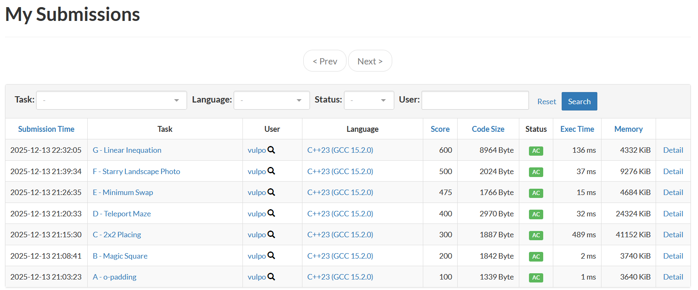
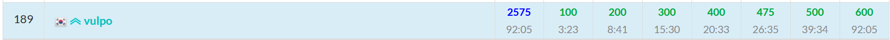

[상위 페이지 · 알고리즘](/study/algorithms/)

---

- [A - o-padding](/study/algorithms/competitive-programming/atcoder-beginner-contest-436/a-o-padding/)

- [B - Magic Square](/study/algorithms/competitive-programming/atcoder-beginner-contest-436/b-magic-square/)

- [C - 2x2 Placing](/study/algorithms/competitive-programming/atcoder-beginner-contest-436/c-2x2-placing/)

- [D - Teleport Maze](/study/algorithms/competitive-programming/atcoder-beginner-contest-436/d-teleport-maze/)

- [E - Minimum Swap](/study/algorithms/competitive-programming/atcoder-beginner-contest-436/e-minimum-swap/)

- [F - Starry Landscape Photo](/study/algorithms/competitive-programming/atcoder-beginner-contest-436/f-starry-landscape-photo/)

- [G - Linear Inequation](/study/algorithms/competitive-programming/atcoder-beginner-contest-436/g-linear-inequation/)
