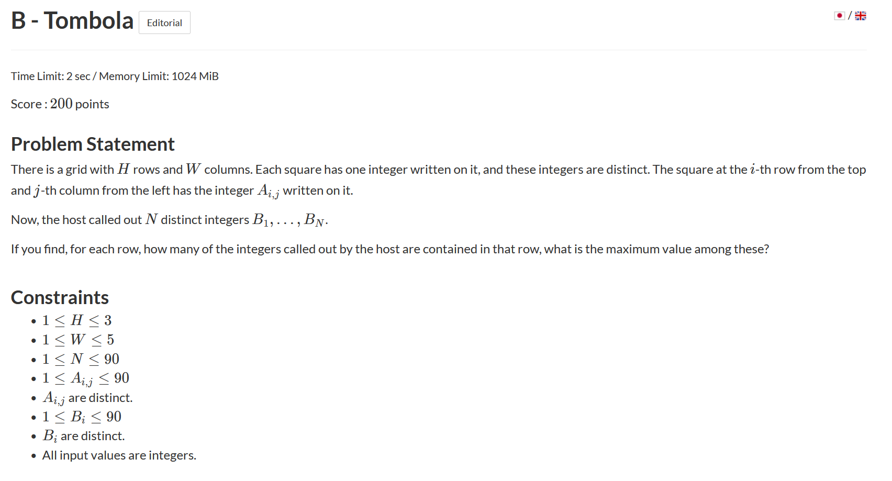
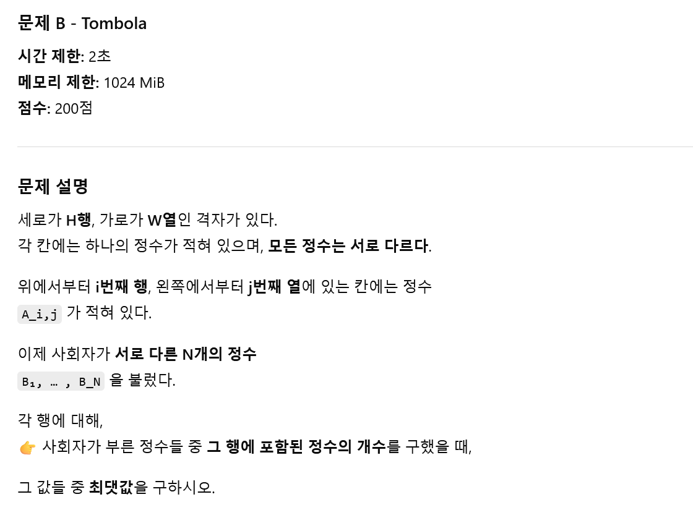

[상위 페이지 · AtCoder Beginner Contest 437](/study/algorithms/competitive-programming/atcoder-beginner-contest-437/)





## 문제 태그

- 구현

## 아이디어

1. 불린 숫자를 체크하는 배열을 만든다 (= is_called)
2. 각 행마다 is_called[A[i][j]]를 통해 불린 숫자인지 확인하고 카운트 한다
3. 각 행 중 가장 큰 카운트를 출력한다

## 정답

```cpp
#include <bits/stdc++.h>

using namespace std;

using ll = long long;
using pii = pair<int, int>;
using vi = vector<int>;
using vll = vector<ll>;
using vpii = vector<pii>;

#define all(x) (x).begin(), (x).end()
#define rall(x) (x).rbegin(), (x).rend()
#define F first
#define S second
#define pb push_back
#define mp make_pair
#define lb lower_bound
#define ub upper_bound

#ifndef ONLINE_JUDGE
template <typename A, typename B>
ostream &operator<<(ostream &os, const pair<A, B> &p)
{
    return os << "{" << p.first << ", " << p.second << "}";
}
template <typename T>
ostream &operator<<(ostream &os, const vector<T> &v)
{
    os << "[";
    for (size_t i = 0; i < v.size(); ++i)
    {
        os << v[i];
        if (i != v.size() - 1)
            os << ", ";
    }
    return os << "]";
}

#define debug(...) cerr << "[DEBUG] " << #__VA_ARGS__ << ": ", DBG(__VA_ARGS__)
template <typename T>
void DBG(const T &v) { cerr << v << endl; }
template <typename T, typename... Args>
void DBG(const T &v, const Args &...args)
{
    cerr << v << ", ";
    DBG(args...);
}
#else
#define debug(...)
#endif

int main()
{
    ios::sync_with_stdio(0);
    cin.tie(0);

    int H, W, N;

    cin >> H >> W >> N;

    vector<vector<int>> A(H, vector<int>(W));
    for (int i = 0; i < H; ++i)
    {
        for (int j = 0; j < W; ++j)
        {
            cin >> A[i][j];
        }
    }

    vector<bool> is_called(91, false);
    for (int i = 0; i < N; ++i)
    {
        int val;
        cin >> val;
        is_called[val] = true;
    }

    int max_cnt = 0;
    for (int i = 0; i < H; ++i)
    {
        int cur_r_cnt = 0;
        for (int j = 0; j < W; ++j)
        {
            if (is_called[A[i][j]]) cur_r_cnt++;
        }
        max_cnt = max(max_cnt, cur_r_cnt);
    }

    cout << max_cnt << "\n";

    return 0;
}
```
