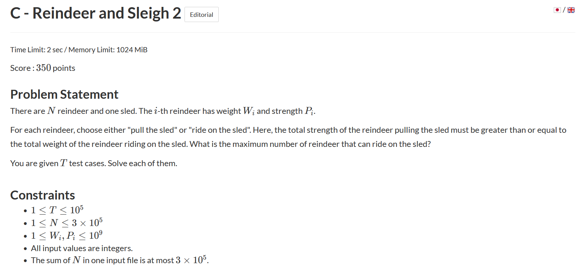
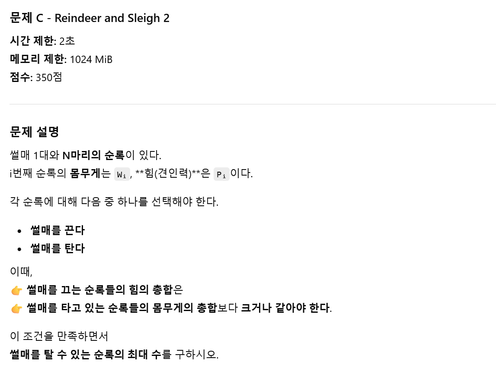

[상위 페이지 · AtCoder Beginner Contest 437](/study/algorithms/competitive-programming/atcoder-beginner-contest-437/)





## 문제 태그

- 그리디

## 아이디어

1. 모든 순록의 힘을 함쳐서 총 예산을 만든다
2. 각 순록을 태울 때 드는 비용(무게 + 힘)을 계산한다
3. 비용이 작은 순록부터 태우는것이 유리하므로 정렬한다
4. 작은 비용부터 하나씩 선택하며 다음을 체크한다
    - 누적 비용이 총 예산을 넘는가?
    - 넘으면 즉시 중단
5. 선택한 순록의 개수가 정답

## 정답

```cpp
#include <bits/stdc++.h>

using namespace std;

using ll = long long;
using pii = pair<int, int>;
using vi = vector<int>;
using vll = vector<ll>;
using vpii = vector<pii>;

#define all(x) (x).begin(), (x).end()
#define rall(x) (x).rbegin(), (x).rend()
#define F first
#define S second
#define pb push_back
#define mp make_pair
#define lb lower_bound
#define ub upper_bound

#ifndef ONLINE_JUDGE
template <typename A, typename B>
ostream &operator<<(ostream &os, const pair<A, B> &p)
{
    return os << "{" << p.first << ", " << p.second << "}";
}
template <typename T>
ostream &operator<<(ostream &os, const vector<T> &v)
{
    os << "[";
    for (size_t i = 0; i < v.size(); ++i)
    {
        os << v[i];
        if (i != v.size() - 1)
            os << ", ";
    }
    return os << "]";
}

#define debug(...) cerr << "[DEBUG] " << #__VA_ARGS__ << ": ", DBG(__VA_ARGS__)
template <typename T>
void DBG(const T &v) { cerr << v << endl; }
template <typename T, typename... Args>
void DBG(const T &v, const Args &...args)
{
    cerr << v << ", ";
    DBG(args...);
}
#else
#define debug(...)
#endif

int main()
{
    ios::sync_with_stdio(0);
    cin.tie(0);

    int T;
    cin >> T;
    while (T--)
    {
        int N;
        cin >> N;

        ll total_strength = 0;
        vll costs;
        costs.reserve(N);

        for (int i = 0; i < N; ++i)
        {
            ll w, p;
            cin >> w >> p;
            total_strength += p;
            costs.pb(w + p);
        }

        sort(all(costs));

        int cnt = 0;
        ll cur_sum = 0;

        for (ll cost : costs)
        {
            if (cur_sum + cost > total_strength)
                break;
            cur_sum += cost;
            cnt++;
        }

        cout << cnt << "\n";
    }

    return 0;
}
```
