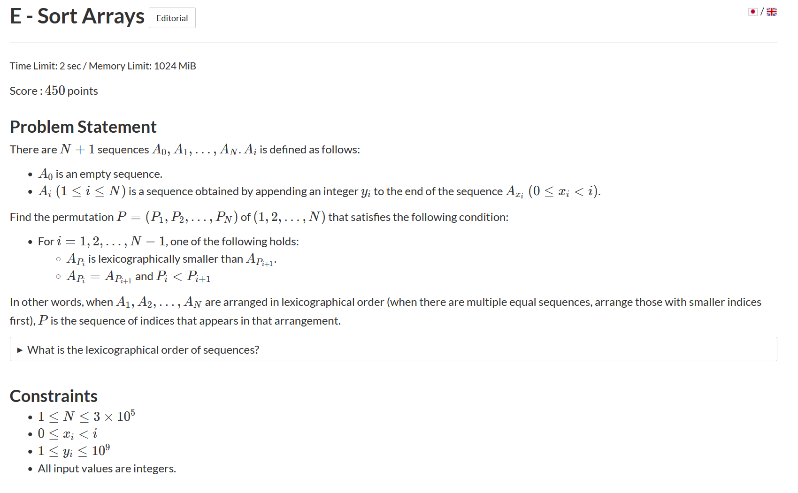
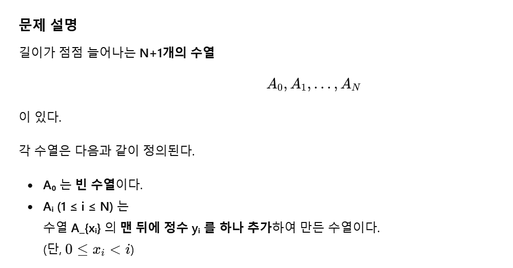
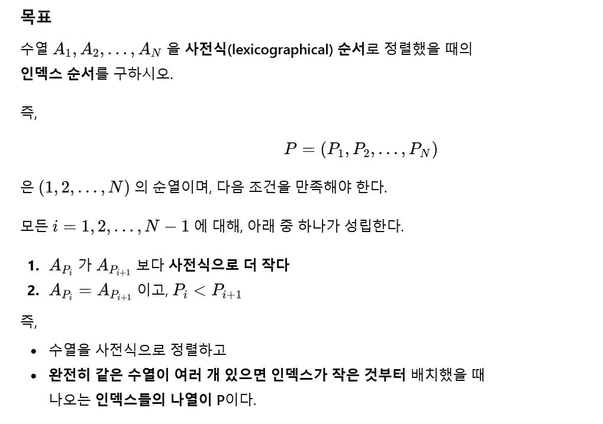
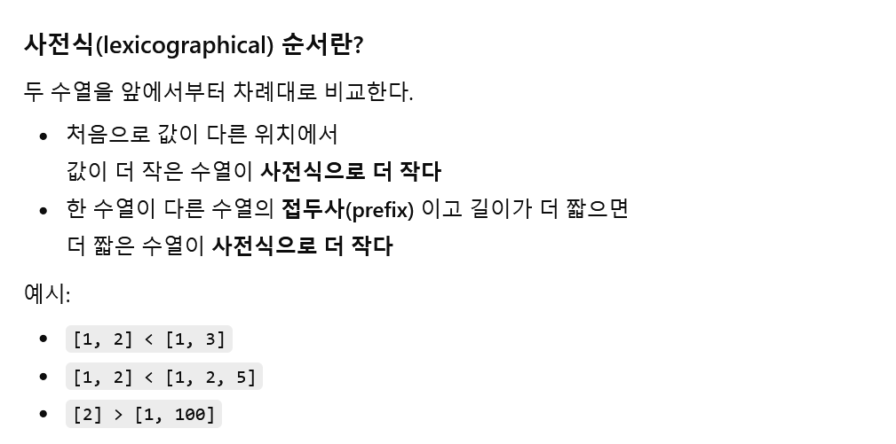

[상위 페이지 · AtCoder Beginner Contest 437](/study/algorithms/competitive-programming/atcoder-beginner-contest-437/)









## 문제 태그

- 자료구조
- 트라이
- 그래프 순회

## 아이디어

1. 우리가 비교해야하는것은 수열의 사전식 순서. 이는 루트부터 내려가며 값을 비교하는 순서를 의미한다. 따라서 문제는 다음과 같이 바뀐다:
트리에서 간선 라벨을 기준으로 사전식 순서대로 노드를 방문한다
    - 각 수열 [x, y]는 부모 노드 x에서 자식 노드로 가는 간선으로 표현되며, 간선의 가중치는 y값
    - 사전식 순서는 트리를 DFS로 순회하되, 각 노드에서 자식들을 간선 가중치(y값) 기준으로 정렬한 후 방문하는 것과 같음
2. 같은 접두사를 가진 수열들은 트리에서 같은 부모 아래에 모여있음
    - 예: [1,2], [1,3], [1,4]는 모두 노드 1의 자식들
    - 이들을 정렬할 때는 y값(2, 3, 4)만 비교하면 됨
3. 사전식 정렬은 다음 규칙과 동일
    1. y값이 작은 쪽이 먼저 출력
    2. y값이 같으면 그 다음 값(다음 깊이의 y값) 비교
    3. 완전히 같으면 인덱스가 작은것부터
4. 이는 Trie를 순회하는것과 동일
    - 각 노드를 방문할 때마다 해당 노드의 자식들을 간선 가중치로 그룹화
    - map을 사용하여 자동으로 가중치 순서대로 정렬
5. 같은 깊이의 노드들을 한번에 처리하고 다음 값 y를 기준에 따라 정렬해준다
    - DFS의 각 레벨에서 현재 방문 중인 노드들의 자식들을 모두 수집
    - 자식들을 y값(간선 가중치)으로 그룹화하여 map에 저장
    - 같은 y값을 가진 노드들은 인덱스 순서대로 정렬 (sort 사용)
    - 그 후 재귀적으로 다음 레벨을 처리

## 정답

```cpp
#include <bits/stdc++.h>

using namespace std;

using ll = long long;
using pii = pair<int, int>;
using vi = vector<int>;
using vll = vector<ll>;
using vpii = vector<pii>;

#define all(x) (x).begin(), (x).end()
#define rall(x) (x).rbegin(), (x).rend()
#define F first
#define S second
#define pb push_back
#define mp make_pair
#define lb lower_bound
#define ub upper_bound

#ifndef ONLINE_JUDGE
template<typename A, typename B>
ostream& operator<<(ostream& os, const pair<A, B>& p) {
    return os << "{" << p.first << ", " << p.second << "}";
}
template<typename T>
ostream& operator<<(ostream& os, const vector<T>& v) {
    os << "[";
    for (size_t i = 0; i < v.size(); ++i) {
        os << v[i];
        if (i != v.size() - 1) os << ", ";
    }
    return os << "]";
}

#define debug(...) cerr << "[DEBUG] " << #__VA_ARGS__ << ": ", DBG(__VA_ARGS__)
template<typename T> void DBG(const T& v) { cerr << v << endl; }
template<typename T, typename... Args> void DBG(const T& v, const Args&... args) { cerr << v << ", "; DBG(args...); }
#else
#define debug(...)
#endif

vector<vpii> adj;

void dfs(const vi& current_nodes) {

    map<int, vi> trie;

    for (int u : current_nodes) {
        if (u != 0) {
            cout << u << " ";
        }

        for (auto& edge : adj[u]) {
            int w = edge.F; 
            int v = edge.S;
            trie[w].pb(v);
        }
    }

    for (auto& [w, next_nodes] : trie) {
        sort(all(next_nodes));
        dfs(next_nodes);
    }
}

int main() {
    ios::sync_with_stdio(0);
    cin.tie(0);
    
    int N;
    cin >> N;
    
    adj.resize(N + 1);
    
    for (int i = 1; i <= N; ++i) {
        int x, y;
        cin >> x >> y;
        adj[x].pb({y, i});
    }
    
    vi start = {0};
    dfs(start);
    
    return 0;
}
```
