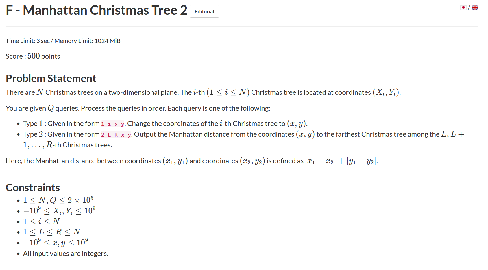
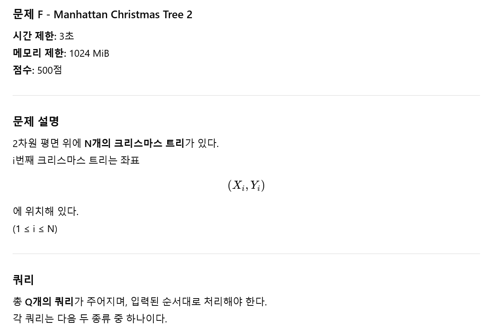
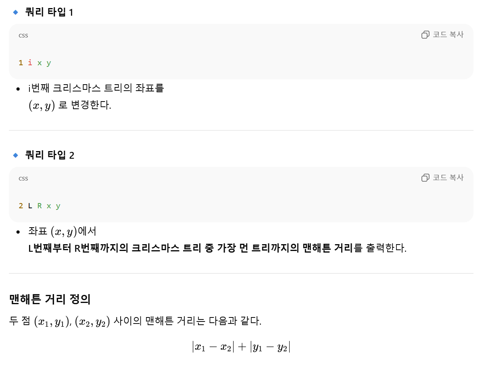

[상위 페이지 · AtCoder Beginner Contest 437](/study/algorithms/competitive-programming/atcoder-beginner-contest-437/)







## 문제 태그

- 자료구조
- 세그먼트 트리
- 수학

## 아이디어

1. 맨해튼의 거리에 절대값을 풀어 다음 4가지 형태 중 하나의 최대값으로 바꿀 수 있다
    
    $$
    	\lvert x_1-x_2\rvert+\lvert y_1-y_2\rvert
    =\max\left\{
    \begin{aligned}
    &(x_1+y_1)-(x_2+y_2)\\
    &(x_1-y_1)-(x_2-y_2)\\
    &(-x_1+y_1)-(-x_2+y_2)\\
    &(-x_1-y_1)-(-x_2-y_2)
    \end{aligned}
    \right\}
    $$
    
    즉 쿼리는 이 4개의 값 중 최대를 뽑는 문제
    
2. 구간 쿼리 + 갱신 + 최댓값 문제
    - 쿼리 타입 1: 한 위치의 값 변경
    - 쿼리 타입 2: 구간 [L,R]에서 최댓값 계산
    - 전형적인 세그먼트 트리 문제 형태
3. 자료구조 설계
    - 각 점 (x,y)를 4개의 값으로 변환하여 저장:
        
        $$
        x+y,\quad x-y,\quad -x+y,\quad -x-y
        $$
        
    - 이 4개 값을 하나의 데이터 구조로 묶어 관리
4. 세그먼트 트리 구조
    - 각 노드는 담당 구간 내에서 4개 값 각각의 최댓값을 저장
    - 구간 병합 시 각 항목별로 최댓값만 취하면 됨
    - 병합 연산이 매우 단순하고 효율적
5. 쿼리 처리 방식
    - 타입 1 (좌표 변경)
        - 해당 인덱스의 점을 새 좌표로 변경
        - 새 좌표를 4개 값으로 변환
        - 세그먼트 트리에서 단일 갱신 수행
    - 타입 2 (최대 맨해튼 거리)
        - 구간 [L,R]에서 4개 값의 최댓값을 한 번에 조회
        - 기준점 (x,y)에 대해 각 항목에서 대응되는 값을 빼줌
        - 그 중 최댓값이 해당 구간에서의 최대 맨해튼 거리
6. 핵심 아이디어 요약
    - 맨해튼 거리를 4가지 선형식의 최댓값으로 변환한 후, 각 구간에서 이 값들의 최댓값을 세그먼트 트리로 관리
7. 직관적 이해
    - 가장 먼 점은 특정 방향(북동, 남동, 북서, 남서)으로 가장 멀리 위치한 점
    - 각 방향별 극값을 미리 관리하면 쿼리 처리가 간단한 뺄셈 연산으로 해결됨

## 정답

```cpp
#include <bits/stdc++.h>
#include <atcoder/segtree>

using namespace std;
using namespace atcoder;

using ll = long long;
using pii = pair<int, int>;
using vi = vector<int>;
using vll = vector<ll>;

#define all(x) (x).begin(), (x).end()
#define rall(x) (x).rbegin(), (x).rend()
#define F first
#define S second
#define pb push_back
#define mp make_pair
#define lb lower_bound
#define ub upper_bound

#ifndef ONLINE_JUDGE
template<typename A, typename B>
ostream& operator<<(ostream& os, const pair<A, B>& p) {
    return os << "{" << p.first << ", " << p.second << "}";
}
template<typename T>
ostream& operator<<(ostream& os, const vector<T>& v) {
    os << "[";
    for (size_t i = 0; i < v.size(); ++i) {
        os << v[i];
        if (i != v.size() - 1) os << ", ";
    }
    return os << "]";
}
#define debug(...) cerr << "[DEBUG] " << #__VA_ARGS__ << ": ", DBG(__VA_ARGS__)
template<typename T> void DBG(const T& v) { cerr << v << endl; }
template<typename T, typename... Args> void DBG(const T& v, const Args&... args) { cerr << v << ", "; DBG(args...); }
#else
#define debug(...)
#endif

const ll INF = 4e18; 

struct Data {
    ll v[4];
};

Data op(Data a, Data b) {
    Data res;
    for(int i = 0; i < 4; i++) {
        res.v[i] = max(a.v[i], b.v[i]);
    }
    return res;
}

Data e() {
    Data res;
    for(int i = 0; i < 4; i++) res.v[i] = -INF;
    return res;
}

Data make_data(ll x, ll y) {
    Data res;
    res.v[0] = x + y;
    res.v[1] = x - y;
    res.v[2] = -x + y;
    res.v[3] = -x - y;
    return res;
}

int main() {
    ios::sync_with_stdio(0);
    cin.tie(0);
    
    int N, Q;
    cin >> N >> Q;

    vector<Data> initial_data(N);
    for(int i = 0; i < N; i++) {
        ll x, y;
        cin >> x >> y;
        initial_data[i] = make_data(x, y);
    }

    segtree<Data, op, e> seg(initial_data);

    while(Q--) {
        int type;
        cin >> type;
        if (type == 1) {
            int i;
            ll x, y;
            cin >> i >> x >> y;
            seg.set(i - 1, make_data(x, y));
        } else {
            int L, R;
            ll x, y;
            cin >> L >> R >> x >> y;

            Data res = seg.prod(L - 1, R);

            ll ans = -INF;
            ans = max(ans, res.v[0] - (x + y));
            ans = max(ans, res.v[1] - (x - y));
            ans = max(ans, res.v[2] - (-x + y));
            ans = max(ans, res.v[3] - (-x - y));
            
            cout << ans << "\n";
        }
    }
    
    return 0;
}
```
