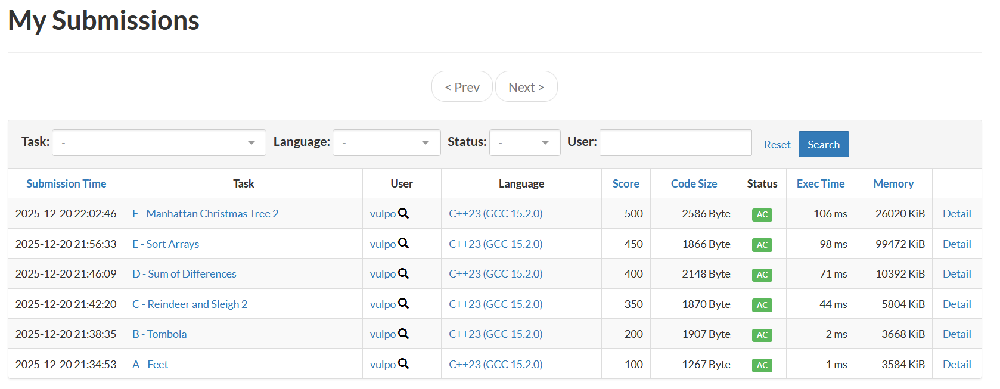
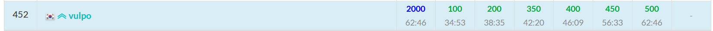

[상위 페이지 · Competitive Programming](/study/algorithms/competitive-programming/)

---

- [A - Feet](/study/algorithms/competitive-programming/atcoder-beginner-contest-437/a-feet/)

- [B - Tombola](/study/algorithms/competitive-programming/atcoder-beginner-contest-437/b-tombola/)

- [C - Reindeer and Sleigh 2](/study/algorithms/competitive-programming/atcoder-beginner-contest-437/c-reindeer-and-sleigh-2/)

- [D - Sum of Differences](/study/algorithms/competitive-programming/atcoder-beginner-contest-437/d-sum-of-differences/)

- [E - Sort Arrays](/study/algorithms/competitive-programming/atcoder-beginner-contest-437/e-sort-arrays/)

- [F - Manhattan Christmas Tree 2](/study/algorithms/competitive-programming/atcoder-beginner-contest-437/f-manhattan-christmas-tree-2/)
