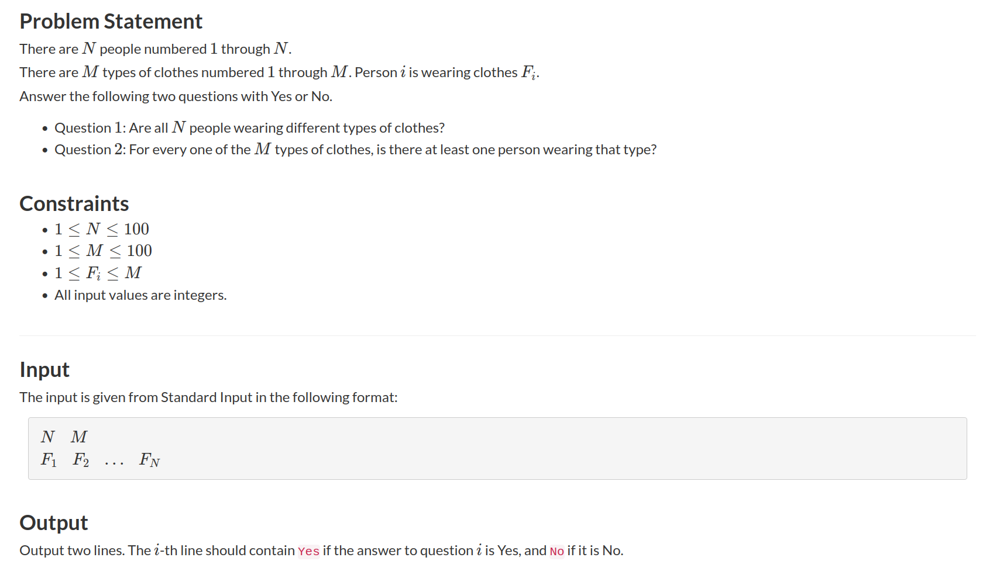

[상위 페이지 · AtCoder Beginner Contest 454](/study/algorithms/competitive-programming/atcoder-beginner-contest-454/)



## 문제 태그

- 구현
- 집합

## 한국어 문제 해석

N명의 사람이 있고, 옷 종류는 1번부터 M번까지 있다. 사람 i는 $$F_i$$번 옷을 입고 있다.

두 질문에 답해야 한다.

- 모든 사람이 서로 다른 종류의 옷을 입고 있는가.
- M종류의 옷이 모두 적어도 한 명에게 입혀져 있는가.

각 질문에 대해 Yes 또는 No를 한 줄씩 출력한다.

## 문제 요약

- N개의 값 $$F_i$$가 주어진다.
- 첫 번째 질문은 중복 여부를 확인하는 문제다.
- 두 번째 질문은 1번부터 M번까지 모든 값이 등장했는지 확인하는 문제다.

## 예시 워크스루

예시 입력에서 N은 3, M은 4이고 옷 번호는 1, 2, 4다.

- 등장한 옷 종류 집합은 1, 2, 4다.
- 집합의 크기는 3이고 사람 수도 3이므로 중복은 없다.
- 옷 종류 수 M은 4인데 집합의 크기는 3이므로 등장하지 않은 옷이 있다.
- 따라서 첫 번째 답은 Yes, 두 번째 답은 No다.

## 아이디어

등장한 옷 번호만 집합에 넣으면 중복은 자동으로 사라진다.

- 집합 크기가 N이면 N명이 모두 다른 옷을 입은 것이다.
- 집합 크기가 M이면 가능한 모든 옷 종류가 적어도 한 번 등장한 것이다.

제약이 작기 때문에 빈도 배열과 집합 모두 가능하다. 현재 코드는 집합을 사용해 두 조건을 크기 비교로 처리한다.

## 구현 포인트

set에 모든 $$F_i$$를 넣는다. 그 뒤 집합의 크기를 N, M과 각각 비교해 출력한다.

## 정답

```cpp
#include <bits/stdc++.h>

using namespace std;

using ll = long long;
using pii = pair<int, int>;
using vi = vector<int>;
using vll = vector<ll>;
using vpii = vector<pii>;

#define all(x) (x).begin(), (x).end()
#define rall(x) (x).rbegin(), (x).rend()
#define sz(x) ((int)((x).size()))
#define F first
#define S second
#define pb push_back
#define mp make_pair
#define lb lower_bound
#define ub upper_bound

#ifndef ONLINE_JUDGE
template<typename A, typename B>
ostream& operator<<(ostream& os, const pair<A, B>& p) {
    return os << "{" << p.first << ", " << p.second << "}";
}
template<typename T>
ostream& operator<<(ostream& os, const vector<T>& v) {
    os << "[";
    for (size_t i = 0; i < v.size(); ++i) {
        os << v[i];
        if (i != v.size() - 1) os << ", ";
    }
    return os << "]";
}

#define debug(...) cerr << "[DEBUG] " << #__VA_ARGS__ << ": ", DBG(__VA_ARGS__)
template<typename T> void DBG(const T& v) { cerr << v << endl; }
template<typename T, typename... Args> void DBG(const T& v, const Args&... args) { cerr << v << ", "; DBG(args...); }
#else
#define debug(...)
#endif

int main() {
    ios::sync_with_stdio(0);
    cin.tie(0);

    int n, m;
    cin >> n >> m;

    set<int> cloth;
    for (int i = 0; i < n; i++) {
        int f;
        cin >> f;
        cloth.insert(f);
    }

    cout << (sz(cloth) == n ? "Yes\n" : "No\n");
    cout << (sz(cloth) == m ? "Yes\n" : "No\n");

    return 0;
}
```

## 검증

### 시간복잡도

각 값을 set에 넣으므로 시간복잡도는 $$O(N log N)$$이다. N과 M이 100 이하라 충분하다.

### 공간복잡도

등장한 옷 번호를 저장하므로 공간복잡도는 $$O(N)$$이다.

### 코너 케이스

- N이 M보다 작으면 두 번째 질문은 반드시 No다.
- N이 M보다 크면 첫 번째 질문은 반드시 No다.
- N과 M이 같고 모든 값이 한 번씩 나오면 두 답 모두 Yes다.
- 같은 옷 번호가 여러 번 나와도 set에는 한 번만 남으므로 중복 판정이 가능하다.
