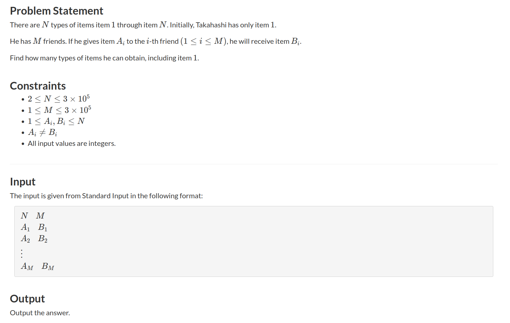
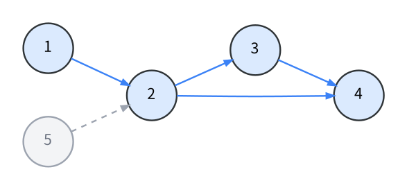

[상위 페이지 · AtCoder Beginner Contest 454](/study/algorithms/competitive-programming/atcoder-beginner-contest-454/)



## 문제 태그

- 그래프
- 너비 우선 탐색
- 도달 가능성

## 한국어 문제 해석

아이템은 1번부터 N번까지 있다. 처음에는 1번 아이템만 가지고 있다.

친구 i에게 $$A_i$$번 아이템을 주면 B_i번 아이템을 받을 수 있다. 이 교환을 통해 최종적으로 얻을 수 있는 아이템 종류 수를 구한다. 처음부터 가지고 있는 1번 아이템도 개수에 포함한다.

## 문제 요약

- 교환 정보 $$A_i$$, $$B_i$$는 방향 간선 $$A_i$$에서 $$B_i$$로 볼 수 있다.
- 처음 가진 아이템은 1번이다.
- 1번에서 시작해 도달 가능한 정점 수가 답이다.

## 예시 워크스루



첫 번째 예시의 간선은 1에서 2, 2에서 3, 3에서 4, 2에서 4, 5에서 2다.

- 처음 방문한 정점은 1이다.
- 1에서 2로 갈 수 있으므로 2를 얻을 수 있다.
- 2에서 3과 4로 갈 수 있으므로 3, 4를 얻을 수 있다.
- 5에서 2로 가는 간선은 있지만 5 자체를 얻을 방법이 없으므로 사용할 수 없다.
- 도달 가능한 정점은 1, 2, 3, 4로 총 4개다.

## 아이디어

각 친구의 교환 조건을 방향 그래프로 바꾸면, 문제는 시작 정점 1에서 도달 가능한 정점 개수를 세는 문제가 된다.

도달 가능성만 필요하므로 탐색 순서는 중요하지 않다. 현재 코드는 큐를 사용한 너비 우선 탐색으로 방문 가능한 아이템을 센다.

## 구현 포인트

인접 리스트 adj에 $$A_i$$에서 $$B_i$$로 가는 간선을 저장한다. visited 배열로 이미 얻은 아이템을 체크하고, 큐에서 하나씩 꺼내 다음 아이템을 확장한다.

## 정답

```cpp
#include <bits/stdc++.h>

using namespace std;

using ll = long long;
using pii = pair<int, int>;
using vi = vector<int>;
using vll = vector<ll>;
using vpii = vector<pii>;

#define all(x) (x).begin(), (x).end()
#define rall(x) (x).rbegin(), (x).rend()
#define sz(x) ((int)((x).size()))
#define F first
#define S second
#define pb push_back
#define mp make_pair
#define lb lower_bound
#define ub upper_bound

#ifndef ONLINE_JUDGE
template<typename A, typename B>
ostream& operator<<(ostream& os, const pair<A, B>& p) {
    return os << "{" << p.first << ", " << p.second << "}";
}
template<typename T>
ostream& operator<<(ostream& os, const vector<T>& v) {
    os << "[";
    for (size_t i = 0; i < v.size(); ++i) {
        os << v[i];
        if (i != v.size() - 1) os << ", ";
    }
    return os << "]";
}

#define debug(...) cerr << "[DEBUG] " << #__VA_ARGS__ << ": ", DBG(__VA_ARGS__)
template<typename T> void DBG(const T& v) { cerr << v << endl; }
template<typename T, typename... Args> void DBG(const T& v, const Args&... args) { cerr << v << ", "; DBG(args...); }
#else
#define debug(...)
#endif

int main() {
    ios::sync_with_stdio(0);
    cin.tie(0);

    int n, m;
    cin >> n >> m;

    vector<vi> adj(n + 1);
    for (int i = 0; i < m; i++) {
        int a, b;
        cin >> a >> b;
        adj[a].pb(b);
    }

    vi visited(n + 1);
    queue<int> q;
    q.push(1);
    visited[1] = 1;

    int ans = 0;
    while (!q.empty()) {
        int cur = q.front();
        q.pop();
        ans++;

        for (int node : adj[cur]) {
            if (visited[node]) continue;
            visited[node] = 1;
            q.push(node);
        }
    }

    cout << ans << '\n';

    return 0;
}
```

## 검증

### 시간복잡도

모든 정점과 간선을 최대 한 번씩 확인하므로 시간복잡도는 $$O(N + M)$$이다.

### 공간복잡도

인접 리스트와 방문 배열, 큐를 사용하므로 공간복잡도는 $$O(N + M)$$이다.

### 코너 케이스

- 1번에서 나가는 간선이 없으면 답은 1이다.
- 사이클이 있어도 visited로 한 번만 방문하므로 무한 반복하지 않는다.
- 1번으로 들어오는 간선은 시작점에서 사용할 수 없으므로 답에 영향을 주지 않는다.
- 여러 경로로 같은 아이템에 도달해도 한 번만 센다.
