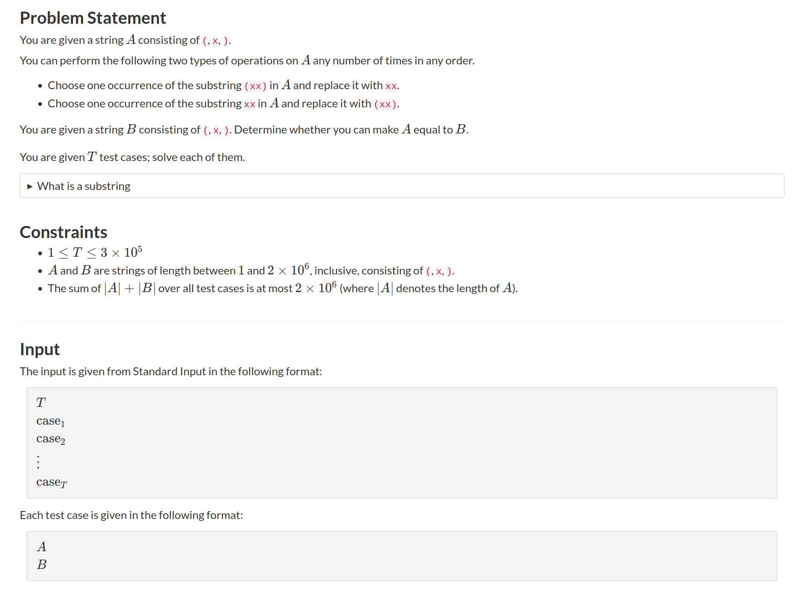
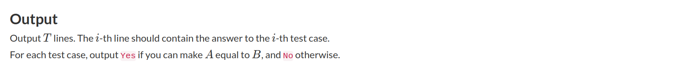

[상위 페이지 · AtCoder Beginner Contest 454](/study/algorithms/competitive-programming/atcoder-beginner-contest-454/)





## 문제 태그

- 문자열
- 스택
- 정규형

## 한국어 문제 해석

문자열 A와 B가 주어진다. 문자열은 왼쪽 괄호, 문자 x, 오른쪽 괄호로만 이루어진다.

다음 두 연산을 원하는 만큼 수행할 수 있다.

- 부분 문자열 (xx)를 xx로 바꾼다.
- 부분 문자열 xx를 (xx)로 바꾼다.

A를 B와 같게 만들 수 있는지 판정한다.

## 문제 요약

- 두 연산은 서로 역연산 관계다.
- 결국 (xx)와 xx는 같은 덩어리로 취급할 수 있다.
- 두 문자열이 같은 정규형으로 줄어드는지 비교하면 된다.

## 예시 워크스루

첫 번째 예시에서 A는 (xx)x이고 B는 x(xx)다.

- A의 앞부분 (xx)를 xx로 줄이면 xxx가 된다.
- xxx의 뒤쪽 xx를 (xx)로 늘리면 x(xx)가 된다.
- 따라서 A를 B로 만들 수 있고 답은 Yes다.

반대로 x와 (x)는 다르다. (x)는 안쪽에 x가 하나뿐이라 (xx) 꼴이 아니고, x 하나를 바로 (x)로 만들 수 있는 연산도 없다.

## 아이디어

연산이 양방향이므로, 한 방향으로만 줄인 결과를 비교해도 된다. 여기서는 (xx)를 발견할 때마다 xx로 줄인다.

이 규칙은 길이를 줄이는 방향으로 적용하면 항상 종료한다. 또 줄일 수 있는 부분은 정확히 네 글자 (xx)이고, 스택처럼 왼쪽부터 처리하면 새로 생기는 패턴도 즉시 확인할 수 있다.

따라서 각 문자열을 끝까지 줄인 결과가 같으면 서로 변환 가능하고, 다르면 불가능하다.

## 구현 포인트

문자를 하나씩 ret에 넣는다. ret의 마지막 네 글자가 (xx)이면 네 글자를 제거하고 xx를 다시 넣는다. 이 과정을 모든 문자에 대해 수행하면 현재 코드의 solve 함수가 정규형 문자열을 반환한다.

## 정답

```cpp
#include <bits/stdc++.h>

using namespace std;

using ll = long long;
using pii = pair<int, int>;
using vi = vector<int>;
using vll = vector<ll>;
using vpii = vector<pii>;

#define all(x) (x).begin(), (x).end()
#define rall(x) (x).rbegin(), (x).rend()
#define sz(x) ((int)((x).size()))
#define F first
#define S second
#define pb push_back
#define mp make_pair
#define lb lower_bound
#define ub upper_bound

#ifndef ONLINE_JUDGE
template<typename A, typename B>
ostream& operator<<(ostream& os, const pair<A, B>& p) {
    return os << "{" << p.first << ", " << p.second << "}";
}
template<typename T>
ostream& operator<<(ostream& os, const vector<T>& v) {
    os << "[";
    for (size_t i = 0; i < v.size(); ++i) {
        os << v[i];
        if (i != v.size() - 1) os << ", ";
    }
    return os << "]";
}

#define debug(...) cerr << "[DEBUG] " << #__VA_ARGS__ << ": ", DBG(__VA_ARGS__)
template<typename T> void DBG(const T& v) { cerr << v << endl; }
template<typename T, typename... Args> void DBG(const T& v, const Args&... args) { cerr << v << ", "; DBG(args...); }
#else
#define debug(...)
#endif

string solve(const string &s) {
    string ret;
    ret.reserve(sz(s));

    for (char c : s) {
        ret.pb(c);
        int n = sz(ret);
        if (n >= 4 && ret[n - 4] == '(' && ret[n - 3] == 'x' && ret[n - 2] == 'x' && ret[n - 1] == ')') {
            ret.pop_back();
            ret.pop_back();
            ret.pop_back();
            ret.pop_back();
            ret.pb('x');
            ret.pb('x');
        }
    }

    return ret;
}

int main() {
    ios::sync_with_stdio(0);
    cin.tie(0);

    int T;
    cin >> T;
    while (T--) {
        string a, b;
        cin >> a >> b;

        cout << (solve(a) == solve(b) ? "Yes\n" : "No\n");
    }

    return 0;
}
```

## 검증

### 시간복잡도

각 문자는 한 번 추가되고, 패턴이 생길 때 상수 시간으로 줄어든다. 문자열 하나당 시간복잡도는 $$O(|S|)$$이고, 테스트 전체는 $$O(sum |A| + |B|)$$이다.

### 공간복잡도

정규형을 담는 문자열을 저장하므로 공간복잡도는 $$O(|S|)$$이다.

### 코너 케이스

- x와 (x)는 서로 변환할 수 없다.
- xx와 (xx)는 서로 변환할 수 있다.
- ((xx))는 안쪽부터 줄어들어 xx와 같아진다.
- 괄호가 깨진 문자열도 그대로 처리된다. 마지막 네 글자가 정확히 (xx)일 때만 줄인다.
