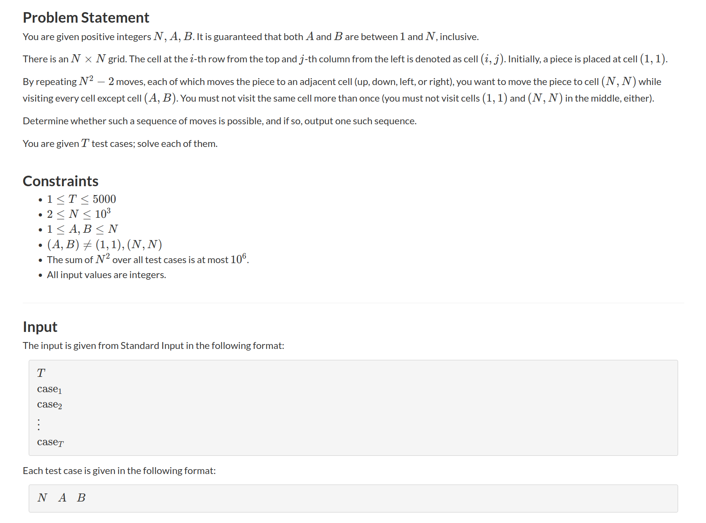
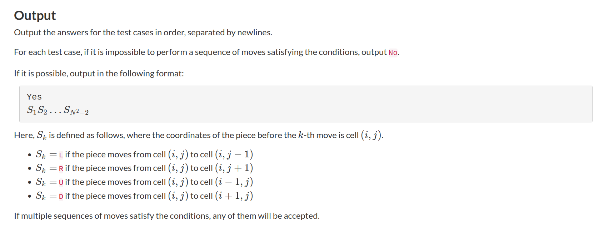
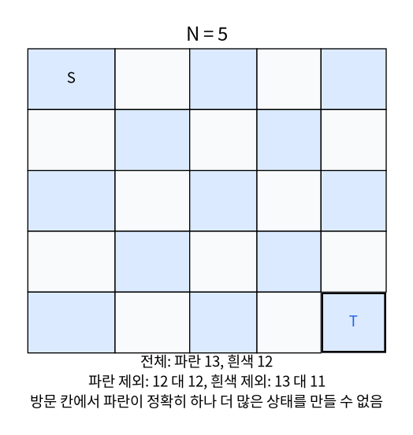
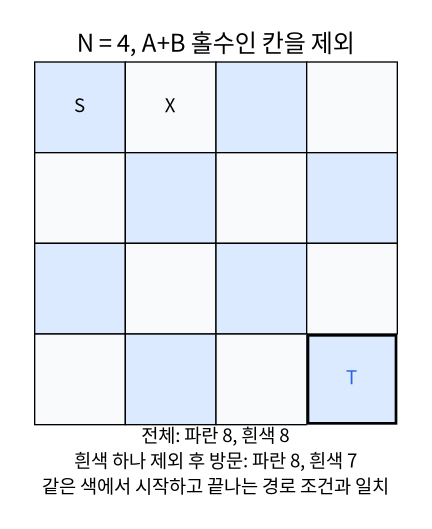
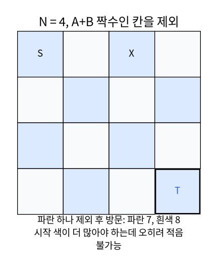

[상위 페이지 · AtCoder Beginner Contest 454](/study/algorithms/competitive-programming/atcoder-beginner-contest-454/)





## 문제 태그

- 구성적 알고리즘
- 격자 그래프
- 해밀턴 경로
- 홀짝성

## 한국어 문제 해석

N 곱하기 N 격자에서 말은 처음에 (1, 1)에 있다. 정확히 $$N^2 - 2$$번 이동해서 (N, N)에 도착해야 한다.

이동은 상하좌우 인접한 칸으로만 가능하다. 전체 칸 중 (A, B)만 방문하지 않고, 나머지 모든 칸은 정확히 한 번씩 방문해야 한다. 중간에 (1, 1)이나 (N, N)을 다시 방문하는 것도 불가능하다.

가능하면 이동 문자열을 하나 출력하고, 불가능하면 No를 출력한다.

## 문제 요약

- (A, B)를 제외한 모든 칸을 한 번씩 방문하는 경로를 구성한다.
- 시작은 (1, 1), 끝은 (N, N)이다.
- 답이 여러 개면 아무거나 출력해도 된다.

## 예시 워크스루

N이 4이고 제외 칸이 (3, 2)라고 하자.

현재 코드는 먼저 위쪽 2행 묶음을 가로로 훑는다.

- 1행을 오른쪽 끝까지 간다.
- 아래로 내려간 뒤 2행을 왼쪽 끝까지 돌아온다.
- 다시 아래로 내려가 제외 칸이 포함된 2행 묶음으로 진입한다.

제외 칸이 있는 3, 4행 묶음에서는 (3, 2)를 피하면서 오른쪽 아래까지 가는 작은 패턴을 만든다. 이 예시에서는 RRRDLLLDDRRURD 같은 문자열이 가능하다.

## 아이디어

격자 그래프를 체스판처럼 칠하면 인접 이동마다 색이 바뀐다.

방문하는 칸 수는 (A, B)를 제외한 $$N^2 - 1$$개다. 시작과 끝까지 포함한 경로가 존재하려면 색 개수의 관계가 맞아야한다

시작 칸을 파란색이라 두면, (A,B)를 제외하고 남는 칸들에서는 **흰색 칸의 개수가 파란색 칸보다 정확히 1개 더 많아야** 번갈아 이동하는 경로가 성립한다.



- **그림 1 (N 홀수)**: 전체 칸 수 $$N^2$$가 홀수이면 두 색의 개수는 처음부터 $$\frac{N^2+1}{2}$$와 $$\frac{N^2-1}{2}$$로 1만큼 차이난다. 여기서 한 칸을 제거하면 그 차이는 $$0$$ (많은 쪽을 제거) 또는 $$2$$ (적은 쪽을 제거)로만 바뀌며, 필요한 차이인 $$1$$을 만들 수 없다. 따라서 $$N$$이 홀수인 경우에는 조건이 성립하지 않는다.



- **그림 2 (N 짝수, A+B 홀수)**: 전체에서 흑/백이 정확히 반반이고, (1,1)과 (N,N)은 같은 색이다. 제외 칸이 반대 색(= $$A+B$$ 홀수)이면 남은 칸에서 시작/끝 색이 1개 더 많아져, 번갈아 이동하는 해밀턴 경로가 성립 가능.



- **그림 3 (N 짝수, A+B 짝수)**: 제외 칸이 시작/끝과 같은 색이면 두 색의 개수가 같아진다. 시작/끝이 같은 색인 경로는 해당 색이 정확히 1개 더 많아야 하므로, 색 개수 조건 때문에 불가능.

이 조건을 정리하면 가능한 경우는 N이 짝수이고 A+B가 홀수인 경우뿐이다.

가능한 경우에는 2행씩 묶어서 경로를 만든다.

- 제외 칸보다 위쪽 2행 묶음은 일반적인 지그재그로 처리한다.
- 제외 칸이 들어 있는 2행 묶음만 특수 패턴으로 처리한다.
- 그 아래쪽 2행 묶음은 반대 방향 지그재그로 처리한다.

## 구현 포인트

row는 제외 칸이 속한 2행 묶음의 위쪽 행이다. a가 홀수면 row는 a이고, a가 짝수면 row는 a - 1이다.

위쪽 묶음은 오른쪽으로 끝까지 간 뒤 내려오고, 왼쪽으로 돌아온 뒤 다시 내려간다. 특수 묶음에서는 제외 칸이 위쪽 행에 있는지 아래쪽 행에 있는지에 따라 DR 또는 RD를 중심으로 패턴을 만든다.

## 정답

```cpp
#include <bits/stdc++.h>

using namespace std;

using ll = long long;
using pii = pair<int, int>;
using vi = vector<int>;
using vll = vector<ll>;
using vpii = vector<pii>;

#define all(x) (x).begin(), (x).end()
#define rall(x) (x).rbegin(), (x).rend()
#define sz(x) ((int)((x).size()))
#define F first
#define S second
#define pb push_back
#define mp make_pair
#define lb lower_bound
#define ub upper_bound

#ifndef ONLINE_JUDGE
template<typename A, typename B>
ostream& operator<<(ostream& os, const pair<A, B>& p) {
    return os << "{" << p.first << ", " << p.second << "}";
}
template<typename T>
ostream& operator<<(ostream& os, const vector<T>& v) {
    os << "[";
    for (size_t i = 0; i < v.size(); ++i) {
        os << v[i];
        if (i != v.size() - 1) os << ", ";
    }
    return os << "]";
}

#define debug(...) cerr << "[DEBUG] " << #__VA_ARGS__ << ": ", DBG(__VA_ARGS__)
template<typename T> void DBG(const T& v) { cerr << v << endl; }
template<typename T, typename... Args> void DBG(const T& v, const Args&... args) { cerr << v << ", "; DBG(args...); }
#else
#define debug(...)
#endif

int main() {
    ios::sync_with_stdio(0);
    cin.tie(0);

    int T;
    cin >> T;
    while (T--) {
        int n, a, b;
        cin >> n >> a >> b;

        if (n & 1 || !((a + b) & 1)) {
            cout << "No\n";
            continue;
        }

        int row = (a % 2 ? a : a - 1);
        string ans;
        ans.reserve(n * n);

        for (int i = 1; i < row; i += 2) {
            ans += string(n - 1, 'R');
            ans += 'D';
            ans += string(n - 1, 'L');
            ans += 'D';
        }

        if (a == row) {
            for (int j = 1; j < b - 1; j += 2) ans += "DRUR";
            ans += "DR";
            for (int j = b + 1; j < n; j += 2) ans += "RURD";
        } else {
            for (int j = 1; j < b; j += 2) ans += "DRUR";
            ans += "RD";
            for (int j = b + 2; j < n; j += 2) ans += "RURD";
        }

        for (int i = row + 2; i <= n; i += 2) {
            ans += 'D';
            ans += string(n - 1, 'L');
            ans += 'D';
            ans += string(n - 1, 'R');
        }

        cout << "Yes\n";
        cout << ans << '\n';
    }

    return 0;
}
```

## 검증

### 시간복잡도

출력 문자열 길이가 $$N^2 - 2$$이므로 시간복잡도는 $$O(N^2)$$이다. 전체 테스트케이스의 $$N^2$$ 합이 제한되어 있으므로 통과 가능하다.

### 공간복잡도

출력 문자열을 저장하므로 공간복잡도는 $$O(N^2)$$이다.

### 코너 케이스

- N이 홀수면 No다.
- A+B가 짝수면 No다.
- N이 2인 경우도 특수 묶음 패턴으로 처리된다.
- 제외 칸이 특수 묶음의 위쪽 행인지 아래쪽 행인지에 따라 다른 패턴을 사용한다.
