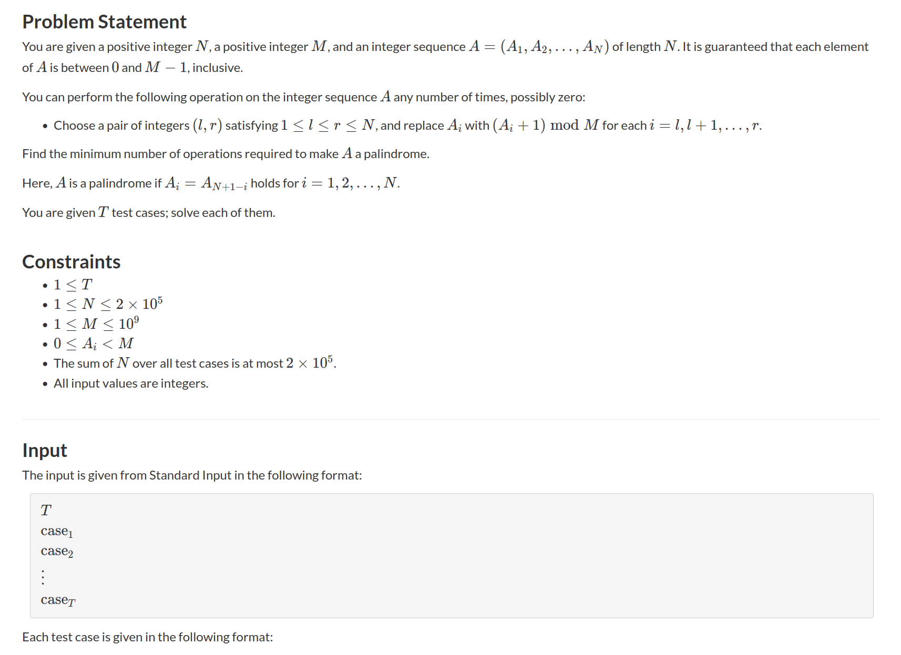
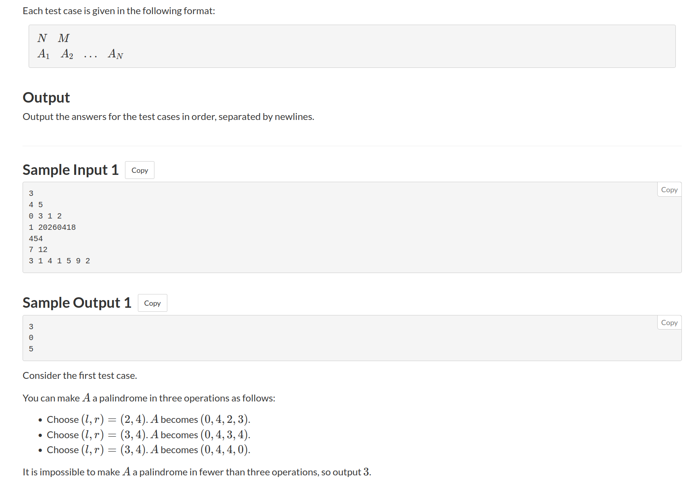

[상위 페이지 · AtCoder Beginner Contest 454](/study/algorithms/competitive-programming/atcoder-beginner-contest-454/)





## 문제 태그

- 그리디
- 차분 배열
- 모듈러 연산
- 팰린드롬

## 한국어 문제 해석

길이 N의 수열 A가 주어진다. 각 원소는 0 이상 M 미만이다.

한 번의 연산으로 연속 구간을 하나 골라, 그 구간의 모든 값을 1씩 증가시키고 M으로 나눈 나머지로 바꿀 수 있다.

연산을 원하는 만큼 사용해서 A를 팰린드롬으로 만들려고 한다. 필요한 최소 연산 횟수를 구한다.

## 문제 요약

- 연속 구간에 1을 더하는 연산의 최소 횟수를 구한다.
- 최종적으로 양끝 쌍의 값이 같아야 한다.
- 값은 모두 M을 기준으로 순환한다.

## 예시 워크스루

첫 번째 예시에서 N은 4, M은 5이고 A는 0, 3, 1, 2다.

양끝 쌍의 차이를 보면 다음과 같다.

- 첫 번째 쌍은 0과 2이므로 차이는 3이다.
- 두 번째 쌍은 3과 1이므로 차이는 2이다.

이 차이 배열을 다시 경계 차분으로 바꾸면, 실제 구간 증가 연산의 **시작(+1)** 과 **끝 다음(-1)** 을 어디에 둘지로 해석할 수 있다.

1) 먼저 대칭쌍 차이를

- $$b_i = A_i - A_{N+1-i} \pmod M$$

로 두고, 양끝을 맞추기 위해 $$b_0=b_{k+1}=0$$을 둔다.

2) 인접한 b의 모듈러 차이

- $$d_i = b_{i-1} - b_i \pmod M$$

를 계산하면, 이것이 경계 차분에서 필요한 변화량이 된다.

3) 예시 (N=4, M=5, A=[0,3,1,2])에서

- $$b=[0,3,2,0]$$
- $$d=[2,1,2]$$, 따라서 $$\mathrm{sum}=5$$

이다.

4) 여기서 각 $$d_i$$는 모듈러이므로 $$d_i$$ 대신 $$d_i-M$$을 써도 같은 의미다. 하지만 실제 구간 연산은 시작과 끝이 항상 짝을 이루므로, 경계 차분의 총합은 **0**이어야 한다. 현재 합이 $$5=M$$이므로 정확히 $$\mathrm{sum}/M=1$$개의 항을 $$M$$만큼 내려 합을 0으로 맞춘다.

5) 어떤 항을 $$M$$만큼 내리면 비용(필요 연산 수)이 그 항의 크기만큼 감소하므로, 가장 큰 값부터 내리는 것이 최적이다. 이 예시에서는 2를 한 번 내려서 답은 $$5-2=3$$이다.

## 아이디어

각 위치가 최종적으로 몇 번 증가했는지를 생각한다. 구간 증가 연산 한 번은 증가 횟수 배열의 차분에서 어떤 위치에 1을 더하고, 그 뒤쪽 경계에서 1을 빼는 것과 같다. 따라서 필요한 연산 수는 차분에서 양수로 시작하는 양의 총량으로 볼 수 있다.

팰린드롬 조건은 양끝 쌍마다 증가 횟수의 차이를 강제한다. k를 N/2라고 하고, 다음 값을 둔다.

$$
b_i = A_i - A_{N+1-i} \pmod M
$$

또 $$b_0$$과 $$b_{k+1}$$은 0으로 둔다. 그러면 인접한 b의 차이

$$
d_i = b_{i-1} - b_i \pmod M
$$

가 각 대칭 경계쌍에서 필요한 차분값이 된다.

처음에는 모든 d_i를 0 이상 M 미만으로 잡는다. 이들의 합은 M의 배수다. 전체 차분 합은 0이어야 하므로 정확히 sum/M개의 값을 M만큼 내려야 한다.

어떤 $$d_i$$를 $$M$$만큼 내리면 비용이 $$d_i$$만큼 줄어든다. 따라서 가장 큰 $$d_i$$부터 내리는 것이 최적이다.

## 구현 포인트

b 배열은 1번부터 k번까지 사용하고, 양끝의 0을 위해 크기를 k+2로 잡는다. diff에는 인접한 b의 모듈러 차이를 넣는다.

sum을 구한 뒤 cnt = sum / m으로 몇 개를 내려야 하는지 계산한다. diff를 내림차순 정렬하고 앞에서 cnt개를 ans에서 빼면 최소 연산 수가 된다.

## 정답

```cpp
#include <bits/stdc++.h>

using namespace std;

using ll = long long;
using pii = pair<int, int>;
using vi = vector<int>;
using vll = vector<ll>;
using vpii = vector<pii>;

#define all(x) (x).begin(), (x).end()
#define rall(x) (x).rbegin(), (x).rend()
#define sz(x) ((int)((x).size()))
#define F first
#define S second
#define pb push_back
#define mp make_pair
#define lb lower_bound
#define ub upper_bound

#ifndef ONLINE_JUDGE
template<typename A, typename B>
ostream& operator<<(ostream& os, const pair<A, B>& p) {
    return os << "{" << p.first << ", " << p.second << "}";
}
template<typename T>
ostream& operator<<(ostream& os, const vector<T>& v) {
    os << "[";
    for (size_t i = 0; i < v.size(); ++i) {
        os << v[i];
        if (i != v.size() - 1) os << ", ";
    }
    return os << "]";
}

#define debug(...) cerr << "[DEBUG] " << #__VA_ARGS__ << ": ", DBG(__VA_ARGS__)
template<typename T> void DBG(const T& v) { cerr << v << endl; }
template<typename T, typename... Args> void DBG(const T& v, const Args&... args) { cerr << v << ", "; DBG(args...); }
#else
#define debug(...)
#endif

int main() {
    ios::sync_with_stdio(0);
    cin.tie(0);

    int T;
    cin >> T;
    while (T--) {
        int n;
        ll m;
        cin >> n >> m;

        vll a(n);
        for (auto &x : a) cin >> x;

        int k = n / 2;
        vll b(k + 2), diff;
        ll sum = 0;

        for (int i = 1; i <= k; i++) {
            b[i] = (a[i - 1] - a[n - i] + m) % m;
        }

        for (int i = 1; i <= k + 1; i++) {
            ll cur = (b[i - 1] - b[i] + m) % m;
            diff.pb(cur);
            sum += cur;
        }

        sort(rall(diff));

        int cnt = sum / m;
        ll ans = sum;
        for (int i = 0; i < cnt; i++) ans -= diff[i];

        cout << ans << '\n';
    }

    return 0;
}
```

## 검증

### 시간복잡도

각 테스트케이스에서 diff의 길이는 N/2+1 정도이고, 정렬이 가장 크다. 시간복잡도는 $$O(N log N)$$이다. 전체 N 합이 제한되어 있으므로 충분하다.

### 공간복잡도

입력 배열, b 배열, diff 배열을 저장하므로 공간복잡도는 $$O(N)$$이다.

### 코너 케이스

- N이 1이면 비교할 쌍이 없고 답은 0이다.
- M이 1이면 모든 값이 0이므로 답은 0이다.
- 이미 팰린드롬이면 모든 차분이 0이 되어 답은 0이다.
- sum은 최대 대략 N 곱하기 M이므로 long long 안에 들어간다.
