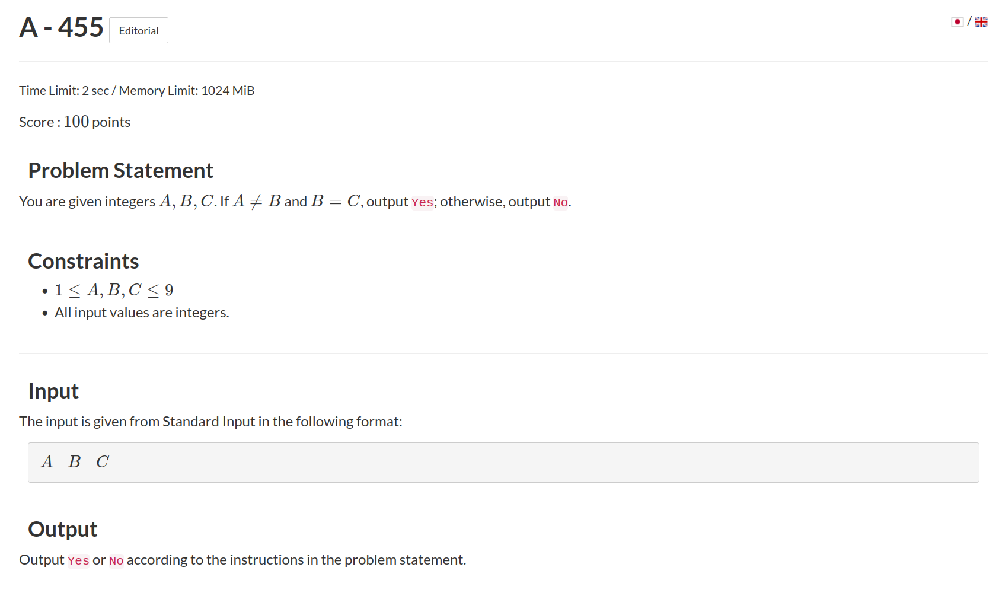

[상위 페이지 · AtCoder Beginner Contest 455](/study/algorithms/competitive-programming/atcoder-beginner-contest-455/)



## 문제 태그

- 구현
- 조건 분기

## 한국어 문제 해석

정수 A, B, C가 주어진다.

A와 B가 다르고, 동시에 B와 C가 같으면 Yes를 출력한다. 그 외의 모든 경우에는 No를 출력한다.

## 문제 요약

- 입력은 정수 A, B, C 한 줄이다.
- 확인할 조건은 두 개다. A와 B는 달라야 하고, B와 C는 같아야 한다.
- 두 조건을 동시에 만족할 때만 Yes다.

## 예시 워크스루

예를 들어 4 5 5가 주어졌다고 하자.

- 먼저 A와 B를 보면 4와 5이므로 서로 다르다.
- 다음으로 B와 C를 보면 5와 5이므로 서로 같다.
- 필요한 두 조건을 모두 만족한다.
- 따라서 답은 Yes다.

6 6 6인 경우도 같이 보자.

- B와 C는 같지만 A와 B가 다르지 않다.
- 첫 번째 조건이 깨지므로 답은 No다.

## 아이디어

필요한 것은 조건식 하나를 그대로 구현하는 것이다.

판정식은 A와 B가 다르고, B와 C가 같은지 여부다. 반복문이나 추가 자료구조는 전혀 필요 없다.

## 구현 포인트

입력으로 세 정수를 읽은 뒤 조건식을 바로 검사한다.

참이면 Yes, 거짓이면 No를 출력하면 끝이다.

## 정답

```cpp
#include <bits/stdc++.h>

using namespace std;

using ll = long long;
using pii = pair<int, int>;
using vi = vector<int>;
using vll = vector<ll>;
using vpii = vector<pii>;

#define all(x) (x).begin(), (x).end()
#define rall(x) (x).rbegin(), (x).rend()
#define sz(x) ((int)((x).size()))
#define F first
#define S second
#define pb push_back
#define mp make_pair
#define lb lower_bound
#define ub upper_bound

#ifndef ONLINE_JUDGE
template<typename A, typename B>
ostream& operator<<(ostream& os, const pair<A, B>& p) {
    return os << "{" << p.first << ", " << p.second << "}";
}
template<typename T>
ostream& operator<<(ostream& os, const vector<T>& v) {
    os << "[";
    for (size_t i = 0; i < v.size(); ++i) {
        os << v[i];
        if (i != v.size() - 1) os << ", ";
    }
    return os << "]";
}

#define debug(...) cerr << "[DEBUG] " << #__VA_ARGS__ << ": ", DBG(__VA_ARGS__)
template<typename T> void DBG(const T& v) { cerr << v << endl; }
template<typename T, typename... Args> void DBG(const T& v, const Args&... args) { cerr << v << ", "; DBG(args...); }
#else
#define debug(...)
#endif

int main() {
    ios::sync_with_stdio(0);
    cin.tie(0);
    
    int a, b, c;
    cin >> a >> b >> c;

    cout << (a != b && b == c ? "Yes\n" : "No\n");
    
    return 0;
}
```

## 검증

### 시간복잡도

상수 번 비교만 하므로 시간복잡도는 O(1)이다.

### 공간복잡도

정수 세 개만 저장하므로 공간복잡도는 O(1)이다.

### 코너 케이스

- A, B, C가 모두 같으면 No다.
- A와 B는 다르지만 B와 C가 다르면 No다.
- A와 B가 다르고 B와 C가 같을 때만 Yes다.
