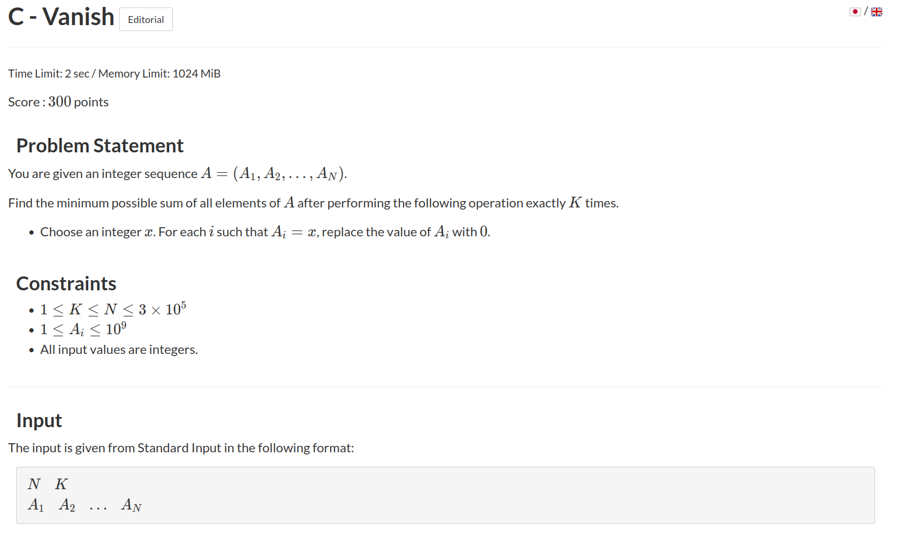

[상위 페이지 · AtCoder Beginner Contest 455](/study/algorithms/competitive-programming/atcoder-beginner-contest-455/)



## 문제 태그

- 그리디
- 해시맵
- 정렬

## 한국어 문제 해석

수열 A가 주어진다. 정확히 K번 연산해야 한다.

한 번의 연산에서는 정수 하나를 골라, 그 값과 같은 원소를 전부 0으로 바꾼다.

모든 연산이 끝난 뒤 원소 합을 최소로 만들고 싶다.

## 문제 요약

- 같은 값은 한 번만 골라도 전부 사라진다.
- 어떤 값을 선택했을 때 줄어드는 총합은 그 값의 총 기여도와 같다.
- 총 기여도가 큰 값부터 K개 선택하는 것이 최적이다.

## 예시 워크스루

수열이 7, 2, 7, 2, 2, 9이고 연산 횟수가 2라고 하자.

- 값 7을 고르면 두 칸이 동시에 사라져 합이 14 줄어든다.
- 값 2를 고르면 세 칸이 동시에 사라져 합이 6 줄어든다.
- 값 9를 고르면 합이 9 줄어든다.

전체 합은 29다.

줄일 수 있는 양이 큰 순서대로 보면 14, 9, 6이므로 먼저 7과 9를 고르는 것이 최선이다.

그러면 남는 합은 29 - 14 - 9 = 6이다.

## 아이디어

어떤 값이 여러 번 등장하더라도, 그 값을 한 번 선택하는 순간 같은 값이 모두 0이 된다.

따라서 각 값마다 다음 양만 계산하면 된다.

값 자체와 그 값의 등장 횟수를 곱한 값이, 그 값을 골랐을 때 줄어드는 총합이다.

이제 문제는 단순해진다.

1. 배열 전체 합을 구한다.
2. 값마다 등장 횟수를 센다.
3. 각 값이 줄일 수 있는 총합을 모은다.
4. 그중 큰 것부터 K개를 전체 합에서 빼면 된다.

연산을 정확히 K번 해야 한다는 조건도 문제 없다.

서로 다른 값의 수가 K보다 적으면 이미 사라진 값을 다시 골라도 결과가 변하지 않기 때문이다.

## 구현 포인트

값 범위가 크므로 해시맵으로 등장 횟수를 세는 것이 편하다.

전체 합과 각 값의 총 기여도는 long long으로 관리해야 안전하다.

## 정답

```cpp
#include <bits/stdc++.h>

using namespace std;

using ll = long long;
using pii = pair<int, int>;
using vi = vector<int>;
using vll = vector<ll>;
using vpii = vector<pii>;

#define all(x) (x).begin(), (x).end()
#define rall(x) (x).rbegin(), (x).rend()
#define sz(x) ((int)((x).size()))
#define F first
#define S second
#define pb push_back
#define mp make_pair
#define lb lower_bound
#define ub upper_bound

#ifndef ONLINE_JUDGE
template<typename A, typename B>
ostream& operator<<(ostream& os, const pair<A, B>& p) {
    return os << "{" << p.first << ", " << p.second << "}";
}
template<typename T>
ostream& operator<<(ostream& os, const vector<T>& v) {
    os << "[";
    for (size_t i = 0; i < v.size(); ++i) {
        os << v[i];
        if (i != v.size() - 1) os << ", ";
    }
    return os << "]";
}

#define debug(...) cerr << "[DEBUG] " << #__VA_ARGS__ << ": ", DBG(__VA_ARGS__)
template<typename T> void DBG(const T& v) { cerr << v << endl; }
template<typename T, typename... Args> void DBG(const T& v, const Args&... args) { cerr << v << ", "; DBG(args...); }
#else
#define debug(...)
#endif

int main() {
    ios::sync_with_stdio(0);
    cin.tie(0);
    
    int n, k;
    cin >> n >> k;

    unordered_map<ll, int> cnt;
    cnt.reserve(2 * n + 5);

    ll ans = 0;
    for (int i = 0; i < n; i++) {
        ll x;
        cin >> x;
        ans += x;
        cnt[x]++;
    }

    vll score;
    score.reserve(sz(cnt));
    for (auto [x, c] : cnt) {
        score.pb(x * c);
    }

    sort(rall(score));
    for (int i = 0; i < min(k, sz(score)); i++) {
        ans -= score[i];
    }

    cout << ans << "\n";
    
    return 0;
}
```

## 검증

### 시간복잡도

등장 횟수 집계가 O(N)이고, 서로 다른 값의 수를 M이라 하면 정렬이 O(M log M)이다.

전체 시간복잡도는 O(N + M log M)이다.

### 공간복잡도

해시맵과 총 기여도 배열을 저장하므로 공간복잡도는 O(M)이다.

### 코너 케이스

- 모든 값이 같으면 첫 선택에서 전부 0이 된다.
- 모든 값이 서로 다르면 큰 값부터 K개 지우는 문제와 같다.
- 서로 다른 값의 수가 K보다 작아도 남은 연산은 이미 사라진 값을 다시 골라 채울 수 있다.

## 참고 개념정리

- 그리디
- 정렬
