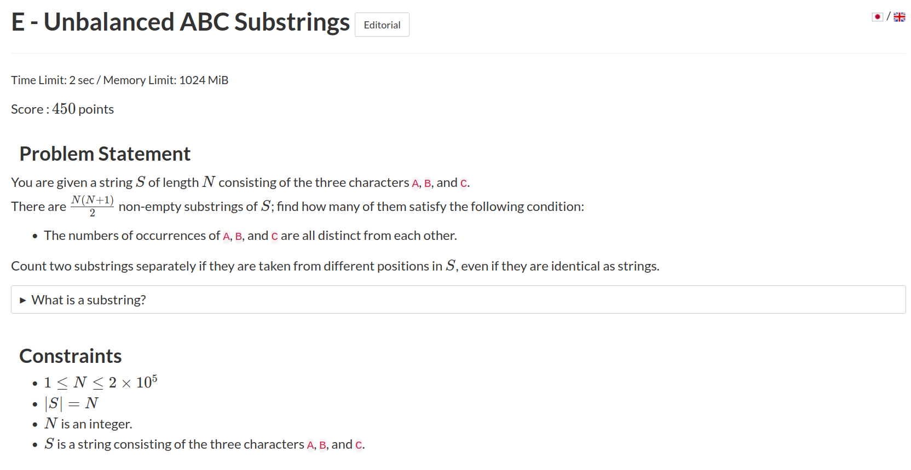

[상위 페이지 · AtCoder Beginner Contest 455](/study/algorithms/competitive-programming/atcoder-beginner-contest-455/)



## 문제 태그

- 누적합
- 포함 배제 원리
- 해시

## 한국어 문제 해석

문자열 S가 A, B, C 세 문자로만 이루어진다.

부분 문자열 안에서 A의 개수, B의 개수, C의 개수가 모두 서로 다른 경우만 세고 싶다.

이 조건을 만족하는 모든 부분 문자열의 개수를 구한다.

## 문제 요약

- 부분 문자열마다 세 문자의 등장 횟수를 본다.
- 세 개의 등장 횟수가 전부 달라야 한다.
- 직접 세기보다는, 두 개 이상 같아지는 경우를 전체에서 빼는 방식이 핵심이다.

## 예시 워크스루

문자열이 AABBCC라고 하자.

부분 문자열 AAB를 보면 A는 2번, B는 1번, C는 0번 나온다.

세 수가 2, 1, 0으로 모두 다르므로 정답에 포함된다.

같은 방식으로 ABB, BBC, BCC도 포함된다.

반면 ABC는 세 문자가 모두 1번씩 등장하므로 세 수가 같아져 탈락한다.

결국 이 예시에서 답은 4가 된다.

## 아이디어

원하는 조건은 세 수가 모두 서로 다른 경우다.

반대로 생각하면 다음 세 사건 중 하나라도 일어나는 부분 문자열을 제외하면 된다.

- A 개수와 B 개수가 같다.
- B 개수와 C 개수가 같다.
- A 개수와 C 개수가 같다.

세 사건의 교집합은 A, B, C 개수가 모두 같은 경우뿐이다.

따라서 포함 배제를 적용하면 답은 다음 꼴이 된다.

전체 부분 문자열 수에서 위 세 경우를 빼고, 세 문자가 모두 같은 경우를 두 번 다시 더하면 된다.

이제 각 개수를 누적합 차이로 센다.

앞에서부터 어떤 위치까지 보았을 때의 A, B, C 누적 개수를 각각 저장하자.

그러면 어떤 부분 문자열에서 A와 B 개수가 같으려면, 그 부분 문자열의 양 끝 prefix에서 A-B 차이가 같아야 한다.

같은 논리로 B-C 차이, A-C 차이도 셀 수 있다.

또 세 문자의 개수가 모두 같으려면 두 조건이 동시에 맞아야 한다.

즉 A-B 차이와 B-C 차이의 순서쌍이 같은 prefix 쌍 수를 세면 된다.

## 구현 포인트

길이 0인 prefix부터 길이 N인 prefix까지 모두 포함해야 한다.

차이값은 음수가 될 수 있으므로 적당한 offset을 더해 배열 인덱스로 바꾼다.

두 차이를 동시에 보는 상태는 하나의 long long 키로 합쳐 unordered_map에 저장한다.

## 정답

```cpp
#include <bits/stdc++.h>

using namespace std;

using ll = long long;
using pii = pair<int, int>;
using vi = vector<int>;
using vll = vector<ll>;
using vpii = vector<pii>;

#define all(x) (x).begin(), (x).end()
#define rall(x) (x).rbegin(), (x).rend()
#define sz(x) ((int)((x).size()))
#define F first
#define S second
#define pb push_back
#define mp make_pair
#define lb lower_bound
#define ub upper_bound

#ifndef ONLINE_JUDGE
template<typename A, typename B>
ostream& operator<<(ostream& os, const pair<A, B>& p) {
    return os << "{" << p.first << ", " << p.second << "}";
}
template<typename T>
ostream& operator<<(ostream& os, const vector<T>& v) {
    os << "[";
    for (size_t i = 0; i < v.size(); ++i) {
        os << v[i];
        if (i != v.size() - 1) os << ", ";
    }
    return os << "]";
}

#define debug(...) cerr << "[DEBUG] " << #__VA_ARGS__ << ": ", DBG(__VA_ARGS__)
template<typename T> void DBG(const T& v) { cerr << v << endl; }
template<typename T, typename... Args> void DBG(const T& v, const Args&... args) { cerr << v << ", "; DBG(args...); }
#else
#define debug(...)
#endif

int main() {
    ios::sync_with_stdio(0);
    cin.tie(0);
    
    int n;
    string s;
    cin >> n >> s;

    int off = n;
    int base = 2 * n + 1;
    vi PA(n + 1), PB(n + 1), PC(n + 1);
    for (int i = 1; i <= n; i++) {
        PA[i] = PA[i - 1] + (s[i - 1] == 'A');
        PB[i] = PB[i - 1] + (s[i - 1] == 'B');
        PC[i] = PC[i - 1] + (s[i - 1] == 'C');
    }

    vll ab(base), bc(base), ac(base);
    unordered_map<ll, ll> same;

    ll eq_ab = 0, eq_bc = 0, eq_ac = 0, eq_all = 0;
    for (int i = 0; i <= n; i++) {
        int x = PA[i] - PB[i] + off;
        int y = PB[i] - PC[i] + off;
        int z = PA[i] - PC[i] + off;

        eq_ab += ab[x];
        eq_bc += bc[y];
        eq_ac += ac[z];
        ab[x]++;
        bc[y]++;
        ac[z]++;

        ll key = 1LL * x * base + y;
        eq_all += same[key];
        same[key]++;
    }

    ll ans = 1LL * n * (n + 1) / 2 - eq_ab - eq_bc - eq_ac + 2 * eq_all;
    cout << ans << "\n";
    
    return 0;
}
```

## 검증

### 시간복잡도

누적합 계산이 O(N), prefix 상태 순회도 O(N)이다.

unordered_map 평균 시간을 기준으로 전체 시간복잡도는 O(N)이다.

### 공간복잡도

누적합 배열 세 개와 상태 카운팅용 배열, 해시맵을 사용하므로 공간복잡도는 O(N)이다.

### 코너 케이스

- 길이 1 부분 문자열은 한 문자만 1번, 나머지 둘은 0번이므로 항상 조건을 만족한다.
- 세 문자의 개수가 모두 같은 부분 문자열은 포함 배제에서 세 번 빠지므로 두 번 다시 더해야 한다.
- 차이값은 음수가 될 수 있으므로 offset 보정이 필요하다.
