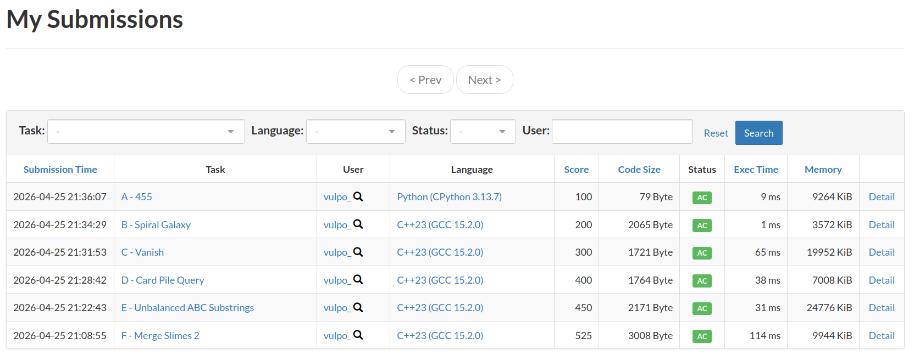
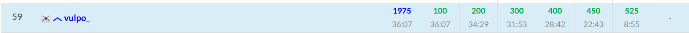

[상위 페이지 · Competitive Programming](/study/algorithms/competitive-programming/)

---

- [A. 455](/study/algorithms/competitive-programming/atcoder-beginner-contest-455/a-455/)

- [B. Spiral Galaxy](/study/algorithms/competitive-programming/atcoder-beginner-contest-455/b-spiral-galaxy/)

- [C. Vanish](/study/algorithms/competitive-programming/atcoder-beginner-contest-455/c-vanish/)

- [D. Card Pile Query](/study/algorithms/competitive-programming/atcoder-beginner-contest-455/d-card-pile-query/)

- [E. Unbalanced ABC Substrings](/study/algorithms/competitive-programming/atcoder-beginner-contest-455/e-unbalanced-abc-substrings/)

- [F. Merge Slimes 2](/study/algorithms/competitive-programming/atcoder-beginner-contest-455/f-merge-slimes-2/)
