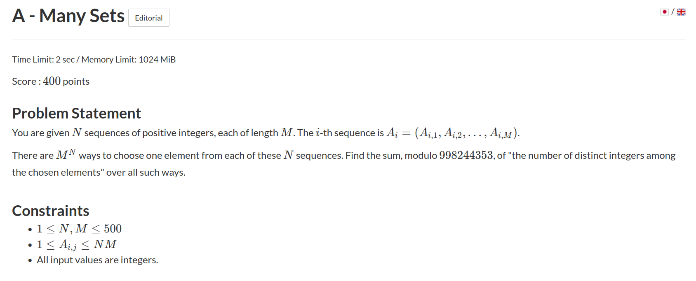

[상위 페이지 · AtCoder Regular Contest 218](/study/algorithms/competitive-programming/atcoder-regular-contest-218/)



## 문제 태그

- 기여도 분해
- 여사건
- 모듈러 연산

## 한국어 문제 해석

양의 정수로 이루어진 수열이 N개 주어진다. 각 수열의 길이는 M이다. i번째 수열은 $$A_i = (A_i,1, A_i,2, ..., A_i,M)$$ 이다.

이 N개의 수열 각각에서 원소를 하나씩 고르는 방법은 $$M^N$$가지 있다. 이 모든 선택 방법에 대해, 선택된 원소들 중 서로 다른 정수의 개수를 더한 값을 998244353으로 나눈 나머지를 구한다.

### 제약

- N과 M은 각각 1 이상 500 이하이다.
- 모든 i, j에 대해 $$A_i,j$$는 1 이상 N M 이하이다.
- 입력으로 주어지는 값은 모두 정수다.

### 입력

입력은 표준 입력에서 다음 형식으로 주어진다.

```
N M
A_1,1 A_1,2 ... A_1,M
A_2,1 A_2,2 ... A_2,M
...
A_N,1 A_N,2 ... A_N,M
```

### 출력

답을 출력한다.

## 문제 요약

- 각 행에서 정확히 하나의 위치를 고른다.
- 고른 값들의 서로 다른 종류 수를 점수로 본다.
- 모든 선택 방법의 점수 합을 구해야 한다.
- 값의 범위는 1부터 NM까지이므로 값별로 기여도를 계산할 수 있다.

## 예시 워크스루

예시로 N이 2, M이 2이고 두 수열이 다음과 같다고 하자.

```
1 3
2 3
```

총 선택 방법은 4가지다.

- 첫 번째 행에서 1, 두 번째 행에서 2를 고르면 서로 다른 값은 1과 2라서 점수는 2다.
- 첫 번째 행에서 1, 두 번째 행에서 3을 고르면 서로 다른 값은 1과 3이라서 점수는 2다.
- 첫 번째 행에서 3, 두 번째 행에서 2를 고르면 서로 다른 값은 3과 2라서 점수는 2다.
- 첫 번째 행에서 3, 두 번째 행에서 3을 고르면 서로 다른 값은 3 하나라서 점수는 1이다.

따라서 전체 합은 7이다.

숫자 3만 따로 보면, 숫자 3을 전혀 고르지 않는 방법은 첫 번째 행에서 1을 고르고 두 번째 행에서 2를 고르는 한 가지뿐이다. 전체 4가지 중 3가지에서 숫자 3이 등장하므로 숫자 3의 기여도는 3이다.

## 아이디어

각 선택 결과에서 서로 다른 값의 개수는, 등장한 값마다 1을 더한 값이다. 따라서 전체 답은 값별 기여도의 합으로 바꿀 수 있다.

값 v에 대해 다음을 정의하자.

- $$c_i(v)$$: i번째 수열에서 값 v가 등장하는 횟수
- $$total$$: 전체 선택 방법 수
- $$avoid(v)$$: 값 v를 한 번도 고르지 않는 선택 방법 수

그러면 전체 선택 방법 수는 다음과 같다.

$$
total = M^N
$$

값 v를 한 번도 고르지 않으려면, 각 행에서 v가 아닌 원소를 골라야 한다. i번째 행에서 가능한 선택 수는 $$M - c_i(v)$$이므로 다음과 같다.

$$
avoid(v) = \prod_{i=1}^{N} (M - c_i(v))
$$

따라서 값 v가 적어도 한 번 등장하는 선택 방법 수는 다음과 같다.

$$
total - avoid(v)
$$

정답은 모든 값 v에 대해 이 값을 더한 것이다.

$$
ans = \sum_v \left(M^N - \prod_{i=1}^{N} (M - c_i(v))\right)
$$

이때 값 v가 어떤 행에 등장하지 않으면 $$c_i(v) = 0$$이므로 해당 행은 곱에 M을 기여한다. 그래서 구현에서는 v가 실제로 등장한 행의 등장 횟수만 저장하고, 등장하지 않은 행의 개수만큼 M의 거듭제곱을 곱해 처리한다.

## 구현 포인트

각 행에서 같은 값이 여러 번 나올 수 있으므로 단순히 값이 등장했는지만 보면 안 된다. 예를 들어 한 행이 1, 1이고 M이 2라면 값 1을 피하는 방법은 0가지다.

현재 코드는 각 행을 정렬한 뒤 같은 값이 몇 번 연속으로 나오는지 센다. 각 숫자에 대해 그 숫자가 등장한 행들의 등장 횟수만 저장해 둔다.

해당 숫자가 등장하지 않은 행은 따로 저장하지 않는다. 대신 그런 행의 개수만큼 M을 곱해야 하므로, 미리 M의 거듭제곱을 준비해 둔다.

## 정당성 요약

각 선택 결과의 서로 다른 값 개수는 등장한 값마다 1씩 더한 값이다. 따라서 전체 선택 결과에 대한 합은 숫자별 등장 선택 방법 수의 합으로 바꿀 수 있다. 어떤 숫자가 등장하는 선택 방법 수는 전체 선택 방법에서 그 숫자를 피하는 선택 방법을 뺀 값이다. 각 행의 선택은 독립이므로 특정 숫자를 피하는 방법 수는 행별 회피 선택 수의 곱이다. 따라서 모든 숫자에 대해 이 값을 더하면 정확히 원하는 합이 된다.

## 정답

```cpp
#include <bits/stdc++.h>

using namespace std;

using ll = long long;
using pii = pair<int, int>;
using vi = vector<int>;
using vll = vector<ll>;
using vpii = vector<pii>;

#define all(x) (x).begin(), (x).end()
#define rall(x) (x).rbegin(), (x).rend()
#define sz(x) ((int)((x).size()))
#define F first
#define S second
#define pb push_back
#define mp make_pair
#define lb lower_bound
#define ub upper_bound

#ifndef ONLINE_JUDGE
template<typename A, typename B>
ostream& operator<<(ostream& os, const pair<A, B>& p) {
    return os << "{" << p.first << ", " << p.second << "}";
}
template<typename T>
ostream& operator<<(ostream& os, const vector<T>& v) {
    os << "[";
    for (size_t i = 0; i < v.size(); ++i) {
        os << v[i];
        if (i != v.size() - 1) os << ", ";
    }
    return os << "]";
}

#define debug(...) cerr << "[DEBUG] " << #__VA_ARGS__ << ": ", DBG(__VA_ARGS__)
template<typename T> void DBG(const T& v) { cerr << v << endl; }
template<typename T, typename... Args> void DBG(const T& v, const Args&... args) { cerr << v << ", "; DBG(args...); }
#else
#define debug(...)
#endif

int main() {
    ios::sync_with_stdio(0);
    cin.tie(0);
    
    const ll MOD = 998244353;

    int n, m;
    cin >> n >> m;

    vector<vi> cnt(n * m + 1);
    for (int i = 0; i < n; i++) {
        vi a(m);
        for (int j = 0; j < m; j++) {
            cin >> a[j];
        }
        sort(all(a));
        for (int l = 0; l < m; ) {
            int r = l;
            while (r < m && a[l] == a[r]) r++;
            cnt[a[l]].pb(r - l);
            l = r;
        }
    }

    vll pw(n + 1, 1);
    for (int i = 1; i <= n; i++) {
        pw[i] = pw[i - 1] * m % MOD;
    }

    ll ans = 0;
    for (int x = 1; x <= n * m; x++) {
        if (cnt[x].empty()) continue;

        ll cur = pw[n - sz(cnt[x])];
        for (int c : cnt[x]) {
            cur = cur * (m - c) % MOD;
        }

        ans += (pw[n] - cur + MOD) % MOD;
        ans %= MOD;
    }

    cout << ans << "\n";
    
    return 0;
}
```

## 검증

### 시간복잡도

각 행을 정렬하므로 시간복잡도는 O(NM log M)이다. N과 M이 500 이하라 충분하다. 값별 순회는 최대 NM개라 O(NM)이다.

### 공간복잡도

값별 등장 횟수를 저장하므로 공간복잡도는 O(NM)이다.

### 코너 케이스

- 한 값이 한 행에서 여러 번 나오는 경우에는 등장 횟수만큼 회피 선택 수가 줄어든다.
- 어떤 값이 모든 행에서 등장하지 않으면 기여도는 0이므로 순회에서 건너뛰어도 된다.
- M이 1이면 각 행에서 선택이 강제된다.
- 모듈러 뺄셈은 음수가 되지 않도록 MOD를 더한 뒤 나머지를 취한다.

## 참고 개념정리

- 포함 배제 원리
- 기여도 분해
