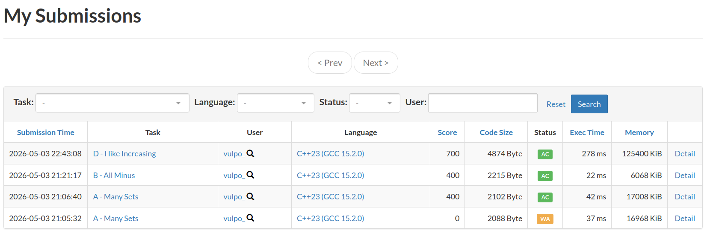
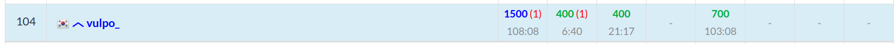

[상위 페이지 · Competitive Programming](/study/algorithms/competitive-programming/)

---

- [A. Many Sets](/study/algorithms/competitive-programming/atcoder-regular-contest-218/a-many-sets/)

- [B. All Minus](/study/algorithms/competitive-programming/atcoder-regular-contest-218/b-all-minus/)

- [D. I like Increasing](/study/algorithms/competitive-programming/atcoder-regular-contest-218/d-i-like-increasing/)
