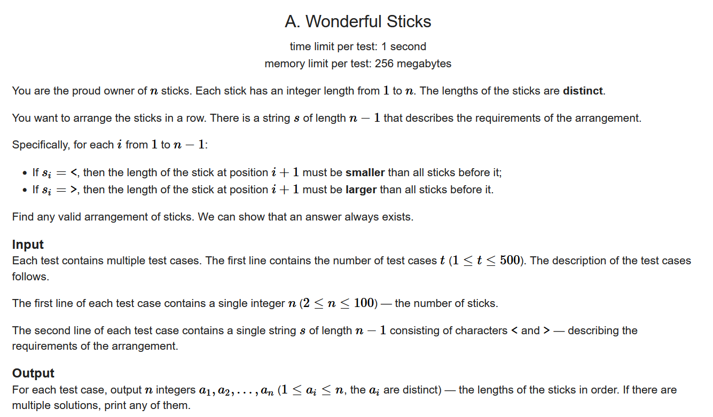

[상위 페이지 · Codeforce Round 1018 (Div. 1+Div. 2)](/study/algorithms/competitive-programming/codeforce-round-1018-div-1-div-2/)



## 문제 해석

- 숫자 n과 n-1개의 ‘<’ 또는 ‘>’가 주어질 것임
- si가 <라면 i+1의 숫자는 이전 모든 숫자보다 작아야함
- si가  >라면 i+1의 숫자는 이전 모든 숫자보다 커야됨

## 문제 태그

- 정렬

## 아이디어

1. '<'의 개수를 k개라고 두면 맨 앞 인덱스는 k+1임이 자명하다
2. 이제 k를 기준으로 배열을 채우면 된다
3. k보다 작아야 하는 숫자는 k개가 존재하며, 이를 small이라고 지칭한다
4. k보다 커야 하는 숫자는 k+2이며, 이를 large라고 지칭한다
5. '>'가 나오면 k보다 커야 하므로 large를 넣고 large + 1을 한다
6. '<'가 나오면 k보다 작아야 하므로 small을 넣고 small - 1을 한다

예시)

5

<<><

'<'가 3개이므로 k는 4여야 한다

4, 0, 0, 0, 0

small = 3

large = 5

'<'이므로 다음으로 작은 3이 들어간다

4, 3, 0, 0, 0

'<'이므로 다음으로 작은 2가 들어간다

4, 3, 2, 0, 0

'>'이므로 4보다 큰 5가 들어간다

4, 3, 2, 5, 0

'<'이므로 마지막으로 작은 1이 들어간다

4, 3, 2, 5, 1

즉, k를 기준으로 '<'은 k-1, k-2, …, 1까지 순서대로 넣으면 만족되고, '>'은 k+1, k+2, …, n까지 순서대로 넣으면 만족된다.

## 정답

```python
import sys
input = sys.stdin.readline

t = int(input())
for _ in range(t):
    n = int(input())
    s = input().strip()

    k = s.count('<')
    ans = [0] * n
    ans[0] = k + 1

    small = k
    large = k + 2

    for i, ch in enumerate(s, start=1):
        if ch == '<':
            ans[i] = small
            small -= 1
        else:
            ans[i] = large
            large += 1

    print(*ans)
```
