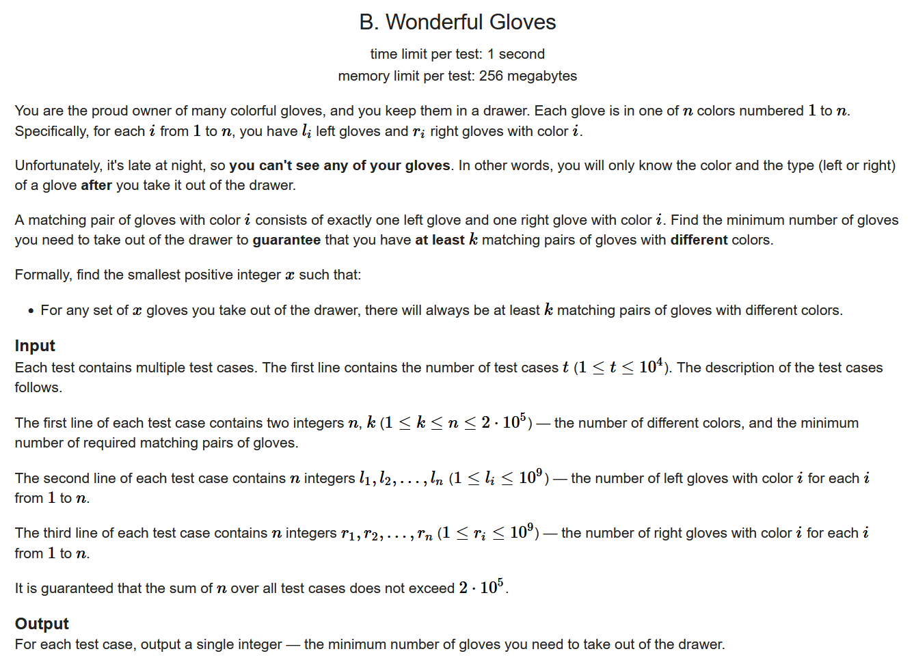

[상위 페이지 · Codeforce Round 1018 (Div. 1+Div. 2)](/study/algorithms/competitive-programming/codeforce-round-1018-div-1-div-2/)



## 문제 해석

- n,k가 주어짐
- n개의 색으로 각 왼장갑, 오른장갑의 개수가 주어짐
- 최소 몇개를 뽑아야 같은 색으로 k개의 쌍을 만드는가? << 장갑이 기준이 아니라 색이 기준임
    - 흰색 2쌍 → 장갑 2쌍이 아닌 1쌍으로 취급한다는것

## 문제 태그

- 그리디
- 정렬

## 아이디어

n = 5, k=3

| 98 | 54 | 75 | 91 | 68 |
| --- | --- | --- | --- | --- |
| 89 | 52 | 27 | 78 | 77 |
1. 일단 각 색에서 왼쪽 오른쪽 중 더 많이 있는걸 가져간다

| 98(택) | 54(택) | 75(택) | 91(택) | 68 |
| --- | --- | --- | --- | --- |
| 89 | 52 | 27 | 78 | 77(택) |
1. 선택받지 못한 쪽에서 큰 순서대로 k-1개 고른다

| 98(택) | 54(택) | 75(택) | 91(택) | 68 |
| --- | --- | --- | --- | --- |
| 89(택) | 52 | 27 | 78(택) | 77(택) |
1. 부족한 한세트는 어디서 꺼내져도 한세트가 만들어짐으로 하나만 뽑으면 된다

## 정답

```python
import sys
input = sys.stdin.readline

t = int(input())
for _ in range(t):
    n, k = map(int, input().split())
    L = list(map(int, input().split()))
    R = list(map(int, input().split()))

    S_max = 0
    mins = []
    for l, r in zip(L, R):
        S_max += max(l, r)
        mins.append(min(l, r))

    mins.sort(reverse=True)
    extra = sum(mins[:k-1]) if k-1 > 0 else 0

    answer = S_max + extra + 1
    print(answer)

```
