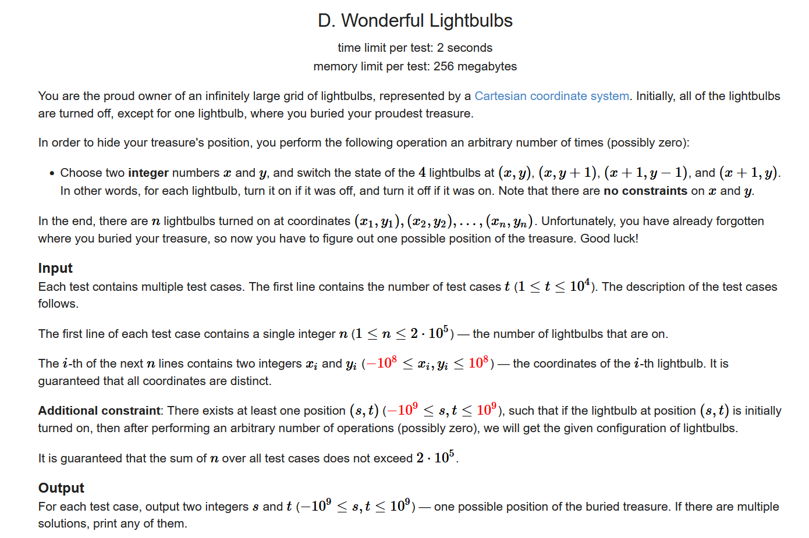

[상위 페이지 · Codeforce Round 1018 (Div. 1+Div. 2)](/study/algorithms/competitive-programming/codeforce-round-1018-div-1-div-2/)



## 문제 설명

- 무한히 큰 격자판 위에 조명(전구)이 있고, 처음에는 **단 하나**의 전구만 켜져 있다. 그 전구가 바로 여러분이 묻어 둔 **보물**의 위치이다.
- 여러분은 보물의 위치를 숨기기 위해, **아무 횟수만큼** 다음과 같은 4개 전구 토글(켜져 있으면 끄고, 꺼져 있으면 켜기) 연산을 수행한다.
    
    > 임의의 정수 x, y를 골라,
    > 
    > 
    > (x, y), (x, y+1), (x+1, y-1), (x+1, y)
    > 
    > 네 위치의 전구 상태를 반전(toggle)시킨다.
    > 
- 연산을 마친 뒤, 총 n개의 전구만이 켜진 상태가 되었다. 그 켜진 전구들의 좌표가 (x₁, y₁), (x₂, y₂), …, (xₙ, yₙ)로 주어진다.

## 문제 태그

- 수학

## 아이디어

1. 주어진 켜진전구 좌표를 전부 xor 해보면 좌표가 복원 됨.
2. 이는 토글되는 점이 4개이기 때문에 xor 연산에 의해 상쇄되기 때문. 만약 3개였다면 안통함

## 정답

```python
import sys
input = sys.stdin.readline

t = int(input())
for _ in range(t):
    n = int(input())
    sx = 0
    sp = 0
    for _ in range(n):
        x, y = map(int, input().split())
        sx ^= x
        sp ^= x + y
    print(sx, sp - sx)

```
