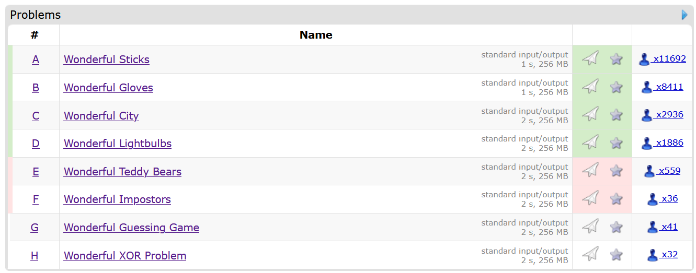

[상위 페이지 · Competitive Programming](/study/algorithms/competitive-programming/)

4솔 마무리

## 문제 풀이

- [A. Wonderful Sticks](/study/algorithms/competitive-programming/codeforce-round-1018-div-1-div-2/a-wonderful-sticks/)

- [B. Wonderful Gloves](/study/algorithms/competitive-programming/codeforce-round-1018-div-1-div-2/b-wonderful-gloves/)

- [C. Wonderful City](/study/algorithms/competitive-programming/codeforce-round-1018-div-1-div-2/c-wonderful-city/)

- [D.Wonderful Lightbulbs](/study/algorithms/competitive-programming/codeforce-round-1018-div-1-div-2/d-wonderful-lightbulbs/)
