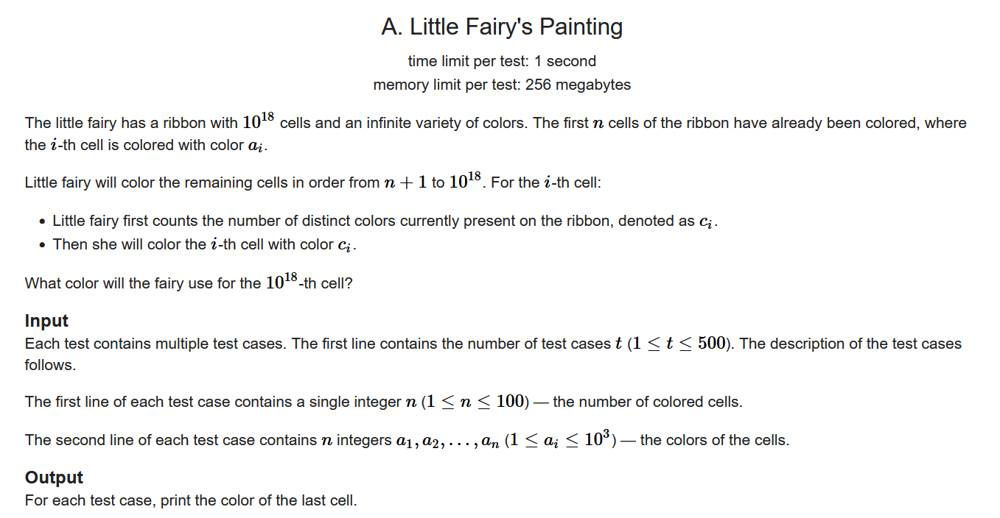
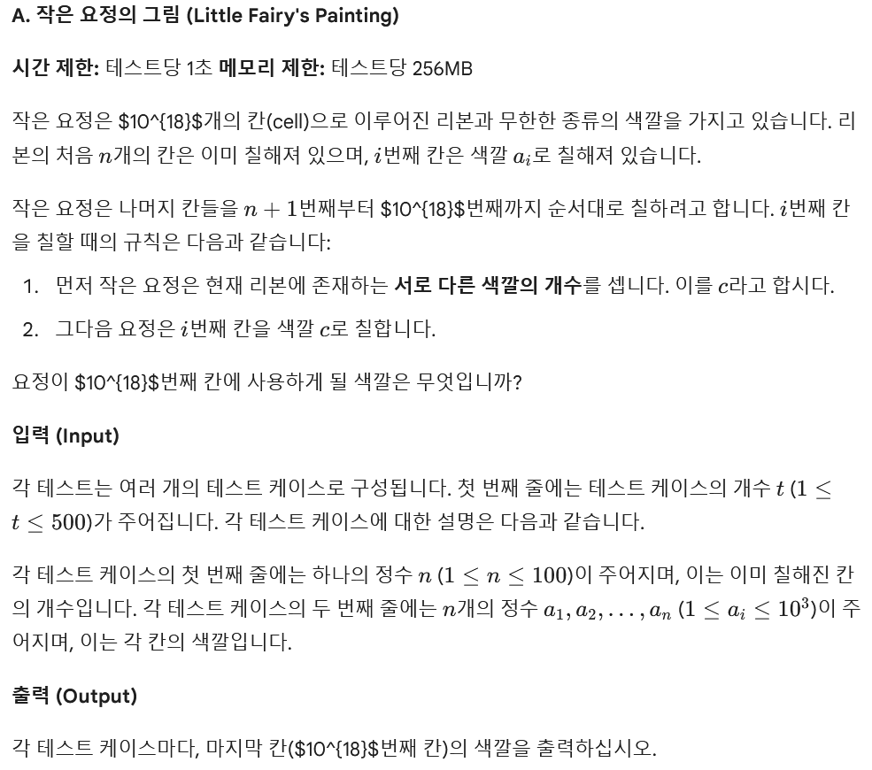

[상위 페이지 · Codeforce Round 1069 (Div. 2)](/study/algorithms/competitive-programming/codeforce-round-1069-div-2/)





## 문제 태그

- 구현

## 아이디어

- 전부 다 색칠 해 볼 필요가 없음
- 다음 칠 할 색이 현재 서로 다른 색의 개수
- 만약 다음 칠할 색이 없는 색이라면 K → K+1
- 만약 다음 칠할 색이 있는 색이라면 그때의 K가 답 
 $$\because$$ 칠할 색이 있는 색이라면 K가 더 이상 바뀌지 않음

## 정답

```cpp
#include <bits/stdc++.h>

using namespace std;

using ll = long long;
using pii = pair<int, int>;
using vi = vector<int>;
using vll = vector<ll>;
using vpii = vector<pii>;

#define all(x) (x).begin(), (x).end()
#define rall(x) (x).rbegin(), (x).rend()
#define F first
#define S second
#define pb push_back
#define mp make_pair
#define lb lower_bound
#define ub upper_bound

#ifndef ONLINE_JUDGE
template<typename A, typename B>
ostream& operator<<(ostream& os, const pair<A, B>& p) {
    return os << "{" << p.first << ", " << p.second << "}";
}
template<typename T>
ostream& operator<<(ostream& os, const vector<T>& v) {
    os << "[";
    for (size_t i = 0; i < v.size(); ++i) {
        os << v[i];
        if (i != v.size() - 1) os << ", ";
    }
    return os << "]";
}

#define debug(...) cerr << "[DEBUG] " << #__VA_ARGS__ << ": ", DBG(__VA_ARGS__)
template<typename T> void DBG(const T& v) { cerr << v << endl; }
template<typename T, typename... Args> void DBG(const T& v, const Args&... args) { cerr << v << ", "; DBG(args...); }
#else
#define debug(...)
#endif

int main() {
    ios::sync_with_stdio(0);
    cin.tie(0);

    int t;
    cin >> t;
    while (t--) {
        int n;
        cin >> n;

        vector<bool> exists(1005, false);
        int distinct_cnt = 0;

        for (int i = 0; i < n; ++i) {
            int a;
            cin >> a;
            if (!exists[a]) {
                exists[a] = true;
                distinct_cnt++;
            }
        }

        while (!exists[distinct_cnt]) {
            distinct_cnt++;
        }

        cout << distinct_cnt << "\n";
    }

    return 0;
}
```
