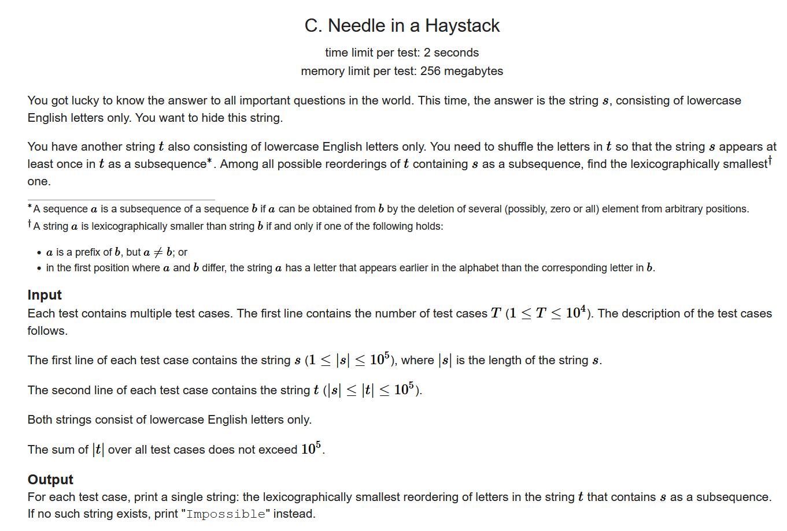
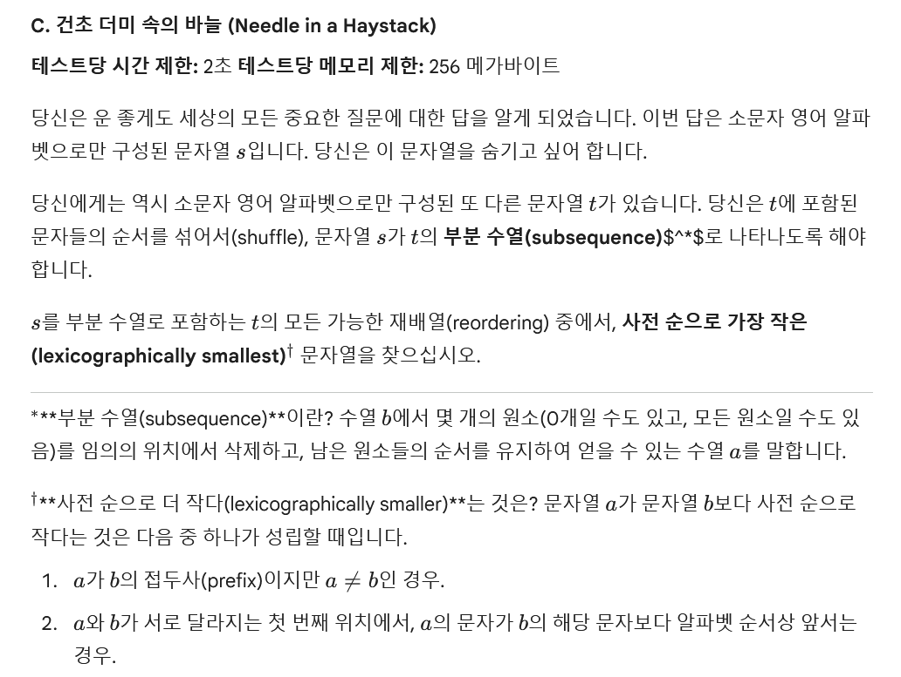

[상위 페이지 · Codeforce Round 1069 (Div. 2)](/study/algorithms/competitive-programming/codeforce-round-1069-div-2/)





## 문제 태그

- 그리디
- 문자열

## 아이디어

1. 우선 t에 있는 모든 문자의 개수를 세고 s를 만드는데 필요한 문자들을 빼서 잔여 알파벳 리스트를 만든다
    - 만약 s를 만드는데 필요한 문자가 부족하면 impossible
2. s를 뒤에서부터 훑으며 배열 하나를 만든다
    - 만약 $$s_i < s_{i+1}$$이라면 $$s_i$$는 최대한 빠르게 쓰는게 사전상 앞이기에 표시를 해준다
3. 이제 s와 잔여 알파벳 리스트를 적절히 병합하여 정답을 만든다
    - Case 1 : 잉여 문자 < s의 현재 문자 → 잉여 문자 사용
    - Case 2 : 잉여 문자 > s의 현재 문자 → s 문자 사용
    - Case 3 : 잉여 문자 == s의 현재 문자 2번에서 만든 배열을 참고하여 선택.
        - $$s_i$$를 빠르게 써야하면 s에서 그게 아니라면 잉여문자에서

## 정답

```cpp
#include <bits/stdc++.h>

using namespace std;

using ll = long long;
using pii = pair<int, int>;
using vi = vector<int>;
using vll = vector<ll>;
using vpii = vector<pii>;

#define all(x) (x).begin(), (x).end()
#define rall(x) (x).rbegin(), (x).rend()
#define F first
#define S second
#define pb push_back
#define mp make_pair
#define lb lower_bound
#define ub upper_bound

#ifndef ONLINE_JUDGE
template <typename A, typename B>
ostream &operator<<(ostream &os, const pair<A, B> &p)
{
    return os << "{" << p.first << ", " << p.second << "}";
}
template <typename T>
ostream &operator<<(ostream &os, const vector<T> &v)
{
    os << "[";
    for (size_t i = 0; i < v.size(); ++i)
    {
        os << v[i];
        if (i != v.size() - 1)
            os << ", ";
    }
    return os << "]";
}

#define debug(...) cerr << "[DEBUG] " << #__VA_ARGS__ << ": ", DBG(__VA_ARGS__)
template <typename T>
void DBG(const T &v) { cerr << v << endl; }
template <typename T, typename... Args>
void DBG(const T &v, const Args &...args)
{
    cerr << v << ", ";
    DBG(args...);
}
#else
#define debug(...)
#endif

int main()
{
    ios::sync_with_stdio(0);
    cin.tie(0);

    int T;
    cin >> T;
    while (T--)
    {
        string s, t;
        cin >> s >> t;

        vi rem_t(26, 0);
        for (char c : t)
            rem_t[c - 'a']++;

        bool is_possible = true;
        for (char c : s)
        {
            if (--rem_t[c - 'a'] < 0)
                is_possible = false;
        }

        if (!is_possible)
        {
            cout << "Impossible\n";
            continue;
        }

        int n = s.size();
        vector<bool> priority(n, false);
        char future_val = '{';

        for (int i = n - 1; i >= 0; i--)
        {
            if (i + 1 < n && s[i] != s[i + 1])
                future_val = s[i + 1];
            if (future_val < s[i])
                priority[i] = true;
        }

        string shortest = "";
        int ptr_s = 0;
        int ptr_t = 0;

        while (ptr_s < n || shortest.size() < t.size())
        {
            while (ptr_t < 26 && rem_t[ptr_t] == 0)
                ptr_t++;

            if (ptr_s == n)
            {
                if (ptr_t < 26)
                {
                    shortest += (char)('a' + ptr_t);
                    rem_t[ptr_t]--;
                }
                else
                    break;
                continue;
            }

            if (ptr_t == 26)
            {
                shortest += s[ptr_s++];
                continue;
            }

            char val_s = s[ptr_s];
            char val_rem = (char)('a' + ptr_t);

            if (val_rem < val_s)
            {
                shortest += val_rem;
                rem_t[ptr_t]--;
            }
            else if (val_rem > val_s)
            {
                shortest += val_s;
                ptr_s++;
            }
            else
            {
                if (priority[ptr_s])
                {
                    shortest += val_s;
                    ptr_s++;
                }
                else
                {
                    shortest += val_rem;
                    rem_t[ptr_t]--;
                }
            }
        }
        cout << shortest << "\n";
    }

    return 0;
}
```
